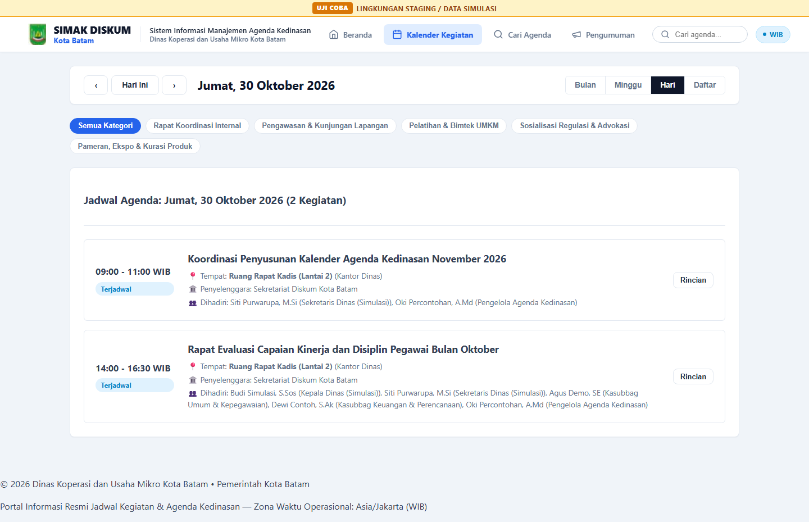
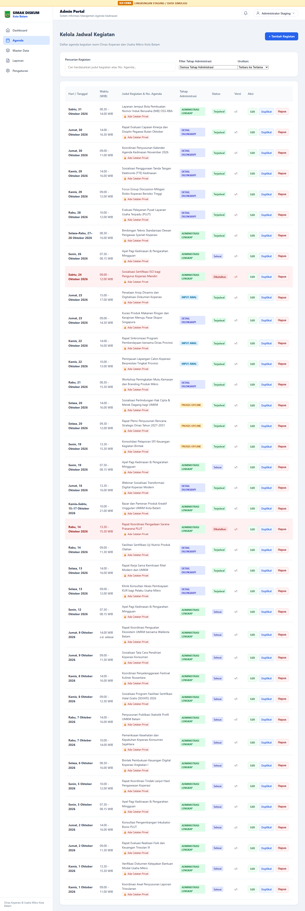
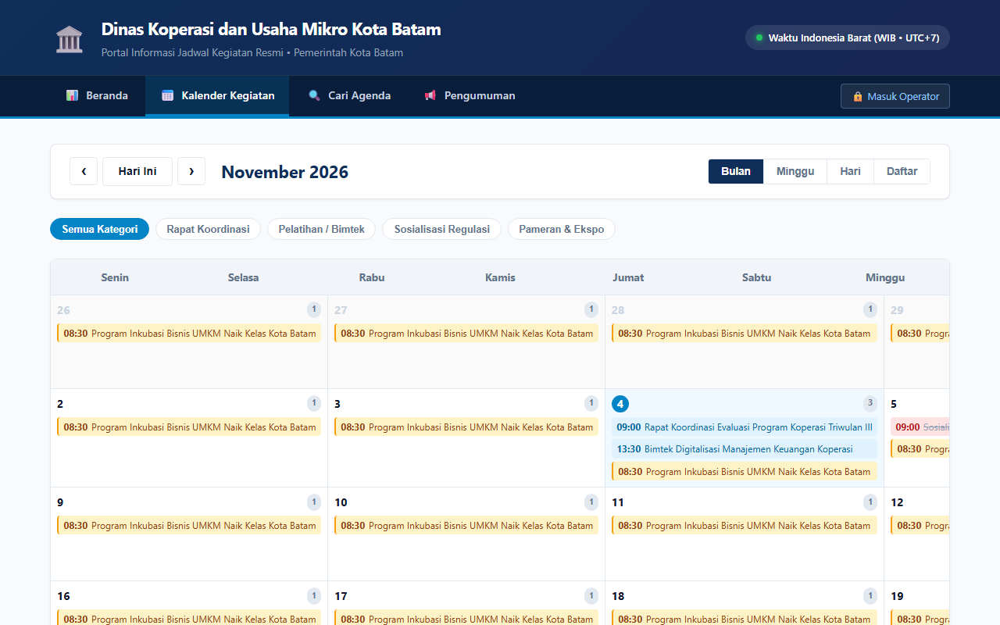
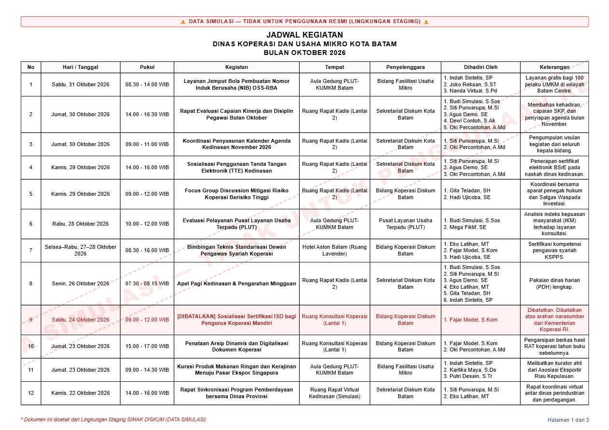
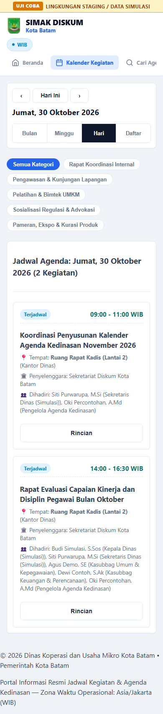
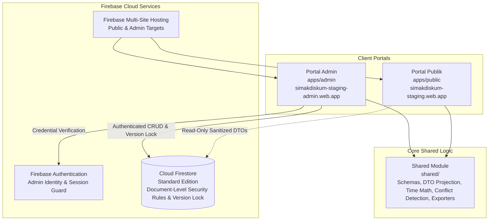

<div align="center">

# SIMAK DISKUM v5.0
### Sistem Informasi Manajemen Agenda Kedinasan
**Dinas Koperasi dan Usaha Mikro Kota Batam**

[](https://vitejs.dev/)
[](https://www.typescriptlang.org/)
[](https://firebase.google.com/)
[](https://firebase.google.com/docs/firestore)
[-6E9F18?style=flat-square&logo=vitest&logoColor=white)](https://vitest.dev/)
[](https://playwright.dev/)
[-0284C7?style=flat-square)]()

[🌐 Portal Publik Staging](https://simakdiskum-staging.web.app) • [🔐 Portal Admin Staging](https://simakdiskum-staging-admin.web.app)

</div>

---

## 📋 Daftar Isi
1. [Tentang SIMAK DISKUM](#-tentang-simak-diskum)
2. [Fitur Utama](#-fitur-utama)
3. [Galeri Antarmuka](#-galeri-antarmuka)
4. [Arsitektur Sistem](#-arsitektur-sistem)
5. [Tautan Demonstrasi Staging](#-tautan-demonstrasi-staging)
6. [Teknologi yang Digunakan](#-teknologi-yang-digunakan)
7. [Ringkasan Milestone Pengembangan](#-ringkasan-milestone-pengembangan)
8. [Panduan Pengembangan Lokal & Pengujian](#-panduan-pengembangan-lokal--pengujian)
9. [Keamanan, Data Sintetik & Batasan Lingkungan](#-keamanan-data-sintetik--batasan-lingkungan)
10. [Status Proyek & Penyangkalan](#-status-proyek--penyangkalan)

---

## 🏛️ Tentang SIMAK DISKUM

**SIMAK DISKUM v5.0** (*Sistem Informasi Manajemen Agenda Kedinasan*) adalah platform web modern berbasis *cloud serverless* yang dirancang khusus untuk memfasilitasi penjadwalan, koordinasi internal, dan publikasi agenda resmi kedinasan di lingkungan **Dinas Koperasi dan Usaha Mikro Kota Batam**.

Sistem ini mentransformasikan alur kerja lama berbasis *spreadsheet* menjadi aplikasi terdistribusi yang aman, efisien, dan responsif. SIMAK DISKUM menerapkan pemisahan akses yang tegas antara informasi transparansi publik bagi masyarakat dan mitra kerja, dengan instrumen tata kelola administrasi internal bagi pimpinan dan staf dinas.

### Tujuan Utama:
- **Transparansi Informasi Publik:** Memberikan akses publik yang mudah, akurat, dan *real-time* terhadap agenda kegiatan resmi dinas.
- **Akuntabilitas & Tata Kelola Internal:** Menyediakan alur kerja 4 tahap administrasi agenda (mulai dari pengusulan awal, penugasan personil, pengikatan surat tugas resmi, hingga penyelesaian kegiatan).
- **Pencegahan Tumpang Tindih Jadwal:** Mendeteksi konflik penjadwalan ruangan rapat dan personil secara instan.
- **Standarisasi Pelaporan Resmi:** Menghasilkan dokumen rekapitulasi jadwal dinas 8 kolom resmi dalam format cetak PDF A4 Landscape standar pemerintah, Excel murni (`.xlsx`), dan gambar visual.

---

## ✨ Fitur Utama

- **🌐 Portal Publik Terbuka (Public Agenda Portal)**
  - Tampilan Kalender Bulanan, Mingguan, dan Harian yang interaktif.
  - Ringkasan agenda kedinasan hari ini dan pengumuman dinas resmi.
  - Sanitasi proyeksi data publik (*strict privacy DTO projection*) pada layer aplikasi yang secara otomatis menyaring catatan privat dan kredensial rapat internal.
- **🔍 Pencarian & Penyaringan Agenda Dinamis**
  - Penyaringan kegiatan instan berdasarkan rentang tanggal, kategori bidang, unit penyelenggara, dan status pelaksanaan.
  - Pencarian cepat berbasis teks dengan *instant feedback*.
- **🔐 Portal Administrasi Internal (Admin Management Dashboard)**
  - Akses terproteksi berbasis otentikasi akun admin resmi (*Firebase Authentication*).
  - Tampilan ringkasan statistik kegiatan, pemantauan agenda tertunda, dan audit riwayat pembaruan.
- **🔄 Alur Kerja 4 Tahap Administrasi Agenda (4-Stage Lifecycle)**
  1. *Entry Awal*: Pendaftaran jadwal rancangan kegiatan atau penerimaan undangan masuk.
  2. *Penugasan*: Alokasi pejabat pendamping atau staf dinas yang ditugaskan.
  3. *Selesai / Surat Tugas*: Pengikatan nomor surat tugas kedinasan dan konfirmasi pelaksanaan.
  4. *Dibatalkan*: Penghentian agenda dengan pencatatan alasan administratif resmi.
- **👥 Manajemen Data Master & Pegawai**
  - Manajemen terpadu data pegawai, pimpinan, bidang bagian, daftar ruangan/lokasi dinas, dan daftar mitra penyelenggara.
  - Perlindungan integritas referensial data (*referential safeguards*) untuk mencegah penghapusan data yang masih tertaut pada agenda aktif.
- **⚡ Deteksi Konflik Penjadwalan Otomatis (Scheduling Conflict Detection)**
  - Validasi interval waktu (*half-open interval matching*) berbasis zona waktu Asia/Jakarta (WIB).
  - Peringatan dini (*conflict modal*) jika ruangan rapat yang sama telah dipesan atau personil yang bersangkutan telah memiliki penugasan lain pada waktu bersamaan.
- **📊 Ekspor Jadwal Resmi 8 Kolom (Official 8-Column Schedule Export)**
  - **Excel Murni (`.xlsx`):** Dibuat menggunakan pustaka ExcelJS dengan *header formatting*, lebar kolom proporsional, dan *styling* warna resmi.
  - **Dokumen PDF A4 Landscape:** Tata letak cetak kompak 3 halaman untuk rekapitulasi 38 agenda bulanan (Milestone S04), pengulangan *table header* di setiap halaman cetak, resolusi nama lokasi/penyelenggara resmi (tanpa kebocoran ID database), serta penomoran halaman dinamis ("Halaman X dari 3").
  - **Gambar Visual (`.png` / `.jpg`):** Untuk kebutuhan publikasi media informasi atau kanal pesan instan.
- **📱 Antarmuka Responsif Modern (Mobile First Design)**
  - Tampilan kartu agenda adaptif (*mobile cards*) yang dirancang khusus untuk layar ponsel (320px, 375px, 390px, 425px) hingga layar desktop (1440px).
  - Desain identitas visual bernuansa khas Kota Batam dengan tipografi jernih dan aksesibilitas tinggi (WCAG 2.1 AA).
- **🛡️ Keamanan Berlapis, Kontrol Akses & Sanitasi Data**
  - **Otorisasi Akses Dokumen Firestore:** *Firestore Security Rules* mengontrol otorisasi akses pada tingkat dokumen (*document-level access control*), memvalidasi otorisasi sesi admin, memblokir seluruh mutasi tulis oleh publik, dan memastikan integritas format data kedinasan.
  - **Minimisasi Data & Proyeksi DTO Publik:** Penyaringan atribut privat (catatan internal, nomor surat rahasia, kredensial rapat) dikelola melalui arsitektur pemisahan struktur dokumen dan sanitasi proyeksi DTO (*Data Transfer Object projection*) pada layer aplikasi sebelum data disajikan ke portal publik.
  - **Kontrol Konkurensi:** Mekanisme *optimistic concurrency lockstep* (`expectedVersion`) untuk mencegah insiden penimpaan data saat diedit bersamaan.

---

## 📸 Galeri Antarmuka

Berikut adalah tangkapan layar langsung dari aplikasi SIMAK DISKUM v5.0 yang diambil pada lingkungan *staging* dan pengujian otomatis terkini (Milestone S03 dan S04):

### 1. Tampilan Desktop (Resolusi 1440px)

| Portal Publik (Masyarakat & Mitra) | Portal Admin (Pengelola Agenda) |
| :---: | :---: |
|  |  |
| *Dashboard Portal Publik: Ringkasan Agenda Harian, Navigasi Kegiatan & Pengumuman Dinas (Milestone S03 Desktop)* | *Dashboard Portal Admin: Manajemen Agenda Kedinasan, Status Alur Kerja 4 Tahap & Tanggal Indonesia (Milestone S03 Desktop)* |

### 2. Kalender Interaktif & Format Ekspor Resmi

| Kalender Bulanan Interaktif | Format Ekspor Jadwal Resmi 8 Kolom |
| :---: | :---: |
|  |  |
| *Navigasi Kalender Bulanan Publik dengan Pemilahan Hari, Minggu, dan Indikator Kategori Kegiatan* | *Format Cetak Jadwal Resmi 8 Kolom (Milestone S04): Standar A4 Landscape 3 Halaman, Header Berulang, Resolusi Nama Resmi & Watermark Staging* |

### 3. Tampilan Responsif Mobile (Resolusi 390px)

| Tampilan Mobile Portal Publik | Tampilan Mobile Portal Admin |
| :---: | :---: |
|  |  |
| *Tampilan Mobile Portal Publik: Kartu Agenda Harian Adaptif, Tata Letak Ergonomis & Bebas Overflow Horizontal (S03-M01)* | *Tampilan Mobile Portal Admin: Kartu Manajemen Agenda Responsif dengan Tombol Aksi Edit, Duplikat & Hapus (Touch Target 44px)* |

---

## 🏗️ Arsitektur Sistem

SIMAK DISKUM v5.0 dibangun menggunakan struktur *monorepo workspace* yang memisahkan tanggung jawab aplikasi secara independen:



### Pemisahan Portal Publik & Portal Admin:
- **`apps/public`**: Aplikasi berbasis web yang ditujukan untuk masyarakat umum. Menggunakan koneksi *read-only* ke Firestore dengan penyaringan atribut data sensitif melalui sanitasi proyeksi DTO (*strict public DTO projection* — menjamin *zero private notes* dan *zero internal meeting credentials* pada sisi konsumsi publik).
- **`apps/admin`**: Aplikasi berbasis web internal yang memerlukan otentikasi admin. Memiliki kontrol penuh untuk pengoperasian CRUD agenda, pengelolaan data master, evaluasi konflik jadwal, dan penerbitan laporan.
- **`shared`**: Pustaka logika bisnis murni (*pure business logic*) yang digunakan bersama oleh portal publik dan admin. Menjamin keseragaman validasi waktu Asia/Jakarta (WIB), kalkulasi interval bentrok, skema validasi, serta pembuatan berkas ekspor Excel/PDF.

---

## 🔗 Tautan Demonstrasi Staging

Sistem saat ini dapat dievaluasi langsung pada lingkungan *Cloud Staging*:

| Portal | URL Staging | Keterangan Akses |
|:---|:---|:---|
| **Portal Publik** | [https://simakdiskum-staging.web.app](https://simakdiskum-staging.web.app) | Terbuka untuk umum (Anonim / *Read-only*) |
| **Portal Admin** | [https://simakdiskum-staging-admin.web.app](https://simakdiskum-staging-admin.web.app) | Memerlukan akun administrator resmi |

> **Catatan:** Seluruh data yang ditampilkan pada tautan demonstrasi staging (termasuk kegiatan agenda Oktober 2026) adalah **data sintetik terstandarisasi** untuk keperluan penjaminan mutu (*QA*) dan pengujian penerimaan pengguna.

---

## 💻 Teknologi yang Digunakan

| Komponen | Teknologi | Keterangan |
|:---|:---|:---|
| **Frontend Framework** | **Vite 6.0** & **TypeScript 5.7** | Pembuatan bundel cepat, *type-safe*, arsitektur modular tanpa ketergantungan framework berat (*vanilla web performance*). |
| **Cloud Hosting** | **Firebase Hosting (Multi-site)** | Pengiriman aset cepat melalui CDN global dengan target terpisah untuk publik dan admin. |
| **Cloud Database** | **Cloud Firestore (Standard Edition)** | Basis data dokumen NoSQL terkelola dengan sinkronisasi *real-time* dan aturan keamanan tingkat dokumen. |
| **Autentikasi** | **Firebase Authentication** | Manajemen sesi admin terenkripsi dan perlindungan *route* internal. |
| **Ekspor Data** | **ExcelJS 4.4** & **HTML Print CSS** | Pustaka pembangkit OpenXML `.xlsx` asli serta tata letak cetak PDF standar A4 Landscape. |
| **Unit Testing** | **Vitest 3.0** | Pengujian logika bisnis, kalkulasi waktu, deteksi konflik, dan aturan Firestore (227 unit tests, 25 test suite). |
| **End-to-End Testing** | **Playwright 1.64** | Pengujian otomatis skenario antarmuka, responsivitas multi-viewport, dan verifikasi ekspor PDF. |

---

## 📈 Ringkasan Milestone Pengembangan

Pengembangan SIMAK DISKUM v5.0 dijalankan melalui tahapan *milestone* terukur dengan pengujian regresi berulang:

| Milestone | Ruang Lingkup & Pencapaian | Pengujian | Status |
|:---:|:---|:---:|:---:|
| **Tasks 1–9** | Landasan arsitektur platform, logika waktu WIB, skema Firestore, repository, dashboard publik & laporan. | 136 Unit / 52 E2E | Disetujui |
| **Gate 5A** | Penguatan konkurensi dengan *optimistic version lockstep* (`expectedVersion`). | 143 Unit / 52 E2E | Disetujui |
| **Feature F01** | Alur kerja 4 tahap administrasi agenda (*Entry Awal*, *Penugasan*, *Selesai/Surat Tugas*, *Dibatalkan*). | 163 Unit / 65 E2E | Disetujui |
| **Visual V01** | Sistem desain visual pemerintahan, geometri kalender 7-kolom, dan aksesibilitas (WCAG 2.1 AA). | 170 Unit / 114 E2E | Disetujui |
| **Pre-Prod P01/P02** | Audit konfigurasi pra-produksi, *role CLI*, mesin pencadangan (*resumable backup ledger*), dan rencana aktivasi terkendali. | 214 Unit / 79 E2E | Disetujui |
| **Milestone A01** | Antarmuka otentikasi login admin, pemulihan sandi, dan proteksi sesi *bootstrap*. | 233 Unit / 62 E2E | Disetujui |
| **Milestone T01** | Penyiapan dataset demonstrasi Oktober 2026 dan pengujian akun admin tunggal. | 239 Unit / 155 E2E | Disetujui |
| **Milestone S01 & QA** | Penyediaan *Cloud Staging* mandiri (`simakdiskum-staging`), perbaikan multi-viewport, dan integrasi ExcelJS. | 288 Unit / 155 E2E | Terverifikasi |
| **Milestone S02** | Pengadaan akun tester eksternal sementara untuk evaluasi QA terisolasi. | 289 Unit / Live Auth | Terverifikasi |
| **Milestone S03** | Remediasi antarmuka mobile kartu agenda (320px–768px), audit paritas data lintas portal, dan eliminasi horizontal overflow. | 216 Unit / 8 Multi-Viewport Live Staging Checks | Disetujui |
| **Milestone S04** | Perbaikan cetak PDF A4 Landscape (tepat 3 halaman untuk 38 agenda, pengulangan header tabel di setiap halaman, resolusi nama lokasi/penyelenggara resmi tanpa kebocoran ID database, dan pembersihan footer ganda). | 227 Unit (termasuk 11 tes baru S04) / Playwright Chromium PDF Verified | Terverifikasi |
| **Milestone S05** | **Tahap Berikutnya:** Pengujian Fungsional Eksternal (*External Functional QA*) & Uji Keterimaan Pengguna Akhir. | *Upcoming* | *Direncanakan* |

---

## 🛠️ Panduan Pengembangan Lokal & Pengujian

### Prasyarat
- **Node.js** (Versi 18.x atau yang lebih baru)
- **npm** (Versi 9.x atau yang lebih baru)
- **Firebase CLI** (Opsional, untuk menjalankan Firebase Local Emulators)

### 1. Kloning Repositori & Instalasi Dependensi
```bash
# Masuk ke direktori aplikasi Firebase
cd department-agenda-firebase

# Pasang seluruh dependensi proyek
npm install
```

### 2. Menjalankan Server Pengembangan Lokal
```bash
# Menjalankan Portal Publik lokal (http://localhost:5173)
npm run dev:public

# Menjalankan Portal Admin lokal (http://localhost:5174)
npm run dev:admin
```

### 3. Menjalankan Rangkaian Pengujian
```bash
# Menjalankan seluruh Unit & Integration Test via Vitest (227 tests passing)
npm test

# Menjalankan pengujian dalam mode pantau (watch mode)
npm run test:watch

# Menjalankan verifikasi otomatis antarmuka menyeluruh (Playwright E2E)
npm run test:e2e

# Menjalankan verifikasi alur otentikasi admin (Playwright Auth)
npm run test:e2e:auth

# Menjalankan pemeriksaan tipe data TypeScript
npm run lint
```

### 4. Membangun Berkas Rilis (Build)
```bash
# Membangun seluruh paket (shared, public, dan admin) untuk mode produksi
npm run build

# Membangun paket dengan konfigurasi Cloud Staging
npm run build:staging
```

### 5. Menjalankan Firebase Local Emulators (Opsional)
```bash
# Menjalankan emulator Firestore (port 8080) dan Hosting (port 5000)
npm run emulators
```

---

## 🔒 Keamanan, Data Sintetik & Batasan Lingkungan

1. **Kerahasiaan Kredensial & Repositori Privat:**
   - Repositori ini berstatus **PRIVATE** dan dilindungi hak akses resmi.
   - Tidak ada kredensial akun riil, kunci privat (*private keys*), token API, atau konfigurasi sensitif yang disimpan dalam pelacakan repositori Git.
2. **Data Sintetik Staging:**
   - Data jadwal dinas yang saat ini terpasang pada lingkungan *staging* (Oktober 2026) merupakan **data sintetik/tiruan** yang disusun untuk keperluan pengujian alur kerja, validasi deteksi bentrok, dan uji responsivitas antarmuka.
3. **Batas Lingkungan Produksi (Production Boundaries):**
   - Proyek Firebase Produksi (`simakdiskum`) berstatus **terlindungi penuh** (*strictly untouched*). Tidak ada *deployment*, mutasi skema, atau manipulasi data yang dilakukan pada lingkungan produksi sebelum seluruh tahapan penerimaan selesai.
4. **Keamanan Basis Data & Privasi Data Publik:**
   - **Kontrol Akses Tingkat Dokumen (*Document-Level Access Control*):** *Firestore Security Rules* mengendalikan otorisasi akses pada tingkat dokumen, memastikan hanya akun administrator resmi yang terotentikasi yang dapat melakukan mutasi tulis (CRUD), serta membatasi akses ke koleksi administratif internal.
   - **Prinsip Minimisasi Data (*Public Data Minimization*):** Perlindungan terhadap catatan privat, nomor surat rahasia, dan kredensial rapat diwujudkan melalui arsitektur pemisahan struktur dokumen dan sanitasi proyeksi DTO (*projection layer*) di sisi aplikasi sebelum disajikan ke ruang publik. Aturan keamanan basis data tidak mengasumsikan kontrol keamanan pada tingkat *field* individual, melainkan mengandalkan isolasi dokumen dan sanitasi DTO yang terverifikasi.

---

## 📌 Status Proyek & Penyangkalan

- **Status Pengembangan:** SIMAK DISKUM v5.0 telah menyelesaikan seluruh tahapan rekayasa teknis hingga **Milestone S04** dan saat ini berada pada tahap **Pra-Rilis Staging** untuk persiapan evaluasi QA fungsional eksternal (**Milestone S05**).
- **Penyangkalan (Disclaimer):** Sistem ini dirancang dan dikembangkan sebagai instrumen pendukung tata kelola administrasi kedinasan pada Pemerintah Kota Batam. Tautan demonstrasi *staging* ditujukan secara khusus untuk proses pengujian dan evaluasi internal para pemangku kepentingan.

---

<div align="center">
  <sub>SIMAK DISKUM v5.0 — Proyek pengembangan sistem agenda kedinasan untuk kebutuhan demonstrasi dan evaluasi. Belum merupakan sistem produksi resmi.</sub>
</div>
