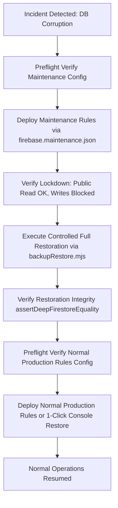

# SIMAK DISKUM v5.0 — Backup, Disaster Recovery & Seeding Runbook (Hardened)

**Dinas Koperasi dan Usaha Mikro Kota Batam**  
**Document Version:** 3.2 (Milestone P02-A Controlled Production Activation Planning - Corrected)  
**Effective Date:** November 2026  
**Infrastructure Target:** Firebase Spark (No-Cost) Plan  
**Primary Tool:** `scripts/backupRestore.mjs`

---

## 1. Executive Summary & Critical Safety Principles

### 1.1 The Firebase Spark Backup Reality
On the **Firebase Spark (No-Cost Plan)**:
- Managed, automated Cloud Firestore backups (`gcloud firestore export` / `firebase firestore:export`) require a **Google Cloud Storage (GCS)** destination bucket.
- Provisioning and writing to external GCS buckets is restricted to the pay-as-you-go **Blaze Plan**.
- On the Spark plan, database safety is achieved via **logical JSON exports** using the Firebase Admin SDK / client scripts (`scripts/backupRestore.mjs`).

### 1.2 Critical Distinction: Merge Import vs Controlled Full Restoration

> [!CAUTION]
> **CORRECTING THE MERGE ASSUMPTION:**  
> A standard `batch.set(docRef, data, { merge: true })` does **NOT** restore a database to its previous state.  
> `merge: true` only merges fields present in the backup. It **does NOT**:
> 1. Remove fields that were created or modified *after* the backup.
> 2. Remove orphaned documents that were created *after* the backup.
> 3. Recover deleted documents if an unauthorized batch operation cleared IDs without record.
> 
> Therefore, SIMAK DISKUM v5.0 defines **two distinct, explicit restore modes**:

| Mode | Command Flag | Mechanism | Effect on Orphaned Live Docs | Effect on Modified Fields | Intended Use Case |
|---|---|---|---|---|---|
| **Non-Destructive Import** | `--mode=merge` | `batch.set(..., { merge: true })` | Preserved intact | Overwritten by backup values | Restoring lost documents or seeding non-conflicting master data |
| **Controlled Full Restoration** | `--mode=full` | `batch.set(..., { merge: false })` + orphan deletion | **Deleted** (requires `--force` & `--dry-run-reviewed`) | Completely replaced by exact backup payload | Disaster recovery after corruption or unauthorized batch update |

> [!IMPORTANT]
> **NEVER SWITCH TO MERGE MODE AFTER A FAILED FULL RESTORE:**  
> If a controlled full restoration fails midway (e.g., due to network disconnection or quota limits), **do NOT switch to `--mode=merge` to finish it**. Switching to merge mode leaves orphaned live documents behind and fails to delete unauthorized extra fields. Instead, resolve the underlying issue and resume the full restore using `--resume`, or restart using `--restart`.

---

## 2. Lossless Serialization of Firestore Data Types

Standard `JSON.stringify` drops or mangles Firestore native types (Timestamps, DocumentReferences, GeoPoints).  
`backupRestore.mjs` implements **lossless type tagging**:

```json
// Example serialized Timestamp in activities.json:
{
  "id": "act_101",
  "title": "Rapat Koordinasi Koperasi",
  "createdAt": {
    "_type": "Firestore.Timestamp",
    "seconds": 1762740000,
    "nanoseconds": 0
  },
  "departmentRef": {
    "_type": "Firestore.DocumentReference",
    "path": "departments/dept_01"
  }
}
```

Upon restoration, `deserializeFirestoreData()` reconstructs true `Timestamp` and `DocumentReference` objects before committing writes to Cloud Firestore.

---

## 3. SHA-256 Integrity Verification

During export, the utility computes a cryptographic SHA-256 checksum for every exported collection file and records it in `manifest.json`:

```json
{
  "exportedAt": "2026-11-05T05:28:21.000Z",
  "systemVersion": "5.0.0",
  "projectId": "simakdiskum",
  "collections": { "activities": 62, "employees": 25 },
  "files": {
    "activities.json": {
      "sha256": "a6b07ab9cf3e284a1e94817a027384...",
      "count": 62
    }
  }
}
```

Before any restore begins, `validateBackupIntegrity()` recalculates all file hashes. If any file has been modified, corrupted, or tampered with, restoration **halts immediately** with a fatal integrity error.

---

## 4. Safety Gates: Dry-Run Diff Analysis & Confirmation

### 4.1 Dry-Run Diff Mode
To inspect what a restore will do without writing or deleting anything:
```bash
cd department-agenda-firebase

# Production dry-run:
node scripts/backupRestore.mjs restore ./backups/2026-11-05 --mode=full --dry-run --target=prod

# Local emulator dry-run:
node scripts/backupRestore.mjs restore ./backups/2026-11-05 --mode=full --dry-run --target=emulator
```

#### Output:
```text
======================================================================
[SIMAK DISKUM] TARGET ENVIRONMENT: LIVE PRODUCTION
Operation:        RESTORE BACKUP (FULL MODE)
Target Project:   simakdiskum
Host / Endpoint:  Live Google Cloud
Auth Method:      ADC
Destructive:      NO (Read-only / Safe)
======================================================================
RESTORE DIFF REPORT (Mode: FULL):
  - activities: 62 backup docs, 64 live docs, 2 orphans
  - employees: 25 backup docs, 25 live docs, 0 orphans
Total documents to restore: 87
Total orphaned live documents: 2 (act_201_new, act_202_new)
[backupRestore] Dry-run complete. No changes were made to Firestore.
```

### 4.2 Mandatory Confirmation Gate (`--force` & `--dry-run-reviewed`)
Controlled full restoration (`--mode=full`) overwrites all live documents (`{ merge: false }`). Therefore, it **strictly requires prior dry-run review and explicit confirmation (`--force`) even when orphan count is zero**:
```bash
cd department-agenda-firebase

# Throws error if run without confirmation:
node scripts/backupRestore.mjs restore ./backups/2026-11-05 --mode=full --target=prod

# Executes controlled full restoration after reviewing diff:
node scripts/backupRestore.mjs restore ./backups/2026-11-05 --mode=full --force --dry-run-reviewed --target=prod
```

---

## 5. Audit Log Protection & ID Collision Safety

### 5.1 Audit Logs Are Protected Records
- In `--mode=full`, **orphaned audit logs are NEVER deleted**. Any audit records created after the backup timestamp remain strictly preserved.
- **Never Overwrite Existing Historical Audit Records:** If a document in `auditLogs.json` matches the ID of an existing live audit record with different content, `backupRestore.mjs` **does not overwrite the live record**. Instead, it saves the backup copy under a collision-safe ID (`${id}_backup_restored_${Date.now()}`) with metadata `isCollidingRestoredRecord: true` and logs an administrative warning.
- **Deep Verification Handling:** `verifyRestoration()` accounts for collision-safe records when validating `auditLogs`, verifying that the backup data exists under its collision ID so deep equality passes honestly.

### 5.2 Independent Privileged Maintenance Logging
Every execution of `restore` or `seed` automatically writes an audit record directly into `auditLogs` with distinct metadata:
```json
{
  "action": "MAINTENANCE_RESTORE",
  "entity": "DATABASE_BACKUP",
  "entityId": "2026-11-05",
  "actorId": "system-admin-adc",
  "actorRole": "admin",
  "details": {
    "mode": "full",
    "manifestHash": "a6b07a...",
    "operationId": "op_1762320501"
  }
}
```

---

## 6. Checkpoint Ledger & Resumable Restoration

### 6.1 Cryptographically Bound Checkpoint Ledger (`restore-progress.json`)
To safeguard against network failure during large multi-batch restorations, `backupRestore.mjs` records progress in `restore-progress.json`:
- **Binding Safeguards:** Checkpoint records `targetProjectId`, `manifestHash`, `mode`, and `operationId`.
- **Validation:** Attempting to resume with a different backup, target environment, or restore mode is rejected immediately.

### 6.2 Checking Progress, Resuming, or Restarting
- **To inspect checkpoint status:**
  ```bash
  cd department-agenda-firebase
  node scripts/backupRestore.mjs status ./backups/2026-11-05 --target=prod
  ```
- **To safely resume an interrupted restore from where it stopped:**
  ```bash
  node scripts/backupRestore.mjs restore ./backups/2026-11-05 --mode=full --resume --force --dry-run-reviewed --target=prod
  ```
  The script validates that the checkpoint's `targetProjectId`, `manifestHash`, and `mode` match. It skips all previously completed batches and continues with remaining batches.
- **To discard the checkpoint and restart fresh from scratch:**
  ```bash
  node scripts/backupRestore.mjs restore ./backups/2026-11-05 --mode=full --restart --force --dry-run-reviewed --target=prod
  ```

---

## 7. Preventing Concurrent Application Writes During Full Restore (Disaster Recovery)

To prevent race conditions or data inconsistency while a destructive restore is taking place, shield Cloud Firestore with maintenance lockdown rules:



### 7.1 Deterministic Maintenance Lockdown Procedure
Never edit `firebase.json` directly. Use the dedicated maintenance configuration:

1. **Preflight Verification:**
   ```bash
   cd department-agenda-firebase
   node scripts/verifyRulesSource.mjs --config=firebase.maintenance.json --target=prod
   ```
   *Expected Output:*
   ```text
   [Rules Verification Passed]
     Config:           firebase.maintenance.json
     Rules File:       firebase/firestore.maintenance.rules
     Expected Release: SIMAK_DISKUM_MAINTENANCE_LOCKDOWN_RULES_V5
     Detected Mode:    MAINTENANCE_LOCKDOWN
   ```

2. **Deploy Maintenance Security Rules (`firebase/firestore.maintenance.rules`):**
   ```bash
   firebase deploy --config firebase.maintenance.json --only firestore:rules --project simakdiskum
   ```
   *Invariants Enforced:*
   - **Public Reads:** Preserved (`allow read: if true`), ensuring citizens encounter zero UI crashes.
   - **Client Writes:** Frozen across all collections (`allow write: if false`).
   - **Admin SDK:** Completely unaffected (Admin SDK credentials bypass security rules).
   *(Verified by `tests/rules/maintenanceRules.test.ts` with 6/6 tests passing).*

3. **Execute Controlled Full Restoration via Admin SDK:**
   ```bash
   node scripts/backupRestore.mjs restore ./backups/2026-11-05 --mode=full --force --dry-run-reviewed --target=prod
   ```

4. **Run Deep Verification:**
   Ensure `verifyRestoration()` completes with 100% matched documents.

5. **Deterministic Restoration of Normal Production Security Rules:**
   Verify `firebase.json` and deploy normal production rules:
   ```bash
   node scripts/verifyRulesSource.mjs --target=prod
   firebase deploy --only firestore:rules --project simakdiskum
   ```
   *Note:* If network connectivity is lost during maintenance, an administrator can manually restore normal production rules in 1-click via **Firebase Console > Firestore > Rules > Rules history > Restore version > Publish**.

---

## 8. Post-Restoration Deep Structural Verification

After all batches commit, `backupRestore.mjs` executes an automated deep structural verification (`assertDeepFirestoreEquality`):
1. **Document Count Verification:** Confirms live document counts match `manifest.json`.
2. **Deep Field-Level Equality:** Recursively compares:
   - Nested plain objects
   - Arrays of primitives and objects
   - Firestore `Timestamp` objects (seconds and nanoseconds)
   - Firestore `DocumentReference` objects (document path)
   - `null` values and optional fields
   - In full mode: verifies that live documents contain **zero unexpected extra keys** that were absent in the backup.

---

## 9. Production Master Data Seeding Safety

### 9.1 Separation of Dev Fixtures vs Production Templates
- **Development Fixtures (`seed:dev` or `--env=dev`):** Synthetic placeholder data clearly labeled `[DEMO]` for local testing in the Firestore emulator:
  ```bash
  cd department-agenda-firebase
  node scripts/backupRestore.mjs seed:dev --target=emulator
  ```
- **Production Seeding (`seed` / `--env=prod`):** Strictly blocked from inserting unverified civil servant names or NIPs.

### 9.2 Production Import Approval Step
The default command:
```bash
cd department-agenda-firebase
node scripts/backupRestore.mjs seed --target=prod
```
will **REJECT** execution with:
```text
[Production Seeding Blocked] Production master data seeding requires a client-approved JSON template.
Pass --template=<path> pointing to an approved template (e.g. templates/productionMasterDataTemplate.json).
```

To seed production:
1. Obtain official civil service decree (SK Penetapan Pejabat & Signatory) from Dinas Koperasi dan Usaha Mikro Kota Batam.
2. Fill `templates/productionMasterDataTemplate.json` with verified names, NIPs, and signatory profiles.
3. Set `"clientApproved": true` and provide `"approvalReference": "SK/DISKUM/..."`.
4. Execute:
   ```bash
   cd department-agenda-firebase
   node scripts/backupRestore.mjs seed --env=prod --template=templates/productionMasterDataTemplate.json --target=prod
   ```

---

## 10. Backup File Security & Data Protection Policies

1. **Git Exclusion:** All backup folders (`backups/`, `*.backup`, `*backup*.json`, `restore-progress.json`) are strictly excluded in `.gitignore`.
2. **Access Control:** Backups contain non-public invitation letter metadata and internal department notes. Store exported files on encrypted, access-controlled municipal drives with restricted administrative access.
3. **Retention Schedule:** Retain daily backups for 30 days and monthly archival snapshots for 12 months.
