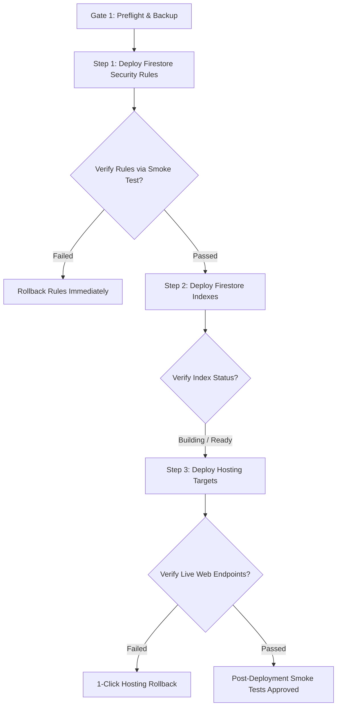

# SIMAK DISKUM v5.0 — Production Deployment & Rollback Runbook (Hardened)

**Dinas Koperasi dan Usaha Mikro Kota Batam**  
**Document Version:** 3.0 (Milestone P01-B Operational Safety Verified)  
**Effective Date:** November 2026  
**Infrastructure Target:** Firebase Multi-Site Hosting & Cloud Firestore Standard Edition on Firebase Spark (No-Cost) Plan  
**Target Project:** `simakdiskum`  
**Public URL:** `https://simakdiskum.web.app`  
**Admin URL:** `https://simakdiskum-admin.web.app`  

---

## 1. Executive Summary & Architecture Grounding

SIMAK DISKUM v5.0 is designed to operate 100% within the free **Firebase Spark Plan**:
- **Hosting:** 2 Sites (`simakdiskum` for Public Portal, `simakdiskum-admin` for Admin Portal).
- **Database:** Cloud Firestore Standard Edition.
- **Authentication:** Firebase Authentication with Email/Password and custom claims (`admin`, `editor`).
- **Storage for Attachments:** External Google Drive links managed under official municipal accounts.
- **Cost:** **$0.00/month** (Zero cloud infrastructure cost).

---

## 2. Multi-Endpoint Non-Atomic Deployment Architecture

> [!WARNING]
> **MULTI-ENDPOINT DEPLOYMENT REALITY:**  
> A single `firebase deploy` command does **NOT** deploy the system as an atomic unit.  
> Firebase Hosting, Cloud Firestore Security Rules, and Firestore Compound Indexes interact with completely separate Google Cloud control planes:
> 1. **Firestore Rules:** Compiled and deployed to the Firestore Security Rules engine. Takes effect within seconds.
> 2. **Firestore Indexes:** Queued and built asynchronously by the Cloud Datastore indexing engine. Compound indexes may take 2–10 minutes to reach status `Enabled`.
> 3. **Firebase Hosting:** Uploads file hashes to the global Fastly/Google CDN edge network. Edge cache propagation takes **1 to 5 minutes** across global Points of Presence (POPs).
> 
> Deploying all targets simultaneously risks race conditions where newly deployed web clients request compound queries against indexes that are still building.

---

## 3. Pre-Deployment Mandatory Checklist (Gate 5 Sign-Off)

Before deploying to production, the Release Manager and Lead Engineer must verify:

- [ ] **Dual-Operator Authorization:** Written sign-off from Department Head and IT Administrator.
- [ ] **Target Project Safeguard:** Active Firebase CLI project is strictly confirmed as `simakdiskum` (`firebase use simakdiskum`).
- [ ] **Release Tag Checked Out:** Repository is on approved Git release tag (e.g. `v5.0.0-rc1`).
- [ ] **Automated Test Suite 100% Pass:** `npx vitest run` passes all **202 automated tests across 23 test files** with 0 failures.
- [ ] **Firestore Security Rules Suite:** `npx vitest run tests/rules/firestore.rules.test.ts` passes **32 / 32 tests**.
- [ ] **Browser E2E Verification Suites:** Playwright suites pass all **79 / 79 scenarios** (100% pass rate).
- [ ] **Pre-Deployment Database Backup:** Run `node scripts/backupRestore.mjs export ./backups/pre_deploy_$(Get-Date -Format 'yyyyMMdd_HHmm')`.
- [ ] **Production Build Clean:** `npm run build` generates `apps/public/dist` and `apps/admin/dist` with 0 warnings/errors.

---

## 4. Safe Step-by-Step Deployment Sequence

To avoid inconsistent intermediate states, deployments must occur in the following explicit sequence:



---

### Step 1: Deploy Firestore Security Rules
Always deploy and verify security rules first so data is protected before frontend code arrives:
```bash
firebase deploy --project simakdiskum --only firestore:rules
```
*Verification:*
- Open [Firebase Console Rules Editor](https://console.firebase.google.com/project/simakdiskum/firestore/rules).
- Verify the active version timestamp.
- Attempt unauthorized unauthenticated write to `publicActivities` from DevTools console; verify `PERMISSION_DENIED`.

*Stop Condition:* If rules fail to deploy or cause legitimate reads to fail, halt immediately and restore previous rules version.

---

### Step 2: Deploy Firestore Indexes
```bash
firebase deploy --project simakdiskum --only firestore:indexes
```
*Verification:*
- Open [Firebase Console Indexes Tab](https://console.firebase.google.com/project/simakdiskum/firestore/indexes).
- Verify `activities` and `publicActivities` compound indexes (`startDate ASC, endDate ASC`, `isPublic ASC, startDate ASC`) show status **Enabled** (not Building or Error).

---

### Step 3: Deploy Hosting Portals
Once database security and indexing are operational, deploy the web application shells:
```bash
firebase deploy --project simakdiskum --only hosting:public,hosting:admin
```
*Verification:*
- Open `https://simakdiskum.web.app` in an incognito window.
- Verify civic branding, Barelang Bridge banner, and 4 summary cards.
- Check DevTools console: 0 JavaScript exceptions.
- Open `https://simakdiskum-admin.web.app`.
- Verify admin login screen renders cleanly.

---

## 5. Rollback Procedures & Propagation Realities

### 5.1 Procedure A: 1-Click Hosting Rollback
If a critical UI defect or frontend exception is discovered after deployment:
1. Navigate to **Firebase Console** -> **Hosting**.
2. Select the affected site (`simakdiskum` or `simakdiskum-admin`).
3. Scroll to **Release History**.
4. Click `⋮` next to the previous release and click **Rollback**.
5. **Edge Propagation Reality:** Rollback takes **1 to 5 minutes** to propagate worldwide across CDN edge nodes. Verify via incognito browser window with Cache Disabled in DevTools.

> [!CAUTION]
> **HOSTING ROLLBACK DOES NOT TOUCH DATABASE RECORDS:**  
> Rolling back Firebase Hosting *only* restores previous static HTML/JS/CSS assets. It does **NOT** roll back Firestore documents, change database schema, or alter security rules. To revert database changes, execute Procedure C.

### 5.2 Procedure B: Security Rules Rollback
If newly published rules inadvertently block legitimate operations:
1. Navigate to **Firebase Console** -> **Firestore** -> **Rules**.
2. Click **Rules history** in top right.
3. Select previous working version and click **Restore version** -> **Publish**.
4. Or via CLI:
   ```bash
   git checkout tags/v5.0.0-rc1 -- firebase/firestore.rules
   firebase deploy --project simakdiskum --only firestore:rules
   ```

### 5.3 Procedure C: Database State Rollback
If bad data was committed during deployment rehearsal:
1. Locate the pre-deployment backup directory under `backups/`.
2. Execute dry-run diff check:
   ```bash
   node scripts/backupRestore.mjs restore ./backups/pre_deploy_xxx --mode=full --dry-run
   ```
3. Once diff is verified, execute controlled full restoration with explicit confirmation:
   ```bash
   node scripts/backupRestore.mjs restore ./backups/pre_deploy_xxx --mode=full --dry-run-reviewed --force
   ```

---

## 6. Firebase Spark Plan Quota Modeling & Reset Schedule

### 6.1 Daily Quota Reset Times (Pacific Time to WIB Conversion)
Firestore daily free quotas (50,000 reads/day, 20,000 writes/day) reset every 24 hours at **Midnight Pacific Time (00:00 PT)**:
- **During Pacific Standard Time (PST / UTC-8, ~November to March):**  
  Midnight PST (00:00 PST) corresponds to **15:00 WIB (3:00 PM WIB)**.
- **During Pacific Daylight Time (PDT / UTC-7, ~March to November):**  
  Midnight PDT (00:00 PDT) corresponds to **14:00 WIB (2:00 PM WIB)**.

### 6.2 Monthly Bandwidth Quota
- Firebase Hosting provides **10 GB/month** transfer on Spark.
- Resets on the **1st day of every calendar month at 00:00 UTC (07:00 WIB)**.
- Public cold load transfer is ~388.11 kB; warm visits are < 3 kB (HTTP 304). At 200 daily visitors, monthly bandwidth consumption is ~0.84 GB (<8.4% of limit).
