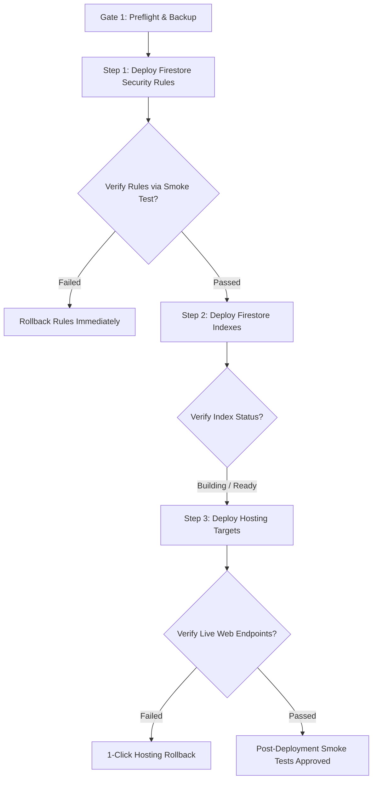

# SIMAK DISKUM v5.0 — Deployment & Rollback Runbook (Hardened)

**Dinas Koperasi dan Usaha Mikro Kota Batam**  
**Document Version:** 2.0 (P01-A Operational Safety Hardened)  
**Effective Date:** November 2026  
**Infrastructure Target:** Firebase Spark (No-Cost) Plan  
**Target Project ID:** `simakdiskum`  
**Public Hosting Target:** `simakdiskum` (`simakdiskum.web.app`)  
**Admin Hosting Target:** `simakdiskum-admin` (`simakdiskum-admin.web.app`)

---

## 1. Safety Notice & Invariant Boundary

> [!CAUTION]
> **PREPARATION & REHEARSAL ONLY.**
> Production deployment is **NOT APPROVED**.
> Do NOT execute live deployment commands until formal written authorization is granted by the department project lead.

---

## 2. Correcting Deployment & Rollback Misconceptions

### 2.1 Non-Atomicity of Firebase Deployments
A single command like `firebase deploy --only hosting,firestore` is **NOT globally atomic**:
- **Firestore Security Rules:** Validated and compiled in Google Cloud; deployed within ~5–10 seconds.
- **Firestore Indexes:** Queued and compiled asynchronously. Large composite indexes can take several minutes to finish building.
- **Hosting Assets:** Uploaded as individual content-addressed blobs; edge routing releases update across global CDN nodes within 1–5 minutes.
- **Failure Consequence:** If rules deploy successfully but hosting asset upload is interrupted, the database is governed by new rules while old frontend code is still live. Therefore, deployment must follow an **ordered sequence with verification gates**.

### 2.2 Asset Rollback Does NOT Touch Database Records
- **Hosting Rollback** reverts only static HTML, CSS, and JS files. It **never modifies, recovers, or deletes** documents in Cloud Firestore.
- **Rules Rollback** restores security access policies. It does not revert data that was written under previous rules.
- **Data Restoration** requires executing `scripts/backupRestore.mjs restore <backupDir>`.

### 2.3 Rollback Realities (Not Instantaneous or Guaranteed)
- Hosting rollback switches pointer releases in Firebase Hosting. While fast, edge POPs and browser disk caches may take minutes to reflect the reverted version.
- Rules rollback requires compiling the previous rules text.
- Rollback is only successful when verified with automated smoke tests against live endpoints.

---

## 3. Pre-Deployment Authorization & Confirmation Gates

Before executing any deployment command, the two-operator verification gate must be completed:

- [ ] **Dual-Operator Sign-off:** Lead System Administrator and Department Verifier have signed the release ticket.
- [ ] **Target Project Verified:** Run `firebase use`. The active project must strictly return `simakdiskum`.
- [ ] **Clean Git Working Tree:** `git status --porcelain` returns 0 modified or untracked files.
- [ ] **Release Tag Checked Out:** Repository is on approved Git release tag (e.g. `v5.0.0-rc1`).
- [ ] **Vitest Test Suite 100% Pass:** `npx vitest run` passes all 180+ tests with 0 failures.
- [ ] **Firestore Rules Regression Pass:** `npx vitest run tests/rules/firestore.rules.test.ts` passes 32/32 tests.
- [ ] **Pre-Deployment Database Backup:** Run `node scripts/backupRestore.mjs export ./backups/pre_deploy_$(Get-Date -Format 'yyyyMMdd_HHmm')`.
- [ ] **Production Build Clean:** `npm run build` generates `apps/public/dist` and `apps/admin/dist` with 0 warnings/errors.

---

## 4. Safe Step-by-Step Deployment Sequence

To avoid inconsistent intermediate states, deployments must occur in the following explicit sequence:



---

### Step 1: Deploy Firestore Security Rules
Always deploy and verify security rules first so data is protected before frontend code arrives:
```bash
firebase deploy --project simakdiskum --only firestore:rules
```
*Verification:*
- Open [Firebase Console Rules Editor](https://console.firebase.google.com/project/simakdiskum/firestore/rules).
- Verify the active version timestamp.
- Attempt unauthorized unauthenticated write to `publicActivities` from DevTools console; verify `PERMISSION_DENIED`.

*Stop Condition:* If rules fail to deploy or cause legitimate reads to fail, halt immediately and restore previous rules version.

---

### Step 2: Deploy Firestore Indexes
```bash
firebase deploy --project simakdiskum --only firestore:indexes
```
*Verification:*
- Open [Firebase Console Indexes Tab](https://console.firebase.google.com/project/simakdiskum/firestore/indexes).
- Verify `activities` and `publicActivities` compound indexes (`startDate ASC, endDate ASC`, `isPublic ASC, startDate ASC`) show status **Enabled** (not Building or Error).

---

### Step 3: Deploy Hosting Portals
Once database security and indexing are operational, deploy the web application shells:
```bash
firebase deploy --project simakdiskum --only hosting:public,hosting:admin
```
*Verification:*
- Open `https://simakdiskum.web.app` in an incognito window.
- Verify civic branding, Barelang Bridge banner, and 4 summary cards.
- Check DevTools console: 0 JavaScript exceptions.
- Open `https://simakdiskum-admin.web.app`.
- Verify admin login screen renders cleanly.

---

## 5. Rollback Procedures

### 5.1 Procedure A: 1-Click Hosting Rollback
If a critical UI defect or frontend exception is discovered after deployment:
1. Navigate to **Firebase Console** -> **Hosting**.
2. Select the affected site (`simakdiskum` or `simakdiskum-admin`).
3. Scroll to **Release History**.
4. Click `⋮` next to the previous release and click **Rollback**.
5. *Verification:* Clear browser cache and verify previous version loads.

### 5.2 Procedure B: Security Rules Rollback
If newly published rules inadvertently block legitimate operations:
1. Navigate to **Firebase Console** -> **Firestore** -> **Rules**.
2. Click **Rules history** in top right.
3. Select previous working version and click **Restore version** -> **Publish**.
4. Or via CLI:
   ```bash
   git checkout tags/v5.0.0-rc1 -- firebase/firestore.rules
   firebase deploy --project simakdiskum --only firestore:rules
   ```

### 5.3 Procedure C: Database State Rollback
If bad data was committed during deployment rehearsal:
1. Locate the pre-deployment backup directory under `backups/`.
2. Execute full restoration with dry-run diff check:
   ```bash
   node scripts/backupRestore.mjs restore ./backups/pre_deploy_xxx --mode=full --dry-run
   ```
3. Once diff is verified:
   ```bash
   node scripts/backupRestore.mjs restore ./backups/pre_deploy_xxx --mode=full --force
   ```
