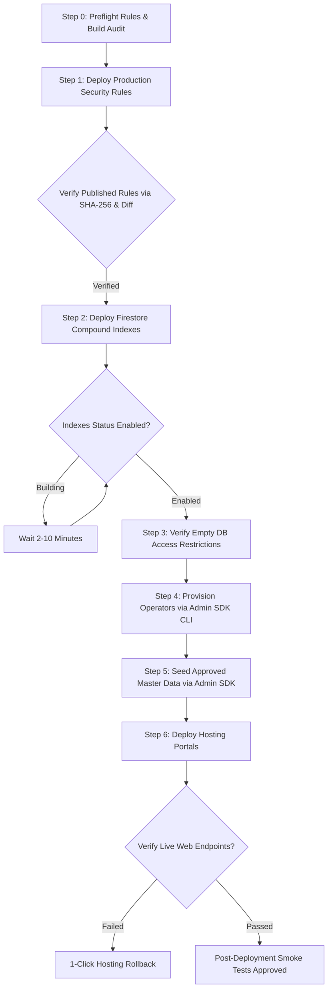

# SIMAK DISKUM v5.0 — Production Deployment & Rollback Runbook (Hardened)

**Dinas Koperasi dan Usaha Mikro Kota Batam**  
**Document Version:** 3.3 (Milestone P02-A Controlled Production Activation Planning - Final Sign-Off)  
**Effective Date:** November 2026  
**Infrastructure Target:** Firebase Multi-Site Hosting & Cloud Firestore Standard Edition on Firebase Spark (No-Cost) Plan  
**Target Project:** `simakdiskum`  
**Public URL:** `https://simakdiskum.web.app`  
**Admin URL:** `https://simakdiskum-admin.web.app`  

---

## 1. Executive Summary & Architecture Grounding

SIMAK DISKUM v5.0 is designed to operate 100% within the free **Firebase Spark Plan**:
- **Hosting:** 2 Sites (`simakdiskum` for Public Portal, `simakdiskum-admin` for Admin Portal).
- **Database:** Cloud Firestore Standard Edition.
- **Authentication:** Firebase Authentication with Email/Password and custom claims (`admin`, `editor`). Public self-registration is permanently disabled.
- **Storage for Attachments:** External Google Drive links configured with **Restricted** access for authorized municipal accounts / Google Group. Zero Drive URLs are exposed to the Public Portal.
- **Cost:** **$0.00/month** (Zero cloud infrastructure cost).

---

## 2. Multi-Endpoint Non-Atomic Deployment Architecture

> [!WARNING]
> **MULTI-ENDPOINT DEPLOYMENT REALITY:**  
> A single `firebase deploy` command does **NOT** deploy the system as an atomic unit.  
> Firebase Hosting, Cloud Firestore Security Rules, and Firestore Compound Indexes interact with completely separate Google Cloud control planes:
> 1. **Firestore Rules:** Compiled and deployed to the Firestore Security Rules engine. Takes effect within seconds.
> 2. **Firestore Indexes:** Queued and built asynchronously by the Cloud Datastore indexing engine. Compound indexes may take 2–10 minutes to reach status `Enabled`.
> 3. **Firebase Hosting:** Uploads file hashes to the global Fastly/Google CDN edge network. Edge cache propagation takes **1 to 5 minutes** across global Points of Presence (POPs).
> 
> Deploying all targets simultaneously risks race conditions where newly deployed web clients request compound queries against indexes that are still building. Deployments must strictly proceed sequentially: Rules $\rightarrow$ Indexes $\rightarrow$ Wait for `Enabled` $\rightarrow$ DB Verification $\rightarrow$ Operator Provisioning $\rightarrow$ Seed Master Data $\rightarrow$ Hosting.

---

## 3. Pre-Deployment Mandatory Checklist (Gate 5 Sign-Off)

Before deploying to production, the Release Manager and Lead Engineer must verify:

- [ ] **Dual-Operator Authorization:** Written sign-off from Department Head and IT Administrator.
- [ ] **Target Project Safeguard:** Active Firebase CLI project is strictly confirmed as `simakdiskum` (`firebase use simakdiskum`).
- [ ] **Release Tag Checked Out:** Repository is on approved Git release tag (e.g. `v5.0.0-rc1`).
- [ ] **Automated Test Suite 100% Pass:** `npx vitest run` passes all **214 automated tests across 25 test files** with 0 failures (62 tests against real emulators, 152 in-memory unit tests).
- [ ] **Firestore Security Rules Suite:** `npx vitest run tests/rules/firestore.rules.test.ts tests/rules/maintenanceRules.test.ts` passes **38 / 38 rules tests**.
- [ ] **Browser E2E Verification Suites:** Playwright suites pass all **79 / 79 scenarios** (100% pass rate).
- [ ] **Rules Source Preflight Verifier:** `node scripts/verifyRulesSource.mjs --target=prod` validates `firebase.json` points to normal rules (`SIMAK_DISKUM_PRODUCTION_SECURITY_RULES_V5`, SHA-256: `444b48ba8e9d5979b0845e997babe9a728fefc930e3f03bab35da91e11570678`, 707 lines).
- [ ] **Pre-Deployment Database Backup:** Run `cd department-agenda-firebase; node scripts/backupRestore.mjs export ./backups/pre_deploy_$(Get-Date -Format 'yyyyMMdd_HHmm') --target=prod`.
- [ ] **Production Build Clean:** `npm run build` generates `apps/public/dist` (13.67 kB gzip shell) and `apps/admin/dist` (4.70 kB gzip shell) with 0 warnings/errors.

---

## 4. Safe Step-by-Step Initial Deployment Sequence

Deployments must follow the strict initial activation order:



---

### Step 0: Preflight Rules & Build Audit
Verify that `firebase.json` is configured for normal production rules and that build artifacts are verified:
```bash
cd department-agenda-firebase
node scripts/verifyRulesSource.mjs --target=prod
npm run build
```

---

### Step 1: Deploy Firestore Security Rules & Verify Published Content
Deploy security rules first so data is protected before any client queries or documents arrive:
```bash
firebase deploy --only firestore:rules --project simakdiskum
```

#### Published Rules Content Verification Protocol:
Relying solely on `RELEASE_IDENTITY` header comments is insufficient. Execute the following 3-step verification:
1. **SHA-256 Checksum & Line Count Verification:**
   Verify that published rules in [Firebase Console Rules Editor](https://console.firebase.google.com/project/simakdiskum/firestore/rules) match SHA-256 `444b48ba8e9d5979b0845e997babe9a728fefc930e3f03bab35da91e11570678` and exactly 707 lines.
2. **Semantic Diff Inspection:**
   Copy the live published text into `temp_published.rules` and run:
   ```bash
   git diff --no-index firebase/firestore.rules temp_published.rules
   ```
   Confirm zero differences.
3. **Live Endpoint Permission Probing:**
   - Unauthenticated write to `publicActivities` $\rightarrow$ rejected with `PERMISSION_DENIED`.
   - Unauthenticated read to `publicActivities` $\rightarrow$ allowed (empty array).
   - Unauthenticated read to `activities` $\rightarrow$ rejected with `PERMISSION_DENIED`.

---

### Step 2: Deploy Firestore Compound Indexes
```bash
firebase deploy --only firestore:indexes --project simakdiskum
```
*Verification:*
- Open [Firebase Console Indexes Tab](https://console.firebase.google.com/project/simakdiskum/firestore/indexes).
- **WAIT:** Compound indexes (`startDate ASC, endDate ASC`, `isPublic ASC, startDate ASC`) will show status `Building` for 2–10 minutes.
- **DO NOT PROCEED** until all indexes show status **`Enabled`**.

---

### Step 3: Verify Empty DB Access Restrictions
Before creating users or inserting data:
- Verify unauthenticated writes to `publicActivities` or `activities` are rejected with `PERMISSION_DENIED`.
- Verify unauthenticated reads to `publicActivities` return empty collection cleanly without errors.
- Verify private collections (`activities`, `employees`, `settings`, `auditLogs`) return `PERMISSION_DENIED`.

---

### Step 4: Provision Initial Operator Accounts via Admin SDK CLI
```bash
# Passwordless provisioning: auto-generates high-entropy credential and setup link
node scripts/manageRoles.mjs provision "<APPROVED_ADMIN_EMAIL>" "Administrator DISKUM" admin --target=prod
node scripts/manageRoles.mjs provision "<APPROVED_OPERATOR_EMAIL>" "Operator Agenda" editor --target=prod
```

> [!CAUTION]
> **CREDENTIAL DISCLOSURE SAFEGUARDS:**  
> One-time administrative setup links are output directly to the interactive terminal. Operators running the CLI must **never** redirect this command output into shared log files, persist it in shell command history, or transmit it via unencrypted messaging channels. Prefer having operators use native Firebase password reset emails (150 emails/day Spark quota).

---

### Step 5: Seed Client-Approved Master Data via Admin SDK
```bash
node scripts/backupRestore.mjs seed --env=prod --template=templates/productionMasterDataTemplate.json --target=prod
```
- Confirm `clientApproved: true` and official SK decree reference in template.

---

### Step 6: Deploy Hosting Portals
> [!WARNING]
> **ADMIN PORTAL PREREQUISITE:**  
> The current production build of `apps/admin` mounts the administrative console directly. Implementing the web login screen (`signInWithEmailAndPassword`) and password recovery view (`sendPasswordResetEmail`) in `apps/admin` is an exact blocker before live operators access the portal in P02-B.

Deploy the web application shells:
```bash
firebase deploy --only hosting:public,hosting:admin --project simakdiskum
```
*Verification:*
- Allow **1 to 5 minutes** for edge CDN propagation.
- Open `https://simakdiskum.web.app` in an incognito window: verify civic branding, Barelang Bridge banner, and 4 summary cards.
- DevTools console: 0 JavaScript exceptions.
- Open `https://simakdiskum-admin.web.app`: verify application shell loads cleanly with valid SSL.

---

## 5. Rollback Procedures & Propagation Realities

### 5.1 Procedure A: 1-Click Hosting Rollback
If a critical UI defect or frontend exception is discovered after deployment:
1. Navigate to **Firebase Console** -> **Hosting**.
2. Select the affected site (`simakdiskum` or `simakdiskum-admin`).
3. Scroll to **Release History**.
4. Click `⋮` next to the previous release and click **Rollback**.
5. **Edge Propagation Reality:** Rollback takes **1 to 5 minutes** to propagate worldwide across CDN edge nodes. Verify via incognito browser window with Cache Disabled in DevTools.

> [!CAUTION]
> **HOSTING ROLLBACK DOES NOT TOUCH DATABASE RECORDS:**  
> Rolling back Firebase Hosting *only* restores previous static HTML/JS/CSS assets. It does **NOT** roll back Firestore documents, change database schema, or alter security rules. To revert database changes, execute Procedure C.

### 5.2 Procedure B: Security Rules Rollback
If newly published rules inadvertently block legitimate operations:
1. Navigate to **Firebase Console** -> **Firestore** -> **Rules**.
2. Click **Rules history** in top right.
3. Select previous working version and click **Restore version** -> **Publish**.
4. Or via CLI:
   ```bash
   node scripts/verifyRulesSource.mjs --target=prod
   firebase deploy --only firestore:rules --project simakdiskum
   ```

### 5.3 Procedure C: Database State Rollback
If bad data was committed during deployment rehearsal:
1. Locate the pre-deployment backup directory under `backups/`.
2. Check restore progress ledger status:
   ```bash
   cd department-agenda-firebase
   node scripts/backupRestore.mjs status ./backups/pre_deploy_xxx --target=prod
   ```
3. Execute dry-run diff check:
   ```bash
   node scripts/backupRestore.mjs restore ./backups/pre_deploy_xxx --mode=full --dry-run --target=prod
   ```
4. Once diff is verified, execute controlled full restoration with explicit confirmation:
   ```bash
   node scripts/backupRestore.mjs restore ./backups/pre_deploy_xxx --mode=full --dry-run-reviewed --force --target=prod
   ```

---

## 6. Disaster Recovery Maintenance Lockdown

When disaster recovery or database restoration is required:
1. **Preflight Verification:**
   ```bash
   node scripts/verifyRulesSource.mjs --config=firebase.maintenance.json --target=prod
   ```
2. **Deploy Maintenance Lockdown:**
   ```bash
   firebase deploy --config firebase.maintenance.json --only firestore:rules --project simakdiskum
   ```
3. **Execute Full Restore (see Section 5.3).**
4. **Restore Production Rules:**
   ```bash
   node scripts/verifyRulesSource.mjs --target=prod
   firebase deploy --only firestore:rules --project simakdiskum
   ```
   *(Or manual 1-click restore in Firebase Console Rules History).*

---

## 7. Firebase Spark Plan Quota Modeling & Reset Schedule

### 7.1 Daily Quota Reset Times (Pacific Time to WIB Conversion)
Firestore daily free quotas (50,000 reads/day, 20,000 writes/day) reset every 24 hours at **Midnight Pacific Time (00:00 PT)**:
- **During Pacific Standard Time (PST / UTC-8, ~November to March):**  
  Midnight PST (00:00 PST) corresponds to **15:00 WIB (3:00 PM WIB)**.
- **During Pacific Daylight Time (PDT / UTC-7, ~March to November):**  
  Midnight PDT (00:00 PDT) corresponds to **14:00 WIB (2:00 PM WIB)**.
- If quota is exceeded, applications display an Indonesian HTTP 429 quota notice modal without crashing.

### 7.2 Monthly Bandwidth Quota
- Firebase Hosting provides **10 GB/month** transfer on Spark.
- Resets on the **1st day of every calendar month at 00:00 UTC (07:00 WIB)**.
- Public cold load transfer is ~388.11 kB; warm visits are < 3 kB (HTTP 304). At 200 daily visitors, monthly bandwidth consumption is ~0.84 GB (<8.4% of limit).

### 7.3 Password Reset Email Quota
- Firebase Authentication supports **150 password reset emails/day** on the Spark free plan via built-in mailer (`noreply@simakdiskum.firebaseapp.com`).
- Quotas are managed by Google Cloud and subject to policy updates.
