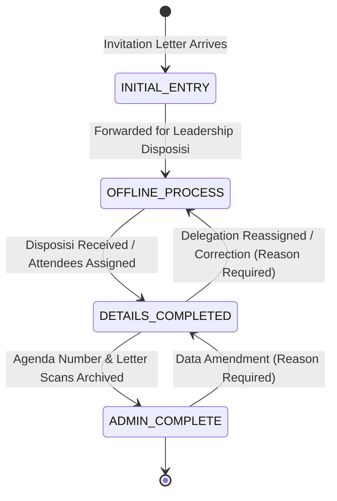

# SIMAK DISKUM v5.0 — Feature F01 Specification
## Agenda Administrative Workflow & Invitation Letter Reference

**Feature ID:** F01  
**Status:** Approved Specification & Implementation in Progress  
**Author:** Senior Software Architect & Firebase Full-Stack Engineer  
**Target Release:** SIMAK DISKUM v5.0  
**Compliance Target:** 100% Spark Free Tier Compatible (Zero Cloud Functions, Zero Blaze Billing)

---

## 1. Executive Summary & Purpose

The Department of Cooperatives and Micro Enterprises of Batam City (Dinas Koperasi dan Usaha Mikro Kota Batam) receives numerous official invitations, meeting notices, and inter-agency memos weekly.

Prior to Feature F01, activities had only operational scheduling statuses (`SCHEDULED`, `COMPLETED`, `CANCELLED`). This forced operators to wait until all administrative details (attendee delegations, disposisi, official agenda registration numbers, and scanned physical letters) were finalized before inputting events into the system, or risk losing track of partially processed invitations.

Feature F01 introduces a formal 4-stage **Administrative Workflow** (`administrativeStage`) decoupled from operational scheduling status, alongside a private, structured **Invitation Letter Reference** (`invitationLetter`). This permits early scheduling into public agendas (ensuring citizens and partner agencies have advance notice of events) while maintaining complete internal administrative traceability without exposing confidential letter metadata or internal Google Drive links to the public.

---

## 2. Business Workflow Stages



The administrative workflow comprises four sequential lifecycle stages:

### Stage 1: `INITIAL_ENTRY` (Input Awal)
- **Trigger:** An incoming invitation letter, nota dinas, or announcement arrives at the secretariat.
- **Operator Action:** The operator immediately inputs the fundamental event schedule (Title, Date, Time, Location, Organizer, Category).
- **Flexibility:** `attendeeIds`, `attendeeSnapshots`, `publicNotes`, and `invitationLetter` metadata may be left empty or unassigned.
- **Validation:** Saving is permitted with nonblocking advisory warnings (`"Perhatian: Daftar peserta kegiatan masih kosong"`).
- **Public Projection:** The activity is safely projected to `publicActivities` and visible on the citizen portal with safe fallback placeholders (`'-'`) for attendees and remarks.

### Stage 2: `OFFLINE_PROCESS` (Proses Offline)
- **Trigger:** The physical letter is circulated for leadership review, internal disposisi, or inter-division coordination.
- **System Role:** The system retains the activity with its original immutable UUID. No automated external workflow engine is invoked. Operators can track that this event is actively undergoing manual review.

### Stage 3: `DETAILS_COMPLETED` (Detail Dilengkapi)
- **Trigger:** Leadership disposisi is returned designating official attendees and public instructions.
- **Operator Action:** The operator assigns official attendees (`attendeeIds`), selects employee snapshots, inputs guest attendees, and enters public attire/instructions (`publicNotes`).
- **Snapshot Integrity:** The existing snapshot-freezing engine resolves and seals attendee titles and departments at this moment without altering historical records.

### Stage 4: `ADMIN_COMPLETE` (Administrasi Lengkap)
- **Trigger:** The secretariat finishes letter logging into the department's physical agenda ledger and uploads a PDF copy to the department's Google Drive archive.
- **Operator Action:** The operator records:
  - **No. Agenda** (handwritten registration number in department agenda book)
  - **Tanggal Surat** (date printed on the physical letter, in `YYYY-MM-DD`)
  - **Topik / Perihal Surat** (subject line of the letter)
  - **Google Drive URL** (direct link to the scanned letter file)
  - **Document Visibility** (default `INTERNAL`)
- **Validation Rule:** To claim `ADMIN_COMPLETE`, the letter metadata must either be fully present and valid, OR an explicit missing-document exception must be indicated (e.g. verbal invitation / no physical letter).

---

## 3. Data Model & Architecture

### 3.1 Data Distinction Matrix (Preventing Common Conflations)

| Concept | System Field | Meaning | Scope |
| :--- | :--- | :--- | :--- |
| **No. Agenda** | `invitationLetter.agendaNumber` | Handwritten registration number in department's incoming mail book (e.g. `045.2/DKUM/XI/2026`) | **Private / Internal Only** |
| **No (Laporan)** | Dynamic row index (`1, 2, 3...`) | Table sequence number in official 8-column reports | **Report / Display Only** |
| **Tanggal Surat** | `invitationLetter.letterDate` | Date on which the letter was signed by the sender | **Private / Internal Only** |
| **Tanggal Kegiatan** | `startDate` & `endDate` | Real-world date(s) when the event physically takes place | **Public & Private** |
| **Topik Surat** | `invitationLetter.letterTopic` | Subject line stated on the invitation letter | **Private / Internal Only** |
| **Judul Kegiatan** | `title` | Departmental activity name displayed on calendars | **Public & Private** |

### 3.2 Private Activity Document Schema Extension (`activities/{id}`)

```typescript
export type AdministrativeStage = 
  | 'INITIAL_ENTRY'
  | 'OFFLINE_PROCESS'
  | 'DETAILS_COMPLETED'
  | 'ADMIN_COMPLETE';

export type DocumentVisibility = 'INTERNAL' | 'PUBLIC';

export interface InvitationLetterMetadata {
  agendaNumber?: string;              // Max 100 chars
  letterDate?: string;                // YYYY-MM-DD
  letterTopic?: string;               // Max 500 chars
  driveUrl?: string;                  // HTTPS Google Drive / Docs URL (Max 1000 chars)
  documentVisibility?: DocumentVisibility; // Default 'INTERNAL'
  missingDocumentReason?: string;     // Explicit reason if ADMIN_COMPLETE lacks letter
}

export interface ActivityDocument {
  // Existing Core Fields
  id: string;
  title: string;
  startDate: string;
  startTime: string;
  endDate: string;
  endTime: string | null;
  openEnded: boolean;
  locationId: string;
  organizerId: string;
  categoryId: string;
  attendeeIds: string[];
  attendeeSnapshots: AttendeeSnapshot[];
  guestAttendees: string[];
  status: ActivityStatus;             // 'SCHEDULED' | 'CANCELLED' | 'COMPLETED'
  cancelReason?: string;
  publicCancellationNotice?: string;
  publicNotes: string;
  privateNotes: string;
  privateMeetingUrl: string | null;
  version: number;
  createdAt: string;
  createdBy: string;
  updatedAt: string;
  updatedBy: string;

  // Feature F01 Extensions
  administrativeStage?: AdministrativeStage; // Default 'INITIAL_ENTRY'
  invitationLetter?: InvitationLetterMetadata;
}
```

### 3.3 Public Projection Schema (`publicActivities/{id}`)

**STRICT PRIVACY POLICY:**  
`publicActivities/{id}` **NEVER** contains `administrativeStage` or `invitationLetter`.  
The public schema remains unchanged:
```typescript
export interface PublicActivityDTO {
  id: string;
  title: string;
  startDate: string;
  startTime: string;
  endDate: string;
  endTime: string | null;
  openEnded: boolean;
  timeDisplay: string;
  dateDisplay: string;
  status: ActivityStatus;
  publicCancellationNotice?: string;
  locationName: string;
  locationType: LocationType;
  organizerName: string;
  categoryName: string;
  publicNotes: string;
  attendeeLabels: string[];
  version: number;
  updatedAt: string;
}
```

---

## 4. Security Rules & Gate 5A Version Lockstep

Firestore rules for `activities/{activityId}` are updated to validate the new fields:

```cel
function isValidDriveUrl(url) {
  return url is string &&
         url.size() <= 1000 &&
         url.matches('^https://(drive|docs)\\.google\\.com/.*');
}

function isValidInvitationLetter(letter) {
  let allowed = ['agendaNumber', 'letterDate', 'letterTopic', 'driveUrl', 'documentVisibility', 'missingDocumentReason'];
  return letter is map &&
         letter.keys().hasOnly(allowed) &&
         (!('agendaNumber' in letter) || (letter.agendaNumber is string && letter.agendaNumber.size() <= 100)) &&
         (!('letterDate' in letter) || isValidDateFormat(letter.letterDate)) &&
         (!('letterTopic' in letter) || (letter.letterTopic is string && letter.letterTopic.size() <= 500)) &&
         (!('driveUrl' in letter) || (letter.driveUrl == null || isValidDriveUrl(letter.driveUrl))) &&
         (!('documentVisibility' in letter) || (letter.documentVisibility in ['INTERNAL', 'PUBLIC'])) &&
         (!('missingDocumentReason' in letter) || (letter.missingDocumentReason is string && letter.missingDocumentReason.size() <= 500));
}
```

### Coordinated Atomic Writes
Any change to `administrativeStage` or `invitationLetter` modifies `activities/{id}`, which increments `version` by +1. Under the Gate 5A security rules, `saveActivity` executes an atomic Firestore transaction that simultaneously updates `publicActivities/{id}` with the matching incremented version `version + 1`. This preserves synchronization while strictly keeping letter metadata private.

---

## 5. UI & Administrative Interface Requirements

1. **Activity Edit Workflow:**
   - Visual stage progression selector with badge indicators:
     - `Input Awal` (INITIAL_ENTRY)
     - `Proses Offline` (OFFLINE_PROCESS)
     - `Detail Dilengkapi` (DETAILS_COMPLETED)
     - `Administrasi Lengkap` (ADMIN_COMPLETE)
   - Invitation Letter Reference Panel:
     - `No. Agenda`: Text input.
     - `Tanggal Surat`: Date picker (`YYYY-MM-DD`).
     - `Perihal Surat`: Text input.
     - `Tautan Google Drive`: URL input with real-time format validation.
     - Safe external link button: `<a href="..." target="_blank" rel="noopener noreferrer">Buka Berkas di Google Drive ↗</a>`.
   - Stage Regression Reason: If an operator sets a stage to an earlier phase (e.g. from `ADMIN_COMPLETE` to `DETAILS_COMPLETED`), the UI prompts for an amendment reason and logs it to `auditLogs`.

2. **Admin Dashboard & Activities Table:**
   - Stage filter dropdown (`Semua Tahap`, `Input Awal`, `Proses Offline`, `Detail Dilengkapi`, `Administrasi Lengkap`).
   - Search bar supporting No. Agenda and Title.
   - Stage status badges and missing data indicators (`⚠️ Peserta belum lengkap`, `⚠️ Surat belum terarsip`).
   - Summary statistics cards reflecting counts for each of the 4 administrative stages.

3. **Official 8-Column Reports Preservation:**
   - The eight official columns are strictly preserved:  
     `No | Hari / Tanggal | Pukul | Kegiatan | Tempat | Penyelenggara | Dihadiri Oleh | Keterangan`
   - Letter metadata is **never** added as an extra column to official print or XLSX outputs.
