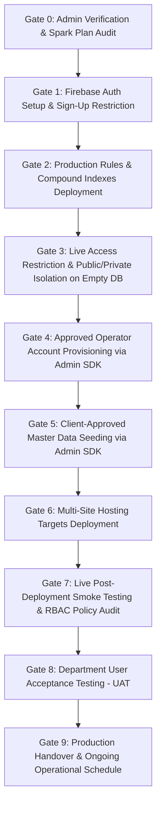
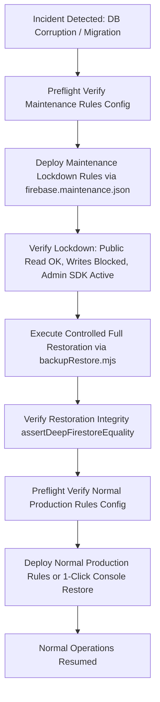

# SIMAK DISKUM v5.0 — Controlled Production Activation Plan & Preflight Guide

**Client:** Dinas Koperasi dan Usaha Mikro Kota Batam  
**System Version:** 5.0.0  
**Target Architecture:** Firebase Multi-site Hosting (`public` & `admin`) + Cloud Firestore Standard Edition on **Firebase Spark (Zero-Cost Plan, $0.00/month)**  
**Target Project:** `simakdiskum`  
**Public Portal URL:** `https://simakdiskum.web.app`  
**Admin Portal URL:** `https://simakdiskum-admin.web.app`  
**Milestone:** **P02-A Controlled Production Activation Planning (Final Sign-Off)**  
**Document Status:** CONDITIONAL PREFLIGHT APPROVED — PRODUCTION ACTIVATION ON HOLD (Awaiting Client Category 2 Approvals & Admin Web Login Implementation)  

---

## 1. Executive Summary & Activation Invariants

This document establishes the precise, phase-by-phase production activation sequence for SIMAK DISKUM v5.0 on Google Cloud / Firebase project `simakdiskum`.

> [!CAUTION]
> **HONEST PREFLIGHT READINESS BOUNDARY:**  
> The SIMAK DISKUM v5.0 software artifacts, build pipelines, security rules, and administrative tooling are **100% verified locally** across **214 Vitest automated tests (25 test files)**, **38 Firestore Security Rules tests**, and **79 Playwright real-browser scenarios**.  
> However, **NO LIVE DEPLOYMENT OR ACCOUNT CREATION MAY OCCUR** until the Dinas Koperasi dan Usaha Mikro Kota Batam delivers the required official administrative items (Category 2: Head of Department Signatory decree, employee directory, and authorized civil servant email roster), and the client-side Admin login/recovery web interfaces are mounted.

### Strict Activation Invariants:
1. **Zero Financial Cost ($0.00/month):** The production deployment operates strictly within the perpetual free tier of the **Firebase Spark Plan**. No Blaze billing account may be linked.
2. **Explicit Stop/Go Decision Gates:** Every phase that introduces changes to Google Cloud or Firebase requires explicit, recorded stakeholder authorization before proceeding.
3. **No Synthetic Data in Production:** All synthetic test data, `[DEMO]` markers, and sample records are strictly quarantined to local development emulators. Only client-approved civil service records may enter production.
4. **Deterministic Security Rules Deployment:**
   - Normal production rules are deployed deterministically using `firebase.json` (`firebase/firestore.rules`), tagged with release identity `SIMAK_DISKUM_PRODUCTION_SECURITY_RULES_V5`.
   - Emergency maintenance lockdown rules are deployed deterministically using `--config firebase.maintenance.json` (`firebase/firestore.maintenance.rules`), tagged with release identity `SIMAK_DISKUM_MAINTENANCE_LOCKDOWN_RULES_V5`.
   - `firebase.json` is **NEVER** modified temporarily during operations.
   - Every rules deployment must be preceded by automated preflight validation (`node scripts/verifyRulesSource.mjs`).
5. **Published Rules Content Verification Beyond Identity Comments:**
   - Verification of deployed rules cannot rely solely on the `RELEASE_IDENTITY` header comment.
   - Deployed rules must be compared character-for-character against approved Git-tagged `firebase/firestore.rules` using cryptographic SHA-256 checksum matching, line-count comparison, and active endpoint permission probing.
6. **Separation of First-Time Setup vs Disaster Recovery:** First-time production activation deploys standard production rules to an empty database before operator accounts or master data are introduced. Maintenance lockdown is quarantined strictly to emergency disaster recovery and major structural migrations.
7. **Confidentiality of Departmental Documents:** Google Drive storage for incoming invitation letters is configured with **Restricted** access, shared strictly with authorized municipal accounts / Google Group. Private Drive URLs and letter metadata are strictly excluded from `publicActivities`, public JSON payloads, and public DOM elements.
8. **Credential Disclosure Safeguards & Native Email Preference:**
   - Runbooks and administrative scripts use generic municipal placeholders (`<APPROVED_ADMIN_EMAIL>`, `<APPROVED_OPERATOR_EMAIL>`).
   - Operator provisioning uses passwordless random entropy.
   - When one-time administrative setup links are printed to the interactive console, operators must ensure this output is delivered directly and **never** captured in shared logs, shell history, or unapproved communication channels.
   - Firebase native password reset emails are preferred wherever supported (Spark free quota: 150 emails/day, subject to Google Cloud limits).
9. **Finite Spark Quotas & Graceful Degradation:** Cloud Firestore daily free quotas (50,000 reads/day, 20,000 writes/day) reset daily at **15:00 WIB (PST) / 14:00 WIB (PDT)**. If client traffic exceeds 50,000 reads, the application degrades gracefully by displaying an informative Indonesian HTTP 429 quota notice modal without crashing the application shell.

---

## 2. Activation Architecture & Quota Allocations

```mermaid
flowchart TD
    subgraph Client Tier [Client Tier - Civic Web Applications]
        PUB["Public Portal (Citizens / Agencies)<br/>https://simakdiskum.web.app"]
        ADM["Admin Portal (Staff / Operators)<br/>https://simakdiskum-admin.web.app"]
    end

    subgraph Firebase Cloud [Firebase Production Platform - Project: simakdiskum (Spark $0/mo)]
        direction TB
        FHOST["Firebase Hosting (2 Sites)<br/>Global CDN (10 GB/month transfer)"]
        FCONF["Firebase Auth (Spark Free)<br/>Email/Password (Public Sign-up DISABLED)<br/>150 reset emails/day (subject to GCP limits)"]
        FSTORE["Cloud Firestore Standard Edition<br/>50k reads/day | 20k writes/day | 1 GB storage"]
        FINDEX["Compound Indexes<br/>activities & publicActivities (Enabled)"]
        FRULES["Security Rules (RBAC)<br/>SIMAK_DISKUM_PRODUCTION_SECURITY_RULES_V5<br/>SHA-256: 444b48ba8e9d5979..."]
    end

    subgraph External Municipal [External Municipal Resources]
        GDRIVE["Batam Municipal Google Drive<br/>RESTRICTED Access (Authorized Department Group Only)<br/>ZERO links leaked to Public Portal"]
        ADMIN_CLI["System Maintenance CLI (ADC)<br/>verifyRulesSource.mjs | manageRoles.mjs | backupRestore.mjs"]
    end

    PUB --> FHOST
    PUB -->|Sanitized Read Only (Zero Drive URLs)| FSTORE
    ADM --> FHOST
    ADM -->|Authenticated RBAC| FCONF
    ADM -->|CRUD with Optimistic Version Lockstep| FSTORE
    ADM -.->|Restricted Document Access| GDRIVE
    ADMIN_CLI ==>|Admin SDK Privileged Access| FSTORE
    ADMIN_CLI ==>|Admin SDK Role Provisioning| FCONF
    FRULES -.->|Enforces Access & Version Lockstep| FSTORE
    FINDEX -.->|Accelerates Multi-Month Queries| FSTORE
```

---

## 3. Part 1 — Initial Production Activation Sequence

The initial activation sequence follows **10 sequential gates** executed in strict dependency order. Every gate has explicit preflight requirements, verification commands, and a **Stop/Go Decision Gate**.



---

### Gate 0 — Pre-Activation Administrative Verification & Spark Plan Audit

| Field | Detail |
|---|---|
| **Objective** | Verify GCP project ownership, confirm Spark billing limits ($0.00/mo), and validate build outputs. |
| **Tooling** | Google Cloud Console, Firebase Console, Git, Local Shell. |
| **Prerequisites** | Project administrator access to GCP project `simakdiskum`. |

#### Procedure:
1. **Confirm Project Ownership & Permissions:**
   - Log in to [Firebase Console](https://console.firebase.google.com/project/simakdiskum).
   - Verify that the designated Department IT Officer holds the `Owner` or `Editor` IAM role.
2. **Audit Billing Plan (Spark Free Plan Enforcement):**
   - Open **Firebase Console > Project Settings > Usage and billing**.
   - **CONFIRM:** Plan is displayed as **Spark ($0.00 / month)**.
   - Ensure no credit card or Google Cloud Billing Account is attached.
3. **Verify Hosting Multi-Site Targets:**
   - Open **Firebase Console > Hosting**.
   - Verify that two distinct hosting sites exist:
     - `simakdiskum` (Default site, intended for Public Portal).
     - `simakdiskum-admin` (Secondary site, intended for Admin Portal).
   - If `simakdiskum-admin` does not exist, create it in Firebase Console under **Hosting > Add another site**.
4. **Verify Local Production Build Outputs:**
   ```bash
   cd department-agenda-firebase
   npm run build
   ```
   - Verify `apps/public/dist/index.html` exists and JS shell is ~49.16 kB (13.67 kB gzip).
   - Verify `apps/admin/dist/index.html` exists and JS shell is ~13.99 kB (4.70 kB gzip).

> [!IMPORTANT]
> **STOP/GO DECISION GATE 0:**  
> **Go Criteria:** `simakdiskum` verified on Spark plan ($0/mo); two Hosting sites confirmed; build passes cleanly with zero errors.  
> **No-Go Action:** Halt. Do not proceed if project ID differs, Blaze billing is active, or build artifacts fail.

---

### Gate 1 — Firebase Authentication Setup & Disabling of Public Sign-Up

| Field | Detail |
|---|---|
| **Objective** | Enable Email/Password provider while permanently blocking public self-registration. |
| **Tooling** | Firebase Console (Authentication section). |
| **Prerequisites** | Gate 0 approval. |

#### Procedure:
1. **Enable Email/Password Sign-In Provider:**
   - Navigate to **Firebase Console > Authentication > Sign-in method**.
   - Click **Add new provider** $\rightarrow$ select **Email/Password**.
   - Enable **Email/Password** toggle. Leave **Email link (passwordless sign-in)** disabled.
   - Click **Save**.
2. **Permanently Disable End-User Self-Registration:**
   - Navigate to **Authentication > Settings > User actions**.
   - **UNCHECK:** `Enable create (sign-up)`.
   - Click **Save**.
   - *Technical Impact:* This blocks all client-side calls to `createUserWithEmailAndPassword()` across both web apps with error `auth/admin-restricted-operation`. Only Admin SDK scripts using administrative service credentials can provision accounts.
3. **Verify Password Reset Capabilities on Spark Plan:**
   - On the Firebase Spark plan, standard Firebase Auth password reset emails are fully supported via Firebase's built-in mailer (`noreply@simakdiskum.firebaseapp.com`), subject to a daily quota of **150 emails/day** (quotas subject to Google Cloud limits).
   - Operators should trigger password reset emails directly from the web interface wherever supported.
   - The administrative CLI (`node scripts/manageRoles.mjs reset-password <email> --target=prod`) generates out-of-band password-setup links as a secondary administrative fallback for government environments with aggressive email spam filtering.

> [!IMPORTANT]
> **STOP/GO DECISION GATE 1:**  
> **Go Criteria:** Email/Password enabled; "Enable create (sign-up)" verified UNCHECKED; self-registration impossible from web clients.  
> **No-Go Action:** Halt. Do not proceed until public signup is provably disabled.

---

### Gate 2 — Initial Production Firestore Security Rules & Compound Indexes Deployment

| Field | Detail |
|---|---|
| **Objective** | Deploy approved production security rules and build compound indexes on the empty database before data or clients are introduced. |
| **Tooling** | Firebase CLI, `scripts/verifyRulesSource.mjs`. |
| **Prerequisites** | Gate 1 approval. |

#### Procedure:
1. **Preflight Rules Verification:**
   Before running any Firebase CLI deployment command, verify the target rules configuration:
   ```bash
   cd department-agenda-firebase
   node scripts/verifyRulesSource.mjs --target=prod
   ```
   *Expected Output:*
   ```text
   ======================================================================
   [SIMAK DISKUM] FIRESTORE RULES DEPLOYMENT PREFLIGHT INSPECTION
   Config File:        firebase.json
   Rules Source:       firebase/firestore.rules
   Release Identity:   SIMAK_DISKUM_PRODUCTION_SECURITY_RULES_V5
   Rules SHA-256:      444b48ba8e9d5979b0845e997babe9a728fefc930e3f03bab35da91e11570678
   Line Count:         707 lines
   Deployment Mode:    PRODUCTION_NORMAL
   Target Project:     simakdiskum
   Routine Safe:       YES (Normal production writes)
   ----------------------------------------------------------------------
   Exact Deterministic CLI Command:
     firebase deploy --only firestore:rules --project simakdiskum
   ======================================================================
   ```
2. **Deploy Production Security Rules:**
   ```bash
   firebase deploy --only firestore:rules --project simakdiskum
   ```
3. **Published Rules Content Verification Protocol (Beyond Header Comments):**
   Relying solely on the `RELEASE_IDENTITY` header comment is insufficient to prove rule integrity. Verify the published ruleset using the following 3-step verification protocol:
   - **Step A: Cryptographic Hash & Line Count Check:**
     Verify that the published rules in [Firebase Console Rules Editor](https://console.firebase.google.com/project/simakdiskum/firestore/rules) match the local SHA-256 checksum (`444b48ba8e9d5979b0845e997babe9a728fefc930e3f03bab35da91e11570678`) and exact line count (707 lines).
   - **Step B: Semantic Content Diff:**
     Copy the live published text from Firebase Console into a verification file (e.g., `temp_published.rules`) and execute:
     ```bash
     git diff --no-index firebase/firestore.rules temp_published.rules
     ```
     Confirm exit code 0 and zero differences.
   - **Step C: Live Permission Probes:**
     Probe the live endpoint:
     - Unauthenticated write to `publicActivities` $\rightarrow$ rejected with `PERMISSION_DENIED`.
     - Unauthenticated read to `publicActivities` $\rightarrow$ allowed (returns empty array).
     - Unauthenticated read to `activities` $\rightarrow$ rejected with `PERMISSION_DENIED`.
4. **Deploy Firestore Compound Indexes:**
   ```bash
   firebase deploy --only firestore:indexes --project simakdiskum
   ```
   *Deployed Indexes (`firestore.indexes.json`):*
   - `activities`: `startDate ASC, endDate ASC, __name__ ASC`
   - `publicActivities`: `startDate ASC, endDate ASC, __name__ ASC`
   - `publicActivities`: `isPublic ASC, startDate ASC, __name__ ASC`
5. **Monitor Index Build Completion:**
   - Open [Firebase Console Indexes Tab](https://console.firebase.google.com/project/simakdiskum/firestore/indexes).
   - **WAIT:** Compound indexes will show status `Building` for 2–10 minutes.
   - **DO NOT PROCEED** until all indexes transition to status **`Enabled`**.

> [!IMPORTANT]
> **STOP/GO DECISION GATE 2:**  
> **Go Criteria:** Production rules verified character-for-character via SHA-256 and published; all compound indexes show status **`Enabled`**; 0 build errors.  
> **No-Go Action:** Halt. Do NOT proceed to client deployment or data operations while indexes are `Building`.

---

### Gate 3 — Live Access Restriction & Public/Private Isolation Verification on Empty Database

| Field | Detail |
|---|---|
| **Objective** | Verify that security rules actively protect the empty database before operator accounts or master records are created. |
| **Tooling** | Browser DevTools Console / Postman / cURL. |
| **Prerequisites** | Gate 2 approval (Rules published and verified; Indexes `Enabled`). |

#### Procedure:
1. **Test Unauthenticated Write Rejection:**
   - Attempt an unauthenticated write to `publicActivities` or `activities` via REST/SDK.
   - Verify that Cloud Firestore rejects the operation with `PERMISSION_DENIED`.
2. **Test Public Read Cleanliness:**
   - Execute an unauthenticated read against `publicActivities`.
   - Verify that the query returns an empty collection cleanly with HTTP 200 / empty snapshot, with zero errors and zero leaked metadata.
3. **Test Private Collection Shielding:**
   - Attempt an unauthenticated read against `activities`, `employees`, `settings`, or `auditLogs`.
   - Verify that all private collections return `PERMISSION_DENIED`.

> [!IMPORTANT]
> **STOP/GO DECISION GATE 3:**  
> **Go Criteria:** Live database proves unauthenticated writes are blocked and private collections are completely inaccessible.  
> **No-Go Action:** Halt immediately if any private collection permits unauthenticated access.

---

### Gate 4 — Approved Operator Account Provisioning via Admin SDK

| Field | Detail |
|---|---|
| **Objective** | Provision initial authorized Admin and Editor accounts using Admin SDK CLI with passwordless random entropy. |
| **Tooling** | `department-agenda-firebase/scripts/manageRoles.mjs` (ADC). |
| **Prerequisites** | Gate 3 approval; official civil service email roster approved in writing by Head of Department. |

#### Procedure:
1. **Set Environment Safeguards:**
   ```bash
   cd department-agenda-firebase
   unset FIREBASE_AUTH_EMULATOR_HOST
   export GCLOUD_PROJECT="simakdiskum"
   ```
2. **Provision System Administrator (Kepala Dinas / Lead IT Admin):**
   ```bash
   node scripts/manageRoles.mjs provision "<APPROVED_ADMIN_EMAIL>" "Administrator DISKUM" admin --target=prod
   ```
3. **Provision Agenda Operators (Editors):**
   ```bash
   node scripts/manageRoles.mjs provision "<APPROVED_OPERATOR_1_EMAIL>" "Operator Agenda 1" editor --target=prod
   node scripts/manageRoles.mjs provision "<APPROVED_OPERATOR_2_EMAIL>" "Operator Agenda 2" editor --target=prod
   ```
4. **Verify Custom Claims Attachment:**
   ```bash
   node scripts/manageRoles.mjs inspect "<APPROVED_ADMIN_EMAIL>" --target=prod
   node scripts/manageRoles.mjs inspect "<APPROVED_OPERATOR_1_EMAIL>" --target=prod
   ```
   - Verify output confirms:
     - `Custom Claims: { role: "admin", department: "Dinas Koperasi dan Usaha Mikro Kota Batam" }`
     - `Disabled: false`
5. **Credential Disclosure Safeguards & Link Delivery:**
   - The CLI outputs a one-time administrative setup link directly to the interactive terminal.
   - **MANDATORY SAFEGUARD:** Operators running the CLI must **never** redirect this output to shared log files, persist it in shell command history, or transmit it over unapproved chat channels.
   - Prefer having operators reset their password via native Firebase email where feasible (150 emails/day Spark quota).
   - If using the CLI link, deliver it via secure municipal channels (official sealed memo / encrypted government channel).

> [!IMPORTANT]
> **STOP/GO DECISION GATE 4:**  
> **Go Criteria:** Real operator accounts provisioned; custom claims verified as `{ role: "admin" }` and `{ role: "editor" }`; zero hardcoded passwords used or logged.  
> **No-Go Action:** If claims fail to attach or wrong emails are used, disable accounts (`node scripts/manageRoles.mjs disable <email> --target=prod`) and halt.

---

### Gate 5 — Client-Approved Master Data Seeding & Signatory Setup

| Field | Detail |
|---|---|
| **Objective** | Seed verified municipal master data (employees, departments, locations, organizers, categories, signatory) into production Firestore under Admin SDK protection. |
| **Tooling** | `department-agenda-firebase/scripts/backupRestore.mjs`. |
| **Prerequisites** | Gate 4 approval; signed municipal decree (SK) approving official master data roster. |

#### Procedure:
1. **Audit Production Master Data Template:**
   - Inspect `department-agenda-firebase/templates/productionMasterDataTemplate.json`.
   - Verify all civil service metadata:
     - Head of Department Name, NIP, Rank/Golongan, and Official Title.
     - Employee directory names and NIPs (zero `[DEMO]` or synthetic markers).
     - Official room locations (Kantor Dinas, Ruang Rapat, Aula).
     - Official stakeholder organizers and event categories.
2. **Verify Client Approval Metadata:**
   - Confirm template contains:
     ```json
     {
       "clientApproved": true,
       "approvalReference": "SK/DISKUM/2026/04/AGENDA",
       "approvedBy": "Kepala Dinas Koperasi dan Usaha Mikro Kota Batam",
       "approvalDate": "2026-11-05"
     }
     ```
3. **Execute Production Master Data Seeding:**
   ```bash
   cd department-agenda-firebase
   unset FIRESTORE_EMULATOR_HOST
   export GCLOUD_PROJECT="simakdiskum"
   
   node scripts/backupRestore.mjs seed --env=prod --template=templates/productionMasterDataTemplate.json --target=prod
   ```
4. **Verify Seeded Data via Read-Only Export:**
   ```bash
   node scripts/backupRestore.mjs export ./backups/post_seed_verification --target=prod
   ```
   - Inspect `backups/post_seed_verification/manifest.json`.
   - Verify document counts: `employees` (verified count), `departments` (verified count), `locations` (verified count), `settings` (1 signatory record).

> [!IMPORTANT]
> **STOP/GO DECISION GATE 5:**  
> **Go Criteria:** Seeding utility validates `clientApproved: true`; zero placeholder markers present; signatory settings match official decree.  
> **No-Go Action:** Halt if template contains unpopulated placeholders or lacks written approval reference.

---

### Gate 6 — Multi-Site Hosting Targets Deployment

| Field | Detail |
|---|---|
| **Objective** | Deploy compiled web application bundles to their respective Firebase Hosting sites. |
| **Tooling** | Firebase CLI (`firebase deploy`). |
| **Prerequisites** | Gate 5 approval (Indexes `Enabled`, master data seeded). |

#### Critical Architecture Check (Admin Portal Auth Interface):
> [!WARNING]
> **PHYSICAL CODEBASE AUDIT FINDING (ADMIN LOGIN INTERFACE):**  
> Physical inspection of `apps/admin/src/` and `apps/admin/dist/` confirms that the Admin Portal bundle currently renders the administrative dashboard directly (`DashboardPage`, `ActivitiesPage`, etc.) without a client-side authentication gate (`signInWithEmailAndPassword` / `sendPasswordResetEmail`).  
> **BLOCKER:** Before live operators are granted access in Milestone P02-B, a dedicated client-side login view and password recovery modal must be mounted in `apps/admin/src/main.ts`.

#### Procedure:
1. **Verify `firebase.json` Multi-Site Targets:**
   - Confirm target configuration:
     - `target: "public"` $\rightarrow$ `apps/public/dist` (Site: `simakdiskum`)
     - `target: "admin"` $\rightarrow$ `apps/admin/dist` (Site: `simakdiskum-admin`)
2. **Execute Multi-Site Hosting Deployment:**
   ```bash
   cd department-agenda-firebase
   firebase deploy --only hosting:public,hosting:admin --project simakdiskum
   ```
3. **Edge CDN Propagation Window:**
   - Allow **1 to 5 minutes** for new static files to propagate across Google/Fastly global edge nodes.
4. **Verify Live Endpoints (Incognito Window):**
   - Public Portal: Open `https://simakdiskum.web.app` (Batam crest, Barelang Bridge banner, 4 summary cards).
   - Admin Portal: Open `https://simakdiskum-admin.web.app` (Administrative interface; verify SSL certificates and HTTP 200).

> [!IMPORTANT]
> **STOP/GO DECISION GATE 6:**  
> **Go Criteria:** Both sites return HTTP 200; DevTools console displays 0 uncaught JavaScript errors; SSL certificates active.  
> **No-Go Action:** If a frontend crash occurs, execute 1-click rollback in Firebase Console Hosting tab and halt.

---

### Gate 7 — Live Post-Deployment Smoke Testing & RBAC Policy Audit

| Field | Detail |
|---|---|
| **Objective** | Perform live browser smoke testing of authentication, RBAC boundaries, and public/private isolation. |
| **Tooling** | Chrome / Edge / Safari (Desktop & Mobile viewports). |
| **Prerequisites** | Gate 6 approval (Hosting deployed). |

#### Procedure:
1. **Public Privacy Audit (Live HTTP Inspection):**
   - Open `https://simakdiskum.web.app`.
   - Inspect Network tab for all Firestore requests.
   - Verify requests query `publicActivities` exclusively. Zero queries to `activities` or `auditLogs`.
   - Inspect DOM elements: 0 raw database IDs (`act_xx`, `emp_xx`, `loc_xx`), 0 internal meeting URLs/passcodes, 0 invitation letter Google Drive links.
2. **Editor Administrative Pipeline Smoke Test:**
   - Open `https://simakdiskum-admin.web.app`.
   - Create test activity in Stage 1 (`INITIAL_ENTRY`). Verify nonblocking warnings for missing attendees/notes.
   - Advance activity through Stage 2 (`OFFLINE_PROCESS`), Stage 3 (`DETAILS_COMPLETED`), and Stage 4 (`ADMIN_COMPLETE`).
   - Verify that completing Stage 4 projects sanitized record into `publicActivities` with synchronized version number.
3. **RBAC Least-Privilege Verification:**
   - As Editor: Attempt to access **Master Data** page. Verify read-only access (Add/Edit buttons disabled or rejected by rules).
   - As Editor: Attempt to access **Pengaturan / Settings**. Verify modification is blocked.
   - Log in as Admin: Verify full access to Master Data CRUD, Official Signatory settings, and Audit Log inspection.
4. **Official 8-Column Report Smoke Test:**
   - As Admin: Generate official report for current month.
   - Click **Cetak Dokumen (A4 Landscape)**: Verify Kop Surat, 8 columns, and Signatory block.
   - Click **Ekspor Excel (.xlsx)**: Verify downloaded file is a genuine OpenXML XLSX spreadsheet with sanitized cells.

> [!IMPORTANT]
> **STOP/GO DECISION GATE 7:**  
> **Go Criteria:** All smoke tests pass; Editor cannot modify master data; public portal exhibits 0 private leaks; 8-column export verified.  
> **No-Go Action:** Halt if any private metadata leaks or if role permissions deviate from specification.

---

### Gate 8 — Department User Acceptance Testing (UAT)

| Field | Detail |
|---|---|
| **Objective** | Authorized department operators execute the 11 formal business scenarios. |
| **Tooling** | Real municipal computers and mobile devices. |
| **Prerequisites** | Gate 7 approval. |

#### Procedure:
- Authorized operators execute all 11 scenarios defined in `docs/USER_ACCEPTANCE_TEST_PLAN.md`:
  1. *Scenario 1:* Input Awal (Stage 1) from incoming invitation letter.
  2. *Scenario 2:* Proses Offline (Stage 2) disposition review.
  3. *Scenario 3:* Detail Dilengkapi (Stage 3) room & attendee assignment.
  4. *Scenario 4:* Conflict engine warning on room/attendee collision.
  5. *Scenario 5:* Administrasi Lengkap (Stage 4) validation and publication.
  6. *Scenario 6:* Backward stage regression with audit logging.
  7. *Scenario 7:* Public portal calendar navigation (Month, Week, Day, List).
  8. *Scenario 8:* Citizen search and activity detail inspection.
  9. *Scenario 9:* Official 8-column landscape print report generation.
  10. *Scenario 10:* Official OpenXML spreadsheet export.
  11. *Scenario 11:* Master data modification by Administrator.

> [!IMPORTANT]
> **STOP/GO DECISION GATE 8:**  
> **Go Criteria:** Department Head and designated operators sign the UAT Acceptance Form with zero critical blocking defects.  
> **No-Go Action:** Address any reported usability or data defects before declaring production operational status.

---

### Gate 9 — Production Handover & Ongoing Operational Procedures

| Field | Detail |
|---|---|
| **Objective** | Transition system to live daily operations with established backup and monitoring routines. |
| **Tooling** | Daily CLI export, Firebase Console monitoring. |
| **Prerequisites** | Gate 8 approval. |

#### Operational Schedule:
1. **Daily Logical Database Backup:**
   - Execute daily export at the end of every business day (e.g. 17:00 WIB):
     ```bash
     cd department-agenda-firebase
     node scripts/backupRestore.mjs export ./backups/backup_$(Get-Date -Format 'yyyyMMdd') --target=prod
     ```
   - Transfer backup archive to encrypted municipal storage. Retain 30 daily snapshots.
2. **Daily Firestore Quota Monitoring:**
   - Monitor daily read consumption (50k limit resets at **15:00 WIB** during PST / **14:00 WIB** during PDT).
3. **Emergency Incident Protocol:**
   - If security breach or credential compromise occurs:
     ```bash
     node scripts/manageRoles.mjs disable <compromised_email> --target=prod
     ```
   - If database corruption occurs, initiate disaster recovery maintenance lockdown and execute controlled restoration (see Part 2).

---

## 4. Part 2 — Disaster Recovery & Scheduled Maintenance Lockdown Procedure

Maintenance lockdown rules are **quarantined strictly to emergency disaster recovery, major structural migrations, and database restoration**. They are **NOT** used during normal day-to-day operations or initial setup.



### 4.1 When to Activate Maintenance Lockdown
Activate maintenance lockdown ONLY when:
1. Cloud Firestore records have suffered data corruption, requiring a full rollback restoration.
2. An unauthorized batch script has modified records outside normal RBAC channels.
3. A major offline structural data migration is being executed by the IT Administrator.

### 4.2 Deterministic Maintenance Rules Deployment
Never edit `firebase.json` directly. Use the dedicated maintenance configuration:

1. **Preflight Verification:**
   ```bash
   cd department-agenda-firebase
   node scripts/verifyRulesSource.mjs --config=firebase.maintenance.json --target=prod
   ```
2. **Deploy Maintenance Lockdown:**
   ```bash
   firebase deploy --config firebase.maintenance.json --only firestore:rules --project simakdiskum
   ```
3. **Verify Lockdown Invariants:**
   - **Public Read Access:** Citizens navigating to public schedules receive live read data without errors (`allow read: if true`).
   - **Client Write Freeze:** All client-side write operations across all collections are rejected with `PERMISSION_DENIED` (`allow write: if false`).
   - **Admin SDK Exemption:** Administrative scripts (`backupRestore.mjs`) connect via Google Cloud credentials and bypass rules entirely.

### 4.3 Controlled Restoration Execution
```bash
# Step 1: Status check
node scripts/backupRestore.mjs status ./backups/<backup_folder> --target=prod

# Step 2: Dry-run diff analysis
node scripts/backupRestore.mjs restore ./backups/<backup_folder> --mode=full --dry-run --target=prod

# Step 3: Execute controlled full restoration with explicit review confirmation
node scripts/backupRestore.mjs restore ./backups/<backup_folder> --mode=full --force --dry-run-reviewed --target=prod
```

### 4.4 Deterministic Return to Normal Production Rules
Once restoration and verification are complete, return Firestore to normal production security rules:

1. **Preflight Verification:**
   ```bash
   node scripts/verifyRulesSource.mjs --target=prod
   ```
2. **Deploy Production Rules:**
   ```bash
   firebase deploy --only firestore:rules --project simakdiskum
   ```
3. **Manual Rollback Alternative via Firebase Console:**
   If CLI access is unavailable, an administrator can manually restore normal production rules in **Firebase Console > Firestore > Rules > Rules history > Restore version > Publish**.  
   *(Note: This is a manual action executed by an authorized administrator, not an automatic background reversion).*

---

## 5. Final Verification Summary Matrix

| Phase | Milestone Action | Safety Guard | Reversible? | Authority Required |
|:---:|---|---|:---:|---|
| **0** | Pre-Activation Admin Verification | Spark Plan Audit ($0/mo) | N/A (Read-only) | Lead Engineer |
| **1** | Auth Config & Signup Restriction | "Enable create" unchecked; 150 reset quota | Yes | Project Owner |
| **2** | Rules & Indexes Deployment | SHA-256 content verification; Indexes `Enabled` | Yes (Rules history) | Lead Systems Architect |
| **3** | Empty DB Access Restriction Verification | Live write freeze & empty read check | N/A (Read-only) | QA Engineer |
| **4** | Operator Account Provisioning | Passwordless random entropy | Yes (`disable`) | Department Head |
| **5** | Master Data Seeding | Client approval flag gate | Yes (Rollback restore) | Department Head |
| **6** | Hosting Targets Deployment | Multi-site separation | Yes (1-click rollback) | Release Manager |
| **7** | Post-Deployment Smoke Audit | Zero private leaks; 0 Drive URLs | N/A (Read/Test) | QA Engineer |
| **8** | Department UAT Execution | 11 business scenarios | N/A (User testing) | Department Stakeholders |
| **9** | Production Handover | Daily backup schedule | N/A (Handover) | Department Head & IT Head |
| **DR** | Maintenance Lockdown | Public reads preserved; writes frozen | Yes (Redeploy normal rules) | Lead Systems Architect |
