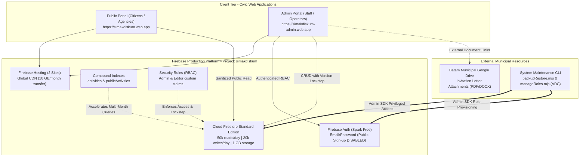
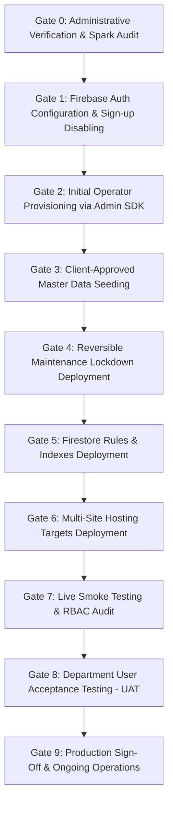

# SIMAK DISKUM v5.0 — Controlled Production Activation Plan & Preflight Guide

**Client:** Dinas Koperasi dan Usaha Mikro Kota Batam  
**System Version:** 5.0.0  
**Target Architecture:** Firebase Multi-site Hosting (`public` & `admin`) + Cloud Firestore Standard Edition on **Firebase Spark (Zero-Cost Plan, $0.00/month)**  
**Target Project:** `simakdiskum`  
**Public Portal URL:** `https://simakdiskum.web.app`  
**Admin Portal URL:** `https://simakdiskum-admin.web.app`  
**Milestone:** **P02-A Controlled Production Activation Planning**  
**Document Status:** P02-A PLANNING ONLY — NO LIVE DEPLOYMENT PERMITTED WITHOUT GATE SIGN-OFF  

---

## 1. Executive Summary & Activation Invariants

This document establishes the precise, phase-by-phase production activation sequence for SIMAK DISKUM v5.0 on Google Cloud / Firebase project `simakdiskum`. 

### Strict Activation Invariants:
1. **Zero Financial Cost ($0.00/month):** The production deployment operates strictly within the perpetual free tier of the **Firebase Spark Plan**. No Blaze billing account may be linked.
2. **Explicit Stop/Go Decision Gates:** Every phase that introduces changes to Google Cloud or Firebase requires explicit, recorded stakeholder authorization before proceeding.
3. **No Synthetic Data in Production:** All synthetic test data, `[DEMO]` markers, and sample records are strictly quarantined to local development emulators. Only client-approved civil service records may enter production.
4. **Reversible Maintenance Shield:** A tested, reversible maintenance security ruleset protects Cloud Firestore from concurrent client mutations during restoration and setup.
5. **Separation of Control Planes:** Deployments occur sequentially (Rules $\rightarrow$ Indexes $\rightarrow$ Hosting) to prevent race conditions where web clients query unindexed database collections.

---

## 2. Activation Architecture & Quota Allocations



---

## 3. Step-by-Step Production Activation Sequence

The activation sequence consists of **10 sequential phases**. Each phase contains explicit verification criteria and an actionable **Stop/Go Decision Gate**.



---

### Phase 0 — Pre-Activation Administrative Verification & Spark Plan Audit

| Field | Detail |
|---|---|
| **Objective** | Verify project ownership, confirm Spark billing limits, and validate build outputs. |
| **Tooling** | Google Cloud Console, Firebase Console, Git, Local Shell. |
| **Prerequisites** | Project administrator access to GCP project `simakdiskum`. |

#### Procedure:
1. **Confirm Project Ownership & Permissions:**
   - Log in to [Firebase Console](https://console.firebase.google.com/project/simakdiskum).
   - Verify that the designated Department IT Officer holds the `Owner` or `Editor` IAM role.
2. **Audit Billing Plan (Spark Free Plan Enforcement):**
   - Open **Firebase Console > Project Settings > Usage and billing**.
   - **CONFIRM:** Plan is displayed as **Spark ($0.00 / month)**.
   - Ensure no credit card or Google Cloud Billing Account is attached that could incur unexpected charges.
3. **Verify Hosting Multi-Site Targets:**
   - Open **Firebase Console > Hosting**.
   - Verify that two distinct hosting sites exist:
     - `simakdiskum` (Default site, intended for Public Portal).
     - `simakdiskum-admin` (Secondary site, intended for Admin Portal).
   - If `simakdiskum-admin` does not exist, create it in Firebase Console under **Hosting > Add another site**.
4. **Verify Local Production Build Outputs:**
   ```bash
   cd department-agenda-firebase
   npm run build
   ```
   - Verify `apps/public/dist/index.html` exists and JS shell is ~49.16 kB (13.67 kB gzip).
   - Verify `apps/admin/dist/index.html` exists and JS shell is ~13.99 kB (4.70 kB gzip).

> [!IMPORTANT]
> **STOP/GO DECISION GATE 0:**  
> **Go Criteria:** `simakdiskum` verified on Spark plan ($0/mo); two Hosting sites confirmed; build passes cleanly with zero errors.  
> **No-Go Action:** Halt. Do not proceed if project ID differs, Blaze billing is active, or build artifacts fail.

---

### Phase 1 — Firebase Authentication Configuration & Sign-Up Restrictions

| Field | Detail |
|---|---|
| **Objective** | Enable Email/Password provider while permanently blocking public self-registration. |
| **Tooling** | Firebase Console (Authentication section). |
| **Prerequisites** | Gate 0 approval. |

#### Procedure:
1. **Enable Email/Password Sign-In Provider:**
   - Navigate to **Firebase Console > Authentication > Sign-in method**.
   - Click **Add new provider** $\rightarrow$ select **Email/Password**.
   - Enable **Email/Password** toggle. Leave **Email link (passwordless sign-in)** disabled.
   - Click **Save**.
2. **Permanently Disable End-User Self-Registration:**
   - Navigate to **Authentication > Settings > User actions**.
   - **UNCHECK:** `Enable create (sign-up)`.
   - Click **Save**.
   - *Technical Impact:* This blocks all client-side calls to `createUserWithEmailAndPassword()` across both web apps with error `auth/admin-restricted-operation`. Only Admin SDK scripts using administrative service credentials can provision accounts.
3. **Verify Password Reset Policy & Limitations:**
   - On the Spark free plan, automated SMTP relay from Google is limited.
   - Password reset links will be generated securely via CLI (`manageRoles.mjs reset-password`) and delivered out-of-band via official municipal channels (Government WhatsApp / Official Department Memo).

> [!IMPORTANT]
> **STOP/GO DECISION GATE 1:**  
> **Go Criteria:** Email/Password enabled; "Enable create (sign-up)" verified UNCHECKED; self-registration impossible from web clients.  
> **No-Go Action:** Halt. Do not proceed to user creation until public signup is provably disabled.

---

### Phase 2 — Initial Operator Provisioning & Custom Role Claims

| Field | Detail |
|---|---|
| **Objective** | Provision initial authorized Admin and Editor accounts using Admin SDK CLI with custom claims. |
| **Tooling** | `department-agenda-firebase/scripts/manageRoles.mjs` (ADC or Service Account). |
| **Prerequisites** | Gate 1 approval; written list of authorized civil servant email addresses signed by Department Head. |

#### Procedure:
1. **Set Environment Safeguards:**
   ```bash
   cd department-agenda-firebase
   # Ensure emulator environment variable is unset
   unset FIREBASE_AUTH_EMULATOR_HOST
   export GCLOUD_PROJECT="simakdiskum"
   ```
2. **Provision System Administrator (Kepala Dinas / Lead Admin):**
   ```bash
   # Provision Admin account (temporary password must meet civic complexity standards)
   node scripts/manageRoles.mjs provision "admin.diskum@batam.go.id" "InitialComplexP@ss2026!" "Administrator DISKUM" admin --target=prod
   ```
3. **Provision Agenda Operators (Editors):**
   ```bash
   # Provision Operator 1
   node scripts/manageRoles.mjs provision "operator1.agenda@batam.go.id" "InitialComplexP@ss2026!" "Operator Agenda 1" editor --target=prod
   
   # Provision Operator 2
   node scripts/manageRoles.mjs provision "operator2.agenda@batam.go.id" "InitialComplexP@ss2026!" "Operator Agenda 2" editor --target=prod
   ```
4. **Verify Custom Claims Attachment:**
   ```bash
   node scripts/manageRoles.mjs inspect "admin.diskum@batam.go.id" --target=prod
   node scripts/manageRoles.mjs inspect "operator1.agenda@batam.go.id" --target=prod
   ```
   - Verify that output confirms:
     - `Custom Claims: { role: "admin", department: "Dinas Koperasi dan Usaha Mikro Kota Batam" }`
     - `Disabled: false`
5. **Generate Secure Password Reset Links:**
   ```bash
   node scripts/manageRoles.mjs reset-password "admin.diskum@batam.go.id" --target=prod
   node scripts/manageRoles.mjs reset-password "operator1.agenda@batam.go.id" --target=prod
   ```
   - Deliver generated URLs directly to authorized personnel via confidential municipal channels.

> [!IMPORTANT]
> **STOP/GO DECISION GATE 2:**  
> **Go Criteria:** Real accounts created; custom claims verified as `{ role: "admin" }` and `{ role: "editor" }`; zero passwords logged to disk or console.  
> **No-Go Action:** If claims fail to attach or wrong emails are used, disable accounts (`node scripts/manageRoles.mjs disable <email> --target=prod`) and halt.

---

### Phase 3 — Client-Approved Master Data Seeding & Signatory Setup

| Field | Detail |
|---|---|
| **Objective** | Seed verified municipal master data (employees, departments, locations, organizers, categories, signatory) into production Firestore. |
| **Tooling** | `department-agenda-firebase/scripts/backupRestore.mjs`. |
| **Prerequisites** | Gate 2 approval; signed municipal decree (SK) approving official master data roster. |

#### Procedure:
1. **Audit Production Master Data Template:**
   - Inspect `department-agenda-firebase/templates/productionMasterDataTemplate.json`.
   - Verify all civil service metadata:
     - Head of Department Name, NIP, Rank/Golongan, and Official Title.
     - Employee directory names and NIPs (zero `[DEMO]` or synthetic markers).
     - Official room locations (Kantor Dinas, Ruang Rapat, Aula).
     - Official stakeholder organizers and event categories.
2. **Verify Client Approval Metadata:**
   - Confirm template contains:
     ```json
     {
       "clientApproved": true,
       "approvalReference": "SK/DISKUM/2026/04/AGENDA",
       "approvedBy": "Kepala Dinas Koperasi dan Usaha Mikro Kota Batam",
       "approvalDate": "2026-11-05"
     }
     ```
3. **Execute Production Master Data Seeding:**
   ```bash
   cd department-agenda-firebase
   unset FIRESTORE_EMULATOR_HOST
   export GCLOUD_PROJECT="simakdiskum"
   
   node scripts/backupRestore.mjs seed --env=prod --template=templates/productionMasterDataTemplate.json --target=prod
   ```
4. **Verify Seeded Data via Read-Only Export:**
   ```bash
   node scripts/backupRestore.mjs export ./backups/post_seed_verification --target=prod
   ```
   - Inspect `backups/post_seed_verification/manifest.json`.
   - Verify document counts: `employees` (verified count), `departments` (verified count), `locations` (verified count), `settings` (1 signatory record).

> [!IMPORTANT]
> **STOP/GO DECISION GATE 3:**  
> **Go Criteria:** Seeding utility validates `clientApproved: true`; zero placeholder markers present; signatory settings match official decree.  
> **No-Go Action:** Halt if template contains unpopulated placeholders or lacks written approval reference.

---

### Phase 4 — Reversible Maintenance Lockdown Activation

| Field | Detail |
|---|---|
| **Objective** | Shield Firestore with reversible maintenance security rules before deploying web applications or database indexes. |
| **Tooling** | Firebase CLI, `department-agenda-firebase/firebase/firestore.maintenance.rules`. |
| **Prerequisites** | Gate 3 approval. |

#### Procedure:
1. **Deploy Maintenance Security Rules:**
   ```bash
   cd department-agenda-firebase
   firebase deploy --project simakdiskum --only firestore:rules
   ```
   *(Note: Deploy using maintenance rules file by referencing `firestore.maintenance.rules` or setting rules file in `firebase.json`).*
2. **Verify Maintenance Lockdown Invariants:**
   - **Public Read Access:** Citizens navigating to public schedules receive live read data without errors (`allow read: if true`).
   - **Client Write Freeze:** All client-side write operations across all collections are rejected with `PERMISSION_DENIED` (`allow write: if false`).
   - **Admin SDK Exemption:** Administrative scripts (`backupRestore.mjs`) connect via Google Cloud credentials and bypass rules entirely.
3. **Document Auto-Reversion & Emergency Rollback:**
   - To immediately restore normal production rules at any point:
     ```bash
     firebase deploy --project simakdiskum --only firestore:rules
     ```
   - Rules can also be reverted in 1-click via **Firebase Console > Firestore > Rules > Rules history > Restore version**.

> [!IMPORTANT]
> **STOP/GO DECISION GATE 4:**  
> **Go Criteria:** Maintenance rules active; client writes blocked; public reads preserved; emergency rollback command confirmed.  
> **No-Go Action:** Halt if maintenance rules block Admin SDK operations or cause unhandled exceptions.

---

### Phase 5 — Production Firestore Security Rules & Compound Indexes Deployment

| Field | Detail |
|---|---|
| **Objective** | Deploy approved production security rules and build compound indexes prior to client activation. |
| **Tooling** | Firebase CLI (`firebase deploy`). |
| **Prerequisites** | Gate 4 approval; master data seeded. |

#### Procedure:
1. **Deploy Production Firestore Security Rules:**
   ```bash
   cd department-agenda-firebase
   firebase deploy --project simakdiskum --only firestore:rules
   ```
   - *Verification:* Open [Firebase Console Rules Tab](https://console.firebase.google.com/project/simakdiskum/firestore/rules). Verify deployment timestamp matches current time.
2. **Deploy Firestore Compound Indexes:**
   ```bash
   firebase deploy --project simakdiskum --only firestore:indexes
   ```
   - *Deployed Indexes (`firestore.indexes.json`):*
     - `activities`: `startDate ASC, endDate ASC, __name__ ASC`
     - `publicActivities`: `startDate ASC, endDate ASC, __name__ ASC`
     - `publicActivities`: `isPublic ASC, startDate ASC, __name__ ASC`
3. **Monitor Index Build Completion:**
   - Open [Firebase Console Indexes Tab](https://console.firebase.google.com/project/simakdiskum/firestore/indexes).
   - **WAIT:** Compound indexes will show status `Building` for 2–10 minutes.
   - **DO NOT PROCEED** until all indexes transition to status **`Enabled`**.

> [!IMPORTANT]
> **STOP/GO DECISION GATE 5:**  
> **Go Criteria:** Production rules published; all compound indexes show status **`Enabled`**; 0 index build errors.  
> **No-Go Action:** Halt. Do NOT deploy hosting targets while indexes are `Building`; newly deployed clients will throw `FAILED_PRECONDITION: The query requires an index`.

---

### Phase 6 — Multi-Site Hosting Targets Deployment

| Field | Detail |
|---|---|
| **Objective** | Deploy compiled web application bundles to their respective Firebase Hosting sites. |
| **Tooling** | Firebase CLI (`firebase deploy`). |
| **Prerequisites** | Gate 5 approval (all indexes `Enabled`). |

#### Procedure:
1. **Verify `firebase.json` Multi-Site Targets:**
   - Confirm target configuration:
     - `target: "public"` $\rightarrow$ `apps/public/dist` (Site: `simakdiskum`)
     - `target: "admin"` $\rightarrow$ `apps/admin/dist` (Site: `simakdiskum-admin`)
2. **Execute Multi-Site Hosting Deployment:**
   ```bash
   cd department-agenda-firebase
   firebase deploy --project simakdiskum --only hosting:public,hosting:admin
   ```
3. **Edge CDN Propagation Window:**
   - Allow **1 to 5 minutes** for new static files to propagate across Google/Fastly global edge nodes.
4. **Verify Live Endpoints (Incognito Window):**
   - Public Portal: Open `https://simakdiskum.web.app` (Batam crest, Barelang Bridge banner, 4 summary cards).
   - Admin Portal: Open `https://simakdiskum-admin.web.app` (Clean login screen, Batam crest, official branding).

> [!IMPORTANT]
> **STOP/GO DECISION GATE 6:**  
> **Go Criteria:** Both sites return HTTP 200; DevTools console displays 0 uncaught JavaScript errors; SSL certificates active.  
> **No-Go Action:** If a frontend crash occurs, execute 1-click rollback in Firebase Console Hosting tab and halt.

---

### Phase 7 — Live Post-Deployment Smoke Testing & RBAC Policy Audit

| Field | Detail |
|---|---|
| **Objective** | Perform live browser smoke testing of authentication, RBAC boundaries, and public/private isolation. |
| **Tooling** | Chrome / Edge / Safari (Desktop & Mobile viewports). |
| **Prerequisites** | Gate 6 approval. |

#### Procedure:
1. **Public Privacy Audit (Live HTTP Inspection):**
   - Open `https://simakdiskum.web.app`.
   - Inspect Network tab for all Firestore requests.
   - Verify that requests query `publicActivities` exclusively. Zero queries to `activities` or `auditLogs`.
   - Inspect DOM elements: 0 raw database IDs (`act_xx`, `emp_xx`, `loc_xx`), 0 internal meeting URLs/passcodes, 0 invitation letter Google Drive links.
2. **Editor Authentication & Administrative Pipeline Smoke Test:**
   - Open `https://simakdiskum-admin.web.app`.
   - Log in using provisioned Editor credentials.
   - Create test activity in Stage 1 (`INITIAL_ENTRY`). Verify nonblocking warnings for missing attendees/notes.
   - Advance activity through Stage 2 (`OFFLINE_PROCESS`), Stage 3 (`DETAILS_COMPLETED`), and Stage 4 (`ADMIN_COMPLETE`).
   - Verify that completing Stage 4 projects sanitized record into `publicActivities` with synchronized version number.
3. **RBAC Least-Privilege Verification:**
   - As Editor: Attempt to access **Master Data** page. Verify read-only access (Add/Edit buttons disabled or rejected by rules).
   - As Editor: Attempt to access **Pengaturan / Settings**. Verify modification is blocked.
   - Log in as Admin: Verify full access to Master Data CRUD, Official Signatory settings, and Audit Log inspection.
4. **Official 8-Column Report Smoke Test:**
   - As Admin: Generate official report for current month.
   - Click **Cetak Dokumen (A4 Landscape)**: Verify Kop Surat, 8 columns, and Signatory block.
   - Click **Ekspor Excel (.xlsx)**: Verify downloaded file is a genuine OpenXML XLSX spreadsheet with sanitized cells.

> [!IMPORTANT]
> **STOP/GO DECISION GATE 7:**  
> **Go Criteria:** All smoke tests pass; Editor cannot modify master data; public portal exhibits 0 private leaks; 8-column export verified.  
> **No-Go Action:** Halt if any private metadata leaks or if role permissions deviate from specification.

---

### Phase 8 — Department User Acceptance Testing (UAT)

| Field | Detail |
|---|---|
| **Objective** | Authorized department operators execute the 11 formal business scenarios. |
| **Tooling** | Real municipal computers and mobile devices. |
| **Prerequisites** | Gate 7 approval. |

#### Procedure:
- Authorized operators execute all 11 scenarios defined in `docs/USER_ACCEPTANCE_TEST_PLAN.md`:
  1. *Scenario 1:* Input Awal (Stage 1) from incoming invitation letter.
  2. *Scenario 2:* Proses Offline (Stage 2) disposition review.
  3. *Scenario 3:* Detail Dilengkapi (Stage 3) room & attendee assignment.
  4. *Scenario 4:* Conflict engine warning on room/attendee collision.
  5. *Scenario 5:* Administrasi Lengkap (Stage 4) validation and publication.
  6. *Scenario 6:* Backward stage regression with audit logging.
  7. *Scenario 7:* Public portal calendar navigation (Month, Week, Day, List).
  8. *Scenario 8:* Citizen search and activity detail inspection.
  9. *Scenario 9:* Official 8-column landscape print report generation.
  10. *Scenario 10:* Official OpenXML spreadsheet export.
  11. *Scenario 11:* Master data modification by Administrator.

> [!IMPORTANT]
> **STOP/GO DECISION GATE 8:**  
> **Go Criteria:** Department Head and designated operators sign the UAT Acceptance Form with zero critical blocking defects.  
> **No-Go Action:** Address any reported usability or data defects before declaring production operational status.

---

### Phase 9 — Production Handover & Ongoing Operational Procedures

| Field | Detail |
|---|---|
| **Objective** | Transition system to live daily operations with established backup and monitoring routines. |
| **Tooling** | Daily CLI export, Firebase Console monitoring. |
| **Prerequisites** | Gate 8 approval. |

#### Operational Schedule:
1. **Daily Logical Database Backup:**
   - Execute daily export at the end of every business day (e.g. 17:00 WIB):
     ```bash
     cd department-agenda-firebase
     node scripts/backupRestore.mjs export ./backups/backup_$(Get-Date -Format 'yyyyMMdd') --target=prod
     ```
   - Transfer backup archive to encrypted municipal storage. Retain 30 daily snapshots.
2. **Daily Firestore Quota Monitoring:**
   - Monitor daily read consumption (50k limit resets at **15:00 WIB** during PST / **14:00 WIB** during PDT).
3. **Emergency Incident Protocol:**
   - If security breach or credential compromise occurs:
     ```bash
     node scripts/manageRoles.mjs disable <compromised_email> --target=prod
     ```
   - If database corruption occurs, initiate reversible maintenance lockdown and execute controlled restoration:
     ```bash
     node scripts/backupRestore.mjs restore ./backups/<backup_folder> --mode=full --dry-run --target=prod
     node scripts/backupRestore.mjs restore ./backups/<backup_folder> --mode=full --force --dry-run-reviewed --target=prod
     ```

---

## 4. Final Verification Summary Matrix

| Phase | Milestone Action | Safety Guard | Reversible? | Authority Required |
|:---:|---|---|:---:|---|
| **0** | Pre-Activation Admin Verification | Spark Plan Audit ($0/mo) | N/A (Read-only) | Lead Engineer |
| **1** | Auth Config & Signup Restriction | "Enable create" unchecked | Yes | Project Owner |
| **2** | Operator Role Provisioning | Zero credentials logged | Yes (`disable`) | Department Head |
| **3** | Master Data Seeding | Client approval flag gate | Yes (Rollback restore) | Department Head |
| **4** | Maintenance Lockdown | Public reads preserved | Yes (Redeploy rules) | Lead Engineer |
| **5** | Rules & Indexes Deployment | Indexes confirmed `Enabled` | Yes (Rules history) | Lead Engineer |
| **6** | Hosting Targets Deployment | Multi-site separation | Yes (1-click rollback) | Release Manager |
| **7** | Post-Deployment Smoke Audit | Zero private leaks | N/A (Read/Test) | QA Engineer |
| **8** | Department UAT Execution | 11 business scenarios | N/A (User testing) | Department Stakeholders |
| **9** | Production Handover | Daily backup schedule | N/A (Handover) | Department Head & IT Head |
