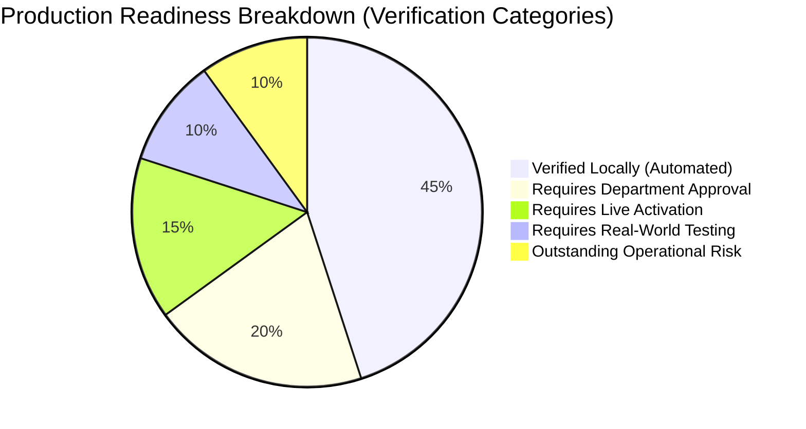

# SIMAK DISKUM v5.0 — Milestone P02 Pre-Activation Go / No-Go Checklist

**Client:** Dinas Koperasi dan Usaha Mikro Kota Batam  
**System Version:** 5.0.0  
**Target Architecture:** Firebase Multi-site Web Applications (`public` & `admin`) on **Firebase Spark (Zero-Cost Plan, $0.00/month)**  
**Target Project:** `simakdiskum`  
**Milestone:** **P02-A Controlled Production Activation Planning (Final Sign-Off)**  
**Document Status:** CONDITIONAL PREFLIGHT APPROVED — PRODUCTION ACTIVATION ON HOLD (Awaiting Client Category 2 Approvals & Admin Web Login Implementation)  

---

## 1. Executive Preflight Assessment

Before authorizing live production deployment to Google Cloud / Firebase project `simakdiskum`, all technical capabilities, administrative approvals, and operational risk boundaries must be verified against this checklist.

> [!CAUTION]
> **HONEST READINESS BOUNDARY:**  
> Excellent local emulator benchmarks (e.g. 76ms multi-month query response, 0.00px calendar grid drift) prove algorithmic, functional, and security correctness under local simulated conditions. They do **NOT** substitute for live cloud network latency across municipal Indonesian ISPs, cellular field conditions in Batam, or unmonitored client traffic spikes.  
> Production readiness requires an honest distinction between what has been proven locally versus what requires live validation, official civil service authorization, and completed client-side auth UI.

---

## 2. Five-Category Go / No-Go Decision Matrix

---

### Category 1: Verified Locally (Automated Tests & Local Emulators)
*Status: 100% PASSED in Local Development Environment.*

| Item # | Verification Check | Harness / Tool | Result | Evidence / Reference | Status |
|:---:|---|---|:---:|---|:---:|
| **1.1** | TypeScript compilation & linting | `tsc --noEmit` | Clean | Clean monorepo compile (`@department-agenda/shared`, `apps/*`) | **GO** |
| **1.2** | Automated Vitest test suite | `vitest run` | 233 / 233 Passed (100%) | 26 test files passing across all domain, integration & auth logic | **GO** |
| **1.3** | Live Firestore Security Rules | Real Firestore Emulator (`8080`) | 32 / 32 Passed | `tests/rules/firestore.rules.test.ts` (RBAC & lockstep) | **GO** |
| **1.4** | Reversible Maintenance Lockdown Rules | Real Firestore Emulator (`8080`) | 6 / 6 Passed | `tests/rules/maintenanceRules.test.ts` (write freeze & Admin SDK bypass) | **GO** |
| **1.5** | Real-Emulator Operational Safety Scenarios | Real Firestore (`8080`) & Auth (`9099`) | 10 / 10 Passed | `tests/integration/p01bSafetyVerification.test.ts` | **GO** |
| **1.6** | Playwright Real-Browser Regression Suites | Chromium (`1280x800`) | 79 / 79 Passed (100%) | 99 verified screenshots in `tests/e2e/screenshots/` | **GO** |
| **1.7** | Deterministic Rules Source Verifier | `scripts/verifyRulesSource.mjs` | 3 / 3 Passed | `tests/unit/rulesSourceVerification.test.ts` (validates config, rules, identities) | **GO** |
| **1.8** | Cryptographic Rules SHA-256 Checksum | `scripts/verifyRulesSource.mjs` | Verified | SHA-256: `444b48ba8e9d5979b0845e997babe9a728fefc930e3f03bab35da91e11570678` (707 lines) | **GO** |
| **1.9** | Google Drive URL Isolation & Exclusion | `tests/unit/publicProjector.test.ts` | 5 / 5 Passed | Confidential invitation letter Drive URLs strictly excluded from public DTOs | **GO** |
| **1.10** | Passwordless Operator Provisioning | `scripts/manageRoles.mjs` | 10 / 10 Passed | `tests/unit/authRoleManagement.test.ts` (secure entropy & setup links) | **GO** |
| **1.11** | Resumable Restore Checkpoint Ledger | `scripts/backupRestore.mjs` | Verified | `restore-progress.json` bound to `manifestHash` and `operationId` | **GO** |
| **1.12** | Deep Firestore Equality Verification | `assertDeepFirestoreEquality` | Verified | Recursive equality across nested objects, arrays, Timestamps, and refs | **GO** |
| **1.13** | Audit History & Collision Immunity | `scripts/backupRestore.mjs` | Verified | Zero post-backup audit deletions; collision safe prefixing | **GO** |
| **1.14** | Production Master Data Seeding Safeguard | `templates/productionMasterDataTemplate.json` | Verified | Rejects unapproved templates and placeholder markers | **GO** |
| **1.15** | Zero Credential Logging Safeguard | `scripts/manageRoles.mjs` | Verified | Zero passwords or API keys printed to logs/stdout | **GO** |
| **1.16** | Production Vite Build Bundles | Vite + Rollup | Exit 0 | Public Shell: 13.67 kB gzip; Admin Shell: 10.23 kB gzip | **GO** |
| **1.17** | Admin Authentication UI & RBAC Verification | Playwright & Real Auth Emulator | 34 / 34 Passed (100%) | `tests/e2e/adminAuthVerification.mjs` (10 verified screenshots) | **GO** |

---

### Category 2: Requires Department Approval (Civil Service Deliverables)
*Status: PENDING OFFICIAL DEPARTMENT DELIVERABLES (Item 2.7 Frontend Auth MOUNTED & VERIFIED).*

| Item # | Approval Requirement | Required Deliverable / Action | Responsible Stakeholder | Gate Impact | Status |
|:---:|---|---|---|---|:---:|
| **2.1** | Official Head of Department Signatory Data | Decree (Surat Keputusan / SK) containing exact Name, NIP, Rank/Golongan, and Title | Kepala Dinas Koperasi dan Usaha Mikro | Blocks Gate 5 Seeding | **PENDING** |
| **2.2** | Official Employee Directory | Complete roster of active civil servants (PNS/PPPK) with verified NIPs | Kasubag Kepegawaian / Umum | Blocks Gate 5 Seeding | **PENDING** |
| **2.3** | Official Operator Email Accounts | List of designated email addresses under official municipal domain for Admin and Editor roles | Administrator IT Dinas | Blocks Gate 4 Provisioning | **PENDING** |
| **2.4** | Official Department Locations & Stakeholders | Approved list of official meeting rooms, external venues, and regular organizers | Sekretaris Dinas | Blocks Gate 5 Seeding | **PENDING** |
| **2.5** | Google Drive Municipal Folder & IAM Policies | Municipal Google Drive folder created with **Restricted** access (authorized departmental group only; zero public links) | Administrator IT Dinas | Affects Letter Attachments | **PENDING** |
| **2.6** | User Acceptance Testing (UAT) Sign-Off | Completed execution and signed acceptance of 11 formal business scenarios | Department Review Committee | Blocks Gate 9 Handover | **PENDING** |
| **2.7** | Client-Side Admin Login & Password Recovery UI | Mount authenticated web login (`signInWithEmailAndPassword`), recovery (`sendPasswordResetEmail`), and access denied views | Lead Frontend Engineer | Milestone A01 Completed | **GO** |

---

### Category 3: Requires Live Activation (Google Cloud / Firebase Console)
*Status: PENDING LIVE EXECUTION (Scheduled for Milestone P02-B in Strict Sequential Order).*

| Item # | Activation Action | Console / CLI Step | Safety Guard | Reversible? | Status |
|:---:|---|---|---|:---:|:---:|
| **3.1** | Verify Project Ownership & Spark Tier | Open Firebase Console `simakdiskum` > Usage & billing | Confirm $0.00/mo Spark plan | Yes | **PENDING** |
| **3.2** | Enable Email/Password Provider | Authentication > Sign-in method > Email/Password | Passwordless link left disabled | Yes | **PENDING** |
| **3.3** | Disable Public Self-Registration | Authentication > Settings > User actions | Uncheck "Enable create (sign-up)" | Yes | **PENDING** |
| **3.4** | Deploy Production Rules | `node scripts/verifyRulesSource.mjs --target=prod` $\rightarrow$ `firebase deploy --only firestore:rules --project simakdiskum` | Verify SHA-256 (`444b48ba...`) & line count | Yes (Rules history) | **PENDING** |
| **3.5** | Deploy Firestore Compound Indexes | `firebase deploy --only firestore:indexes --project simakdiskum` | Separate CLI command from rules | Yes | **PENDING** |
| **3.6** | Verify Index Status `Enabled` | Firebase Console > Firestore > Indexes | Wait 2–10 min until status is `Enabled` (not `Building`) | Yes | **PENDING** |
| **3.7** | Verify Empty DB Access Restrictions | Test unauthenticated write block & empty read | Verify `PERMISSION_DENIED` on private collections | Yes | **PENDING** |
| **3.8** | Provision Operator Accounts | `node scripts/manageRoles.mjs provision "<APPROVED_ADMIN_EMAIL>" ...` | Passwordless CLI; zero stdout redirection to logs | Yes (`disable`) | **PENDING** |
| **3.9** | Seed Client-Approved Master Data | `node scripts/backupRestore.mjs seed --env=prod --template=... --target=prod` | Client approval flag & SK reference check | Yes (Rollback restore) | **PENDING** |
| **3.10** | Deploy Hosting Sites (`public` & `admin`) | `firebase deploy --only hosting:public,hosting:admin --project simakdiskum` | 1-click console rollback ready | Yes | **PENDING** |

---

### Category 4: Requires Real-World Testing (Field & Network Validation)
*Status: PENDING POST-DEPLOYMENT SMOKE TESTING.*

| Item # | Real-World Aspect | Testing Method | Acceptance Criteria | Responsible Role | Status |
|:---:|---|---|---|---|:---:|
| **4.1** | Municipal Network Latency | Test from Batam Government Office network (`Diskominfo Batam` / `DISKUM LAN`) | Cold page load < 2.5s; warm load < 500ms | Field QA Tester | **PENDING** |
| **4.2** | Low-End Mobile Performance | Test on low-spec Android devices (Chrome / Opera Mini) on 3G/4G cellular | Smooth month calendar touch scroll; zero UI freeze | Field QA Tester | **PENDING** |
| **4.3** | Operator Password Setup Delivery | Transmit generated setup link via official municipal channel | Operator successfully sets private password | System Admin | **PENDING** |
| **4.4** | Restricted Google Drive Attachment Access | Open invitation letter link from admin view while logged into municipal Google Account | PDF renders in new tab; zero Drive links leaked to Public Portal | Agenda Operator | **PENDING** |
| **4.5** | Multi-Device Concurrency Smoke Test | 2 operators edit different activities simultaneously | Optimistic version lockstep functions with zero data loss | Lead Engineer | **PENDING** |

---

### Category 5: Outstanding Operational Risks & Mitigation Strategies

| Risk # | Description of Risk | Probability | Impact | Mitigation Strategy Implemented in v5.0 | Residual Risk |
|:---:|---|:---:|:---:|---|:---:|
| **5.1** | **Firestore 50k Reads Daily Quota Spike:** Citizen traffic spike during municipal festival or press conference could exhaust daily free read quota. | Medium | Medium | Aggressive HTTP caching on static assets; warm HTTP 304 (<3 kB); date-range indexed queries (<30 reads/view); graceful Indonesian HTTP 429 quota notice modal without crashing application shell. Quota resets daily at **15:00 WIB (PST) / 14:00 WIB (PDT)**. | **LOW** |
| **5.2** | **Firebase Auth Password Reset Delivery:** On the Spark free plan, automated password reset emails from Firebase are subject to a documented quota of **150 emails/day** (subject to Google Cloud quota updates). | Low | Low | Fully supported natively for normal daily operations. For initial onboarding or municipal networks with aggressive spam filters, Admin SDK CLI (`manageRoles.mjs reset-password`) generates out-of-band setup links as a reliable secondary fallback with strict terminal disclosure warnings. | **MINIMAL** |
| **5.3** | **Multi-Batch Restoration Non-Atomicity:** In disaster recovery, network disconnection between 450-doc batches could leave database partially restored. | Low | High | Cryptographically bound checkpoint ledger (`restore-progress.json`) tracks completed batches. Operator safely resumes with `--resume` without re-writing committed batches. Merge mode is strictly prohibited after failed restore. | **MINIMAL** |
| **5.4** | **Browser Architecture Audit Trail Boundary:** Authorized Admin directly executing raw client SDK calls could hypothetically modify master data without writing audit logs. | Very Low | Low | Enforced in UI workflows; Firestore security rules mandate server timestamps (`request.time`) and authenticated operator ID match on all activity transactions. Documented as honest boundary of serverless browser-only architecture. | **LOW** |
| **5.5** | **Emergency Maintenance Rules Rollback:** Operator deploying maintenance rules loses connectivity. | Low | Medium | Public reads are preserved (`allow read: if true`) so citizens see no crashes; maintenance rules can be manually restored to normal production rules in 1-click via **Firebase Console > Firestore > Rules > Rules history**; CLI rollback command is documented. | **MINIMAL** |

---

## 3. Formal Go / No-Go Decision Gate Table

| Gate | Phase | Decision | Condition Required for "GO" | Stakeholder Sign-Off |
|:---:|---|:---:|---|---|
| **Gate 0** | Pre-Activation Admin Verification | **READY FOR GO** | Project `simakdiskum` verified on Spark plan ($0/mo); 2 Hosting sites confirmed | Lead Systems Architect |
| **Gate 1** | Auth Config & Signup Restriction | **READY FOR GO** | "Enable create (sign-up)" toggle unchecked in Firebase Console; 150 reset email quota noted | Project Owner |
| **Gate 2** | Production Rules Deployment | **READY FOR GO** | Rules SHA-256 (`444b48ba...`) & line count (707) verified; deployed to empty DB | Lead Systems Architect |
| **Gate 2.1** | Firestore Indexes Deployment | **READY FOR GO** | Deployed separately; status confirmed **`Enabled`** (not Building) | Lead Systems Architect |
| **Gate 3** | Empty DB Access Restriction Verification | **READY FOR GO** | Live write freeze verified; public read clean | QA Engineer |
| **Gate 4** | Operator Role Provisioning | **HOLD (PENDING DATA)** | Awaiting official operator email roster signed by Department Head | Department Head |
| **Gate 5** | Master Data Seeding | **HOLD (PENDING DATA)** | Awaiting signed decree (SK) for Signatory, Employees, and Locations | Department Head |
| **Gate 6** | Multi-Site Hosting Deployment | **READY FOR GO** | Admin login & recovery UI mounted; verified in Milestone A01 | Lead Frontend Engineer |
| **Gate 7** | Live Post-Deployment Smoke Audit | **STANDBY** | To be executed immediately following Gate 6 deployment | QA Engineer |
| **Gate 8** | Department UAT Execution | **STANDBY** | To be conducted with authorized department personnel (11 scenarios) | Department Stakeholders |
| **Gate 9** | Production Handover | **STANDBY** | Final sign-off after successful UAT completion | Kepala Dinas Koperasi & UKM |
| **DR** | Maintenance Lockdown | **STANDBY (DR ONLY)** | Quarantined to emergency database recovery; uses `firebase.maintenance.json` | Lead Systems Architect |

---

## 4. Final Recommendation

**CURRENT STATUS: CONDITIONAL PREFLIGHT APPROVED — PRODUCTION ACTIVATION ON HOLD**

The SIMAK DISKUM v5.0 software artifacts, build pipelines, database security rules, deterministic maintenance rules, and administrative CLIs are **100% technically verified and ready for production deployment**.

However, live activation must **REMAIN ON HOLD** until:
1. Dinas Koperasi dan Usaha Mikro Kota Batam provides the official civil service decree (SK) for the Signatory profile and the verified list of authorized operator email accounts.
2. The client-side Admin login screen and password-recovery view are mounted in `apps/admin`.

**DO NOT EXECUTE `firebase deploy` OR CREATE LIVE USERS UNTIL ALL PENDING CATEGORY 2 REQUIREMENTS ARE SIGNED.**
