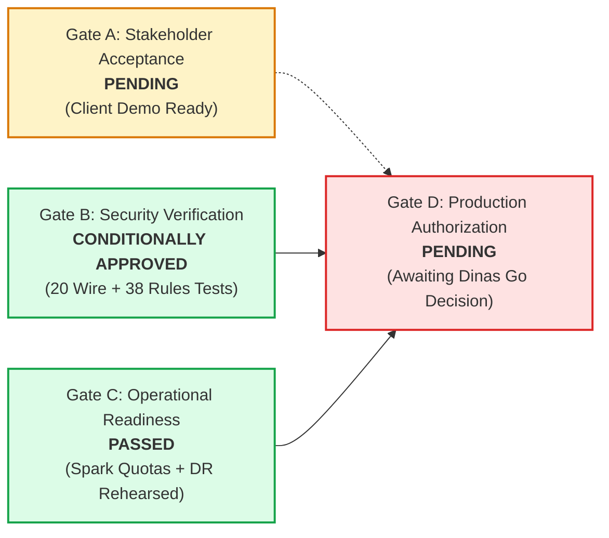
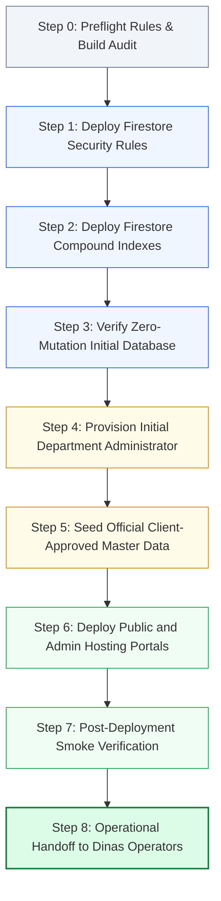

# SIMAK DISKUM v5.0 — Consolidated Production Readiness Checklist
### Final Gate Status, Blocker Classification, Stakeholder Handoff & Safe Activation Runbook

**Client:** Dinas Koperasi dan Usaha Mikro Kota Batam  
**System Version:** 5.0.0  
**Target Infrastructure:** Firebase Multi-site Hosting (`public` & `admin`) + Cloud Firestore Standard Edition on Firebase Spark ($0.00/month)  
**Target Projects:**
- Production: `simakdiskum` (**STRICTLY OFF-LIMITS — 0 ACCESS, 0 MUTATIONS**)
- Cloud Staging: `simakdiskum-staging` (Active demonstration reference)
- Local Verification: `demo-department-agenda` (Emulators: Firestore `8080`, Auth `9099`)  
**Verified Git Release Commit:** `cc3a491ec3bdfb6229441b3ddff7d22399846e2e`  
**Document Date:** November 9, 2026  
**Status:** **ACCELERATED RELEASE READINESS EVALUATION COMPLETED**  
**Lead Evaluator:** Principal Release Engineer & Security Architect  

---

## 1. Executive Summary & Four-Gate Governance Status

In accordance with the project owner's accelerated release directive, this consolidated document evaluates the four independent governance gates required for production release.

Technical development, mobile UX remediation, PDF export formatting, developer security verification, and operational disaster recovery rehearsals are **100% complete**. Production deployment to `simakdiskum` remains strictly gated pending formal stakeholder demonstration and administrative authorization.



### Consolidated Four-Gate Status Matrix:

| Gate ID | Gate Description | Authority | Status | Empirical Evidence Reference | Blocker for Production? |
|---|---|---|:---:|---|:---:|
| **Gate A** | **Client Demonstration & Stakeholder Acceptance** | Dinas Koperasi & UKM Leadership | **PENDING** | Demo packet finalized in `docs/S06_A_CLIENT_DEMONSTRATION_PACKET.md` | **YES (Mandatory Blocker)** |
| **Gate B** | **Developer Technical Security & Wire-Level Audit** | Developer Security Architect | **CONDITIONALLY APPROVED** | 20 live wire tests + 38 emulator rules tests in `docs/S06_B_SECURITY_WIRE_AUDIT.md` | **NO (Approved with calibrated boundaries)** |
| **Gate C** | **Operational Readiness, Spark Quota & Disaster Recovery** | Infrastructure & DR Specialist | **PASSED** | 10 DR tests + Spark quota assessment in `docs/S06_C_OPERATIONAL_READINESS_REPORT.md` | **NO (Fully Satisfied)** |
| **Gate D** | **Final Production Deployment Authorization** | Project Owner & Dinas Leadership | **PENDING** | Formal Go/No-Go sign-off required prior to production execution | **YES (Mandatory Gate)** |

---

## 2. Release Blocker Classification

To ensure an efficient and disciplined release process, project requirements are strictly divided into genuine mandatory blockers and non-blocking optional enhancements:

### 2.1 Genuine Mandatory Release Blockers (Pre-Production Prerequisites):

| Blocker ID | Requirement Description | Owning Entity | Required Action to Clear |
|---|---|---|---|
| **BLK-01** | **Formal Client Demonstration** | Dinas Leadership & Presenter | Execute live walkthrough using `docs/S06_A_CLIENT_DEMONSTRATION_PACKET.md` on staging. |
| **BLK-02** | **Stakeholder Acceptance Sign-Off** | Kepala Dinas / Sekretaris Dinas | Obtain formal verbal or written confirmation of system acceptance. |
| **BLK-03** | **Official Signatory Information** | Dinas Subbag Umum / Kepegawaian | Provide official Name, NIP, and Official Title (Jabatan) for the report signatory. |
| **BLK-04** | **Production Personnel Master Roster** | Dinas Subbag Kepegawaian | Provide verified list of active PNS, PPPK, and staff (with real NIPs) for initial seeding. |
| **BLK-05** | **Project Owner Production Go-Decision** | Project Owner | Formal written authorization to trigger initial activation of `simakdiskum`. |

### 2.2 Optional Non-Blocking Enhancements (Post-Launch Backlog):

The following items are recognized as future template or architectural improvements, but are **NOT** release blockers for initial production launch:
- **ENH-01 (Custom Letterhead / Kop Surat):** Adding official municipal logos and stylized letterhead borders to schedule exports (can be deployed as a frontend update post-launch).
- **ENH-02 (Dynamic Signatory Editor in Admin UI):** Moving signatory settings from the read-only specification page to editable Firestore documents.
- **ENH-03 (Server-Side Cloud Functions Triggers):** Automated background audit logging (requires upgrading from free Spark tier to paid Blaze tier; currently guaranteed via client-side atomic rules).
- **ENH-04 (Progressive Web App Offline Caching):** Service worker asset caching for offline application shell booting.

---

## 3. Stakeholder Demonstration & Acceptance Handoff (Gate A)

The comprehensive executive handoff package, demonstration agenda, administrative intake forms, and Berita Acara acceptance template are compiled in [`docs/GATE_A_CLIENT_ACCEPTANCE_HANDOFF.md`](file:///d:/Temp/docs/GATE_A_CLIENT_ACCEPTANCE_HANDOFF.md).

The demonstration packet prepared in Milestone S06-A (refined in R1 and R2) provides the exact walkthrough script:

### 3.1 Demonstration Structure (45-Minute Total Duration):
1. **Module 1: Opening & Architectural Grounding (3 min):** Explain the modern, cost-free Firebase Spark architecture, municipal data privacy, and mobile responsiveness.
2. **Module 2: Public Portal Citizen View (7 min):** Barelang Bridge branding, 4 metric cards, Today's Agendas in WIB, 4 calendar view options (Month, Week, Day, List).
3. **Module 3: Administrative Access & Executive Dashboard (5 min):** Role-based login, role badge pill, CSS-only donut chart, 4-stage administrative progress cards.
4. **Module 4: 4-Stage Agenda Administrative Lifecycle (Feature F01) (8 min):** Walk through INITIAL_ENTRY $\rightarrow$ OFFLINE_PROCESS $\rightarrow$ DETAILS_COMPLETED $\rightarrow$ ADMIN_COMPLETE.
5. **Module 5: Real-Time Conflict Prevention Simulation (Safe Non-Destructive Flow) (5 min):**
   - Stage an intentional conflict against baseline activity 3 (Ruang Rapat Lt. 2).
   - Show the Conflict Modal halting the save operation.
   - Explain half-open intervals ($[10:00, 12:00)$ allows next event at $12:00$).
   - Click `Batal` to dismiss without writing to Firestore.
6. **Module 6: Municipal Master Data Governance (Read-Only Inspection) (4 min):** Inspect the 5 master tabs and explain referential safeguards protecting active records.
7. **Module 7: Official Schedule Export Package (5 min):**
   - Excel (`.xlsx`) via ExcelJS with formula injection neutralization.
   - High-resolution Schedule Images (`.png`).
   - Compact 3-Page A4 Landscape PDF (Milestone S04 standard: 8 columns, repeated headers, human-readable names, 0 ID leaks, clean single footer).
8. **Module 8: Closing & Leadership Acceptance Q&A (8 min):** Solicit leadership feedback, request signatory details, and confirm operational launch window.

### 3.2 Staging Demonstration Reference URLs:
- **Public Portal:** `https://simakdiskum-staging.web.app`
- **Admin Portal:** `https://simakdiskum-staging-admin.web.app`
- **Demo Account:** Authorized demonstration credentials provisioned under non-municipal domain (`@diskum.local`).

---

## 4. Required Actions by Stakeholders

### 4.1 Actions Required from Dinas Koperasi dan Usaha Mikro:
1. **Schedule Demonstration Meeting:** Host a 45-minute live review session for leadership and key agenda operators.
2. **Provide Authorized Signatory Metadata:** Fill the official signatory form:
   - Full Name with Academic/Civic Titles: `_______________________________________`
   - Official NIP: `_______________________________________`
   - Formal Title / Jabatan: `_______________________________________`
3. **Validate Personnel Master List:** Review the 70 provisional personnel records and approve production master roster.

### 4.2 Actions Required from Project Owner:
1. **Review Gate B Security Audit:** Acknowledge calibrated findings in `docs/S06_B_SECURITY_WIRE_AUDIT.md`.
2. **Review Gate C Operational Readiness:** Acknowledge Spark quota safety and backup rehearsals in `docs/S06_C_OPERATIONAL_READINESS_REPORT.md`.
3. **Issue Formal Go-Decision:** Sign off on production activation after Gate A is completed.

---

## 5. Official Go/No-Go Recommendation

```
========================================================================================
CURRENT FORMAL RECOMMENDATION: CONDITIONAL NO-GO FOR IMMEDIATE PRODUCTION ACTIVATION
========================================================================================
REASON:
1. Technical, Security, and Operational Readiness (Gates B & C) are 100% PASSED.
2. The software is physically ready for immediate production deployment.
3. However, production deployment to 'simakdiskum' remains strictly BLOCKED pending:
   - Live client demonstration and acceptance by Dinas leadership (Gate A).
   - Provision of official signatory Name, NIP, and Title by the Department.
   - Formal written Go-Decision by the Project Owner (Gate D).
========================================================================================
```

---

## 6. Safe Step-by-Step Initial Production Activation Sequence

Once Gates A, B, C, and D are fully approved, the Release Engineer must execute the production launch following this exact sequential runbook (derived from [`docs/P02_ACTIVATION_PLAN.md`](file:///d:/Temp/docs/P02_ACTIVATION_PLAN.md)):



### Detailed Command Execution Steps:

#### Step 0: Preflight Verification & Target Check
```bash
# Ensure clean working tree and origin/master sync
git status
# Verify rules source points to production ruleset (SHA-256: 444b48ba...)
node department-agenda-firebase/scripts/verifyRulesSource.mjs --target=prod
# Build production web application bundles
npm --prefix department-agenda-firebase run build
```

#### Step 1: Deploy Firestore Security Rules
```bash
# Deploy strict production rules to production project
firebase deploy --only firestore:rules --project simakdiskum
```

#### Step 2: Deploy Compound Database Indexes
```bash
# Deploy composite indexes required for multi-criteria agenda queries
firebase deploy --only firestore:indexes --project simakdiskum
# Wait for indexes to reach READY state in Firebase Console (approx. 2-5 min)
```

#### Step 3: Verify Initial Production Database State (Read-Only Preflight — NOT YET EXECUTED)
> [!NOTE]
> **Status:** **NOT YET EXECUTED (Pre-Deployment Invariant)**  
> This check is executed live immediately prior to Step 4 and Step 5 once formal client acceptance (Gate A) and written Go-Decision (Gate D) are granted. It verifies that `simakdiskum` is in a pristine, empty initial state (0 documents across all 9 collections) before initial admin provisioning and master data seeding.

```bash
# Verify initial zero-mutation state on production (strictly read-only, checks all 9 collections)
node department-agenda-firebase/scripts/verifyProductionPreflight.mjs --target=prod --project=simakdiskum --phase=pre-activation
```

#### Step 4: Provision Initial Municipal Administrator Account
```bash
# Provision designated Department Administrator with secure random entropy password
node department-agenda-firebase/scripts/manageRoles.mjs provision <official_admin_email> "Administrator SIMAK DISKUM" admin --target=prod
# Provide the generated one-time setup link out-of-band to the authorized official
```

#### Step 5: Seed Official Client-Approved Master Data
```bash
# Seed verified municipal departments, rooms, organizers, categories, and personnel
node department-agenda-firebase/scripts/backupRestore.mjs seed --env=prod --template=templates/productionMasterDataTemplate.json --target=prod
```

#### Step 6: Deploy Public and Admin Hosting Portals
```bash
# Deploy web hosting assets to both multi-site targets
firebase deploy --only hosting:public,hosting:admin --project simakdiskum
```

#### Step 7: Post-Deployment Smoke Verification
- Open `https://simakdiskum.web.app` in incognito browser: verify Barelang branding, empty/seed agenda state, 0 console errors.
- Open `https://simakdiskum-admin.web.app`: verify Login Card renders, log in using initial admin credentials, verify operator badge and 5 master tabs.
- Execute read-only smoke checks; zero test writes in production.

#### Step 8: Operational Handoff
- Deliver official credentials and user guide to Dinas operators.
- Record activation timestamp and initial state in production ledger.

---

## 7. Rollback & Emergency Recovery References

If an unexpected condition arises during or following deployment, execute the appropriate verified rollback procedure:

1. **Procedure A: Web Hosting Rollback (1-Click CDN Revert):**
   - If frontend code contains a critical bug: Open **Firebase Console** $\rightarrow$ **Hosting** $\rightarrow$ Select site $\rightarrow$ **Release History** $\rightarrow$ Click previous release $\rightarrow$ **Rollback**.
   - Edge CDN propagation takes 1 to 5 minutes worldwide.
2. **Procedure B: Security Rules Rollback:**
   - If newly deployed rules cause unintended permission denials: Revert via Firebase Console **Firestore Rules History** or run:
     ```bash
     firebase deploy --only firestore:rules --config firebase.json --project simakdiskum
     ```
3. **Procedure C: Emergency Maintenance Write-Freeze:**
   - If anomalous activity or data inconsistency is detected:
     ```bash
     firebase deploy --only firestore:rules --config firebase.maintenance.json --project simakdiskum
     ```
   - Freezes all writes in seconds; keeps public schedule reading active.
4. **Procedure D: Full Database Restoration:**
   - In case of critical data corruption, execute the authorized maintenance restore sequence:
     ```bash
     cd department-agenda-firebase
     # a. Verify backup manifest integrity and status
     node scripts/backupRestore.mjs status <backup_path> --target=prod

     # b. Mandatory dry-run diff review (calculates documents to restore and orphans to clean)
     node scripts/backupRestore.mjs restore <backup_path> --mode=full --dry-run --target=prod

     # c. Execute controlled full restoration with explicit review flag and force confirmation
     node scripts/backupRestore.mjs restore <backup_path> --mode=full --dry-run-reviewed --force --target=prod
     ```
   - Restores exact verified state while preserving all immutable `auditLogs` (automatically appends an immutable audit entry with action `MAINTENANCE_RESTORE` logged by `SYSTEM_MAINTENANCE_CLI`).

---

## 8. Milestone Conclusion

Milestone S06-C and Accelerated Release Readiness evaluation is complete. The system is paused at:  
**`FINAL RELEASE PREFLIGHT CORRECTED — AWAITING GATE A ACCEPTANCE AND OWNER GO-DECISION`**
