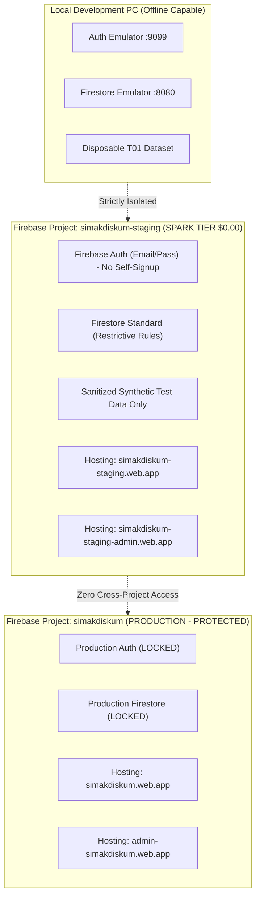

# SIMAK DISKUM Kota Batam v5.0 — S01 Separate Firebase Cloud Staging Plan

**Document Version:** 1.0.0  
**Status:** PLANNING ONLY — LOCAL REVIEW CHECKPOINT  
**Target Project:** `simakdiskum-staging` (Isolated Project, Subject to Verification)  
**Production Boundary:** ZERO Production Changes / No Live Execution Authorized  
**Cost Model:** Firebase Spark Plan ($0.00 / month Target)  

---

## 1. Executive Summary & Architectural Scope

The purpose of **S01 Cloud Staging** is to provide an online testbed where authorized municipal stakeholders, testers, and developers can verify the SIMAK DISKUM application from remote desktops, tablets, and mobile devices across commercial cellular networks without requiring the local development PC to remain running.

To guarantee zero impact on the eventual production system, **S01 Staging is completely decoupled from the production Firebase project (`simakdiskum`)**.



---

## 2. Infrastructure & Cost Isolation (Spark Plan $0.00/mo)

| Component | Production (`simakdiskum`) | Staging (`simakdiskum-staging`) |
|---|---|---|
| **Firebase Project** | `simakdiskum` | `simakdiskum-staging` |
| **Billing Plan** | Spark Tier ($0.00/month) | Spark Tier ($0.00/month) |
| **Cloud Firestore** | Standard Edition (Production rules) | Standard Edition (Production-equivalent rules) |
| **Public Hosting Site** | `simakdiskum` (`simakdiskum.web.app`) | `simakdiskum-staging` (`simakdiskum-staging.web.app`) |
| **Admin Hosting Site** | `admin-simakdiskum` (`admin-simakdiskum.web.app`) | `simakdiskum-staging-admin` (`simakdiskum-staging-admin.web.app`) |
| **Authentication** | Email/Password, no public signup | Email/Password, no public signup |
| **Data Policy** | Client-approved production records | **Sanitized / Synthetic test data ONLY** |
| **Visual Banner** | Clean municipal production banner | Unobtrusive `[LINGKUNGAN UJI COBA / STAGING]` banner |

> [!IMPORTANT]
> **Strict Billing Safeguard:** Both staging and production remain strictly on the Firebase **Spark free tier**. No Cloud Functions or Blaze billing are enabled ($0.00/month).

---

## 3. Configuration Separation & Deployment Guards

To prevent accidental deployments or cross-environment data mutations, all operational scripts must explicitly validate the active target project:

### 3.1 Firebase RC Multi-Project Configuration
`department-agenda-firebase/.firebaserc` will be updated upon authorization:
```json
{
  "projects": {
    "default": "simakdiskum",
    "production": "simakdiskum",
    "staging": "simakdiskum-staging"
  },
  "targets": {
    "simakdiskum-staging": {
      "hosting": {
        "public": ["simakdiskum-staging"],
        "admin": ["simakdiskum-staging-admin"]
      }
    },
    "simakdiskum": {
      "hosting": {
        "public": ["simakdiskum"],
        "admin": ["admin-simakdiskum"]
      }
    }
  }
}
```

### 3.2 CLI Target Enforcement
All management scripts (`scripts/manageRoles.mjs`, `scripts/backupRestore.mjs`, `scripts/deployCheck.mjs`) enforce strict execution switches:
- Local Emulator: `--target=emulator`
- Cloud Staging: `--target=staging` (explicit project check against `simakdiskum-staging`)
- Live Production: `--target=prod` (explicit project check against `simakdiskum`)

Attempting to run a script with mismatched project IDs or ambient emulator environment variables immediately halts with an exit code 1.

---

## 4. Staging Test Data Policy

**Strict Rule:** No real personnel NIPs, personal mobile phone numbers, internal Zoom passwords, or uncertified employee personal information may be deployed to the publicly accessible cloud staging environment.

### Approved Staging Dataset:
1. **Departments:** Standard 8 municipal divisions.
2. **Employees:** Synthetic test personnel representing each division (e.g. `Pegawai Uji Coba 01`, `Operator Staging`).
3. **Activities:** Sanitized historical agenda fixtures (30–40 representative activities from October 2026 with all Zoom passcodes and private phone numbers stripped or replaced with mock placeholder values).
4. **Visual Indicator:** An unobtrusive watermarked ribbon at the top of both the Public and Admin Portals:  
   `[LINGKUNGAN UJI COBA / STAGING — DATA SIMULASI]`

---

## 5. Access Control Model

1. **Public Portal (`simakdiskum-staging.web.app`):**
   - Read-only anonymous access to `publicActivities` and `publicSettings`.
   - Displays only sanitized test data.
2. **Admin Portal (`simakdiskum-staging-admin.web.app`):**
   - Strictly protected by Firebase Authentication and Firestore Security Rules.
   - Public self-registration is disabled.
   - Provision exactly **one** designated staging Admin account (`staging.admin@batam.go.id`).
   - Hosting URL obscurity is never treated as a security boundary; Cloud Firestore Gate 5A rules enforce deny-by-default for all private collections.

---

## 6. Step-by-Step S01 Activation Sequence (Future Execution)

When authorized, the cloud staging environment will be deployed according to the following strict 12-step sequence:

1. **Explicit Authorization Check:** Confirm written approval from project leadership.
2. **Project Provisioning:** Create Firebase project `simakdiskum-staging` on Google Cloud Console.
3. **Plan Verification:** Confirm Spark free tier ($0.00/mo) is active and billing is not attached.
4. **Authentication Setup:** Enable Email/Password sign-in method; disable user self-registration.
5. **Firestore Provisioning:** Provision Cloud Firestore Standard Edition in `asia-southeast2` (Jakarta).
6. **Security Rules Deployment:** Deploy strict production-equivalent security rules (`firebase/firestore.rules`) to `simakdiskum-staging`.
7. **Compound Indexes Deployment:** Deploy `firebase/firestore.indexes.json` and verify indexing completion.
8. **Staging Admin Provisioning:** Provision staging administrator account via `manageRoles.mjs --target=staging`.
9. **Synthetic Data Seeding:** Ingest sanitized synthetic master data and sample activities.
10. **Hosting Build & Deployment:** Build with staging environment configuration and deploy via `firebase deploy --only hosting --project=simakdiskum-staging`.
11. **Multi-Device Live Verification:** Test public and admin portals from external desktop and mobile devices across 4G/5G cellular networks.
12. **Isolation Audit:** Re-verify that production project `simakdiskum` remains 100% untouched.

> [!CAUTION]
> **NO EXECUTION AUTHORIZED:** This plan is for review and architectural verification only. None of the above steps may be executed during milestone T01.
