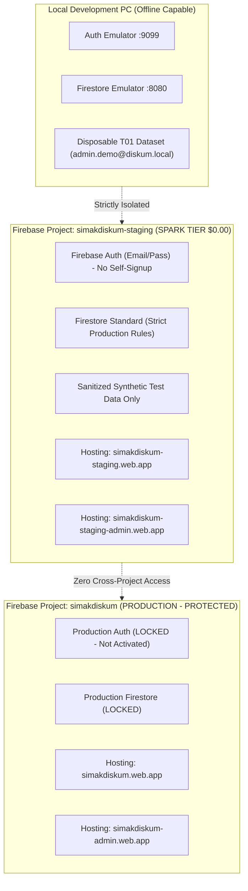

# SIMAK DISKUM Kota Batam v5.0 — S01 Separate Firebase Cloud Staging Plan

**Document Version:** 1.1.0  
**Status:** PLANNING ONLY — S01 CLOUD STAGING AUTHORIZATION CHECKPOINT  
**Target Project:** `simakdiskum-staging` (Isolated Project, Subject to Verification & Authorization)  
**Production Boundary:** ZERO Production Changes / No Live Cloud Execution Authorized  
**Cost Model:** Firebase Spark Plan ($0.00 / month Target)  

---

## 1. Executive Summary & Architectural Scope

The purpose of **S01 Cloud Staging** is to provide an online testbed where authorized municipal stakeholders, testers, and developers can verify the SIMAK DISKUM application from remote desktops, tablets, and mobile devices across commercial cellular networks without requiring the local development PC to remain running.

To guarantee zero impact on the eventual production system, **S01 Staging is completely decoupled from the production Firebase project (`simakdiskum`)**.



---

## 2. Infrastructure & Cost Isolation (Spark Plan $0.00/mo)

| Component | Production (`simakdiskum`) | Staging (`simakdiskum-staging`) |
|---|---|---|
| **Firebase Project** | `simakdiskum` | `simakdiskum-staging` |
| **Billing Plan** | Spark Tier ($0.00/month) | Spark Tier ($0.00/month) |
| **Cloud Firestore** | Standard Edition (`firebase/firestore.rules`) | Standard Edition (`firebase/firestore.rules` — Strict Gate 5A) |
| **Public Hosting Site** | `simakdiskum` (`simakdiskum.web.app`) | `simakdiskum-staging` (`simakdiskum-staging.web.app`) |
| **Admin Hosting Site** | `simakdiskum-admin` (`simakdiskum-admin.web.app`) | `simakdiskum-staging-admin` (`simakdiskum-staging-admin.web.app`) |
| **Authentication** | Email/Password, no public signup | Email/Password, no public signup |
| **Data Policy** | Client-approved production records | **Sanitized / Synthetic test data ONLY** |
| **Visual Banner** | Clean municipal production banner | Unobtrusive `[LINGKUNGAN UJI COBA / STAGING]` banner |

> [!IMPORTANT]
> **Strict Billing Safeguard:** Both staging and production remain strictly on the Firebase **Spark free tier**. No Cloud Functions or Blaze billing are enabled ($0.00/month).
> - Daily Firestore quota: 50,000 reads, 20,000 writes, 20,000 deletes.
> - Staging testing footprint: ~152 sample activities + 70 synthetic employees = ~350 initial writes, ~800 reads per testing session (< 2% of daily Spark allowance).

---

## 3. Configuration Separation, Site ID Standardization & Deployment Guards

### 3.1 Standardized Hosting Site Identifiers & Global Namespace Notice
To eliminate past documentation ambiguities, production and staging site identifiers are standardized as follows:
- **Production Public:** `simakdiskum` (`https://simakdiskum.web.app`)
- **Production Admin:** `simakdiskum-admin` (`https://simakdiskum-admin.web.app`) — *Standardized; all references to `admin-simakdiskum` are permanently deprecated.*
- **Staging Public:** `simakdiskum-staging` (`https://simakdiskum-staging.web.app`)
- **Staging Admin:** `simakdiskum-staging-admin` (`https://simakdiskum-staging-admin.web.app`)

> [!WARNING]
> **Site ID Availability Notice:** Hosting site IDs exist in a single global Google Cloud namespace. Do **NOT** assume proposed site identifiers are already reserved or available. Prior to deployment, preflight verification via `firebase hosting:sites:create <site-id> --project=simakdiskum-staging` must be executed to confirm global availability and bind site ownership.

### 3.2 Firebase RC Multi-Project Configuration
`department-agenda-firebase/.firebaserc` separates environments cleanly:
```json
{
  "projects": {
    "default": "simakdiskum",
    "production": "simakdiskum",
    "staging": "simakdiskum-staging"
  },
  "targets": {
    "simakdiskum": {
      "hosting": {
        "public": [
          "simakdiskum"
        ],
        "admin": [
          "simakdiskum-admin"
        ]
      }
    },
    "simakdiskum-staging": {
      "hosting": {
        "public": [
          "simakdiskum-staging"
        ],
        "admin": [
          "simakdiskum-staging-admin"
        ]
      }
    }
  },
  "etags": {}
}
```

### 3.3 Separate Web SDK Configuration & Zero Emulator Endpoints in Staging Builds
Client applications (`apps/public/src/firebase.ts` and `apps/admin/src/firebase.ts`) dynamically resolve environment configuration:
- In Staging mode (`import.meta.env.MODE === 'staging'`), the client loads configuration for project `simakdiskum-staging`.
- In Production mode (`import.meta.env.MODE === 'production'`), the client loads configuration for project `simakdiskum`.
- **Localhost Emulator Endpoint Guard:** Staging and production bundles strictly disable emulator connections via `!isStagingOrProd`. Even if a staging build is previewed locally (`npm run preview` on `localhost:4173`), the application will **NEVER** connect to localhost emulator ports (`8080` / `9099`); it communicates exclusively with the remote cloud project.

### 3.4 CLI Target Enforcement & Production Rejection Guards
All operational scripts (`scripts/manageRoles.mjs`, `scripts/backupRestore.mjs`) implement strict guardrails verified by unit tests:
- When `--target=staging` is specified:
  - If active project is `simakdiskum` (PRODUCTION), the script **immediately halts with an error**, refusing to mutate production.
  - Target project must strictly equal `simakdiskum-staging`.
- When `--target=prod` is specified:
  - If active project is `simakdiskum-staging` (STAGING), the script **immediately halts with an error**, refusing to execute production commands on staging.
  - Target project must strictly equal `simakdiskum`.
- When `--target=emulator` is specified:
  - Requires `FIRESTORE_EMULATOR_HOST` / `FIREBASE_AUTH_EMULATOR_HOST` to be active.

---

## 4. Staging Test Data Policy

**Strict Invariant:** Real civil servant NIPs, personal mobile phone numbers, live Zoom passwords/passcodes, and uncertified personnel records are **STRICTLY PROHIBITED** from cloud staging.

### Approved Staging Dataset:
1. **Departments:** Standard 8 municipal divisions.
2. **Employees:** Synthetic test personnel representing each division with mock identifiers (e.g. `Pegawai Uji Coba 01`, `Operator Staging`).
3. **Activities:** Sanitized historical agenda fixtures (30–40 representative activities from October 2026 with all Zoom passcodes, passwords, and private phone numbers stripped or replaced with safe generic placeholders).
4. **Visual Indicator:** An unobtrusive watermarked ribbon at the top of both the Public and Admin Portals:  
   `[LINGKUNGAN UJI COBA / STAGING — DATA SIMULASI]`

---

## 5. Access Control & Security Model

1. **Public Portal (`simakdiskum-staging.web.app`):**
   - Read-only anonymous access to `publicActivities` and `publicSettings`.
   - Displays only sanitized synthetic test data.
2. **Admin Portal (`simakdiskum-staging-admin.web.app`):**
   - Protected by Firebase Authentication (Email/Password) and Gate 5A Firestore Security Rules.
   - Public self-registration is strictly disabled.
   - Provision exactly **one** designated staging Admin account using an authorized test address (e.g. `staging.admin@diskum.internal`).
   - Zero credential reuse: No local emulator passwords or production credentials may ever be reused in staging.
   - Cloud Firestore Security Rules deployed to staging are **identical to production** (`firebase/firestore.rules`), enforcing deny-by-default on private collections.

---

## 6. Step-by-Step S01 Activation Sequence (Future Execution Upon Authorization)

When authorized, the cloud staging environment will be deployed according to the following strict 12-step sequence:

1. **Explicit Authorization Check:** Confirm written approval from project leadership to create cloud resources.
2. **Project Provisioning:** Create Firebase project `simakdiskum-staging` on Google Cloud Console.
3. **Plan Verification:** Confirm Spark free tier ($0.00/mo) is active and billing is not attached.
4. **Authentication Setup:** Enable Email/Password sign-in provider; disable public self-registration.
5. **Firestore Provisioning:** Provision Cloud Firestore Standard Edition in `asia-southeast2` (Jakarta).
6. **Security Rules Deployment:** Deploy strict production security rules (`firebase/firestore.rules`) to `simakdiskum-staging`.
7. **Compound Indexes Deployment:** Deploy `firebase/firestore.indexes.json` and verify indexing completion.
8. **Hosting Multi-Site Creation & Target Binding:**
   - Verify availability: `firebase hosting:sites:create simakdiskum-staging --project=simakdiskum-staging`
   - Create admin multi-site: `firebase hosting:sites:create simakdiskum-staging-admin --project=simakdiskum-staging`
   - Apply target bindings in `.firebaserc`.
9. **Staging Admin Provisioning:** Provision staging administrator account via `manageRoles.mjs provision ... --target=staging`.
10. **Synthetic Data Seeding:** Ingest sanitized synthetic master data and sample activities using `backupRestore.mjs --target=staging`.
11. **Hosting Build & Deployment:** Build with staging environment configuration (`npm run build:staging`) and deploy via `firebase deploy --only hosting --project=simakdiskum-staging`.
12. **Multi-Device Live Verification & Isolation Audit:** Test public and admin portals from external desktop and mobile devices across 4G/5G cellular networks, then confirm production project `simakdiskum` remains 100% untouched.

> [!CAUTION]
> **NO LIVE EXECUTION AUTHORIZED:** This plan is for architectural verification and preflight approval only. None of the cloud deployment steps above may be executed during this milestone. The system is paused at the **S01 CLOUD STAGING AUTHORIZATION CHECKPOINT**.
