# SIMAK DISKUM v5.0 — Paket Persiapan Demonstrasi Klien (Milestone S06-A)
### Client Demonstration Packet & Stakeholder Presentation Guide

**Sistem:** SIMAK DISKUM v5.0 (*Sistem Informasi Manajemen Agenda Kedinasan*)  
**Instansi Klien:** Dinas Koperasi dan Usaha Mikro Kota Batam  
**Target Rilis Produksi:** Firebase Spark Free Tier ($0.00/bulan) — Proyek: `simakdiskum`  
**Lingkungan Evaluasi / Demonstrasi:** Cloud Staging: `simakdiskum-staging`  
- **Portal Publik Staging:** [https://simakdiskum-staging.web.app](https://simakdiskum-staging.web.app)  
- **Portal Admin Staging:** [https://simakdiskum-staging-admin.web.app](https://simakdiskum-staging-admin.web.app)  
**Tanggal Dokumen:** 9 November 2026  
**Status Dokumen:** **PAKET PERSIAPAN RESMI — SIAP UNTUK TINJAUAN PEMILIK PROYEK (OWNER REVIEW)**  
**Penyusun:** Tim Pengembang & Tim Penjaminan Mutu SIMAK DISKUM v5.0  

---

## 📋 Daftar Isi

1. [Ringkasan Eksekutif & Tujuan Demonstrasi](#1-ringkasan-eksekutif--tujuan-demonstrasi)
2. [Daftar Periksa Kesiapan Demonstrasi Staging (Pre-Demo Checklist)](#2-daftar-periksa-kesiapan-demonstrasi-staging-pre-demo-checklist)
3. [Akun Peraga Resmi & Protokol Keamanan Kredensial](#3-akun-peraga-resmi--protokol-keamanan-kredensial)
4. [Naskah Panduan Presentasi Demonstrasi Langsung (Step-by-Step Script)](#4-naskah-panduan-presentasi-demonstrasi-langsung-step-by-step-script)
   - [Modul 1: Portal Publik & Identitas Khas Batam](#modul-1-portal-publik--identitas-khas-batam)
   - [Modul 2: Kalender Publik Interaktif & Pencarian Canggih](#modul-2-kalender-publik-interaktif--pencarian-canggih)
   - [Modul 3: Otentikasi Admin & Dashboard Eksekutif](#modul-3-otentikasi-admin--dashboard-eksekutif)
   - [Modul 4: Alur Kerja 4 Tahap Administrasi (Feature F01) & Panel Surat Undangan](#modul-4-alur-kerja-4-tahap-administrasi-feature-f01--panel-surat-undangan)
   - [Modul 5: Mesin Deteksi Konflik Penjadwalan Otomatis](#modul-5-mesin-deteksi-konflik-penjadwalan-otomatis)
   - [Modul 6: Manajemen Data Master & Perlindungan Referensial](#modul-6-manajemen-data-master--perlindungan-referensial)
   - [Modul 7: Paket Ekspor Resmi 8 Kolom (Excel, PNG, PDF A4 Landscape)](#modul-7-paket-ekspor-resmi-8-kolom-excel-png-pdf-a4-landscape)
   - [Modul 8: Adaptasi Responsif Multi-Perangkat (Desktop vs Ponsel)](#modul-8-adaptasi-responsif-multi-perangkat-desktop-vs-ponsel)
5. [Peta Data Demonstrasi (38 Agenda Sintetik Oktober 2026)](#5-peta-data-demonstrasi-38-agenda-sintetik-oktober-2026)
6. [Protokol Keamanan Tindakan Langsung (Safe Live-Action Protocol)](#6-protokol-keamanan-tindakan-langsung-safe-live-action-protocol)
7. [Audit Skrip Pencadangan & Pemulihan (backupRestore.mjs CLI Discrepancy)](#7-audit-skrip-pencadangan--pemulihan-backuprestoremjs-cli-discrepancy)
8. [Antisipasi Tanya Jawab Pemangku Kepentingan (Stakeholder Q&A)](#8-antisipasi-tanya-jawab-pemangku-kepentingan-stakeholder-qa)
9. [Formulir Pengumpulan Umpan Balik Pemangku Kepentingan (Feedback Template)](#9-formulir-pengumpulan-umpan-balik-pemangku-kepentingan-feedback-template)

---

## 1. Ringkasan Eksekutif & Tujuan Demonstrasi

Dokumen ini disusun sebagai instrumen operasional terpadu bagi pemapar (*presenter*) dalam melaksanakan **Milestone S06 Gerbang A: Demonstrasi Klien & Penerimaan Pimpinan Dinas (*Stakeholder Acceptance*)** di hadapan jajaran pimpinan dan staf operasional **Dinas Koperasi dan Usaha Mikro Kota Batam**.

```mermaid
flowchart LR
    subgraph S05["Milestone S05 (Selesai)"]
        S05A["Pengujian Pengguna Informal<br/>(Verbal Positif - Sukarela Asep)"]
    end

    subgraph S06A["Milestone S06-A (Saat Ini)"]
        Packet["Penyusunan Paket Demonstrasi<br/>(S06_A_CLIENT_DEMONSTRATION_PACKET.md)"]
        Prep["Verifikasi Akun & Lingkungan Staging"]
        Audit["Audit Skrip & Peta Data 38 Agenda"]
    end

    subgraph GateA["Gerbang A: Demonstrasi Klien"]
        LiveDemo["Peragaan Langsung di Hadapan Pimpinan Dinas<br/>(Kepala Dinas, Sekretaris, Operator Agenda)"]
        Feedback["Pengumpulan Umpan Balik & Tinjauan SK"]
    end

    subgraph FutureGates["Gerbang Lanjutan (Terpisah)"]
        GateB["Gerbang B: Audit Keamanan Pengembang"]
        GateC["Gerbang C: Kesiapan Spark & Cadangan"]
        GateD["Gerbang D: Go-Live simakdiskum"]
    end

    S05A --> S06A
    S06A --> GateA
    GateA -.-> GateB
    GateB -.-> GateC
    GateC -.-> GateD

    style S06A fill:#eff6ff,stroke:#2563eb,stroke-width:2px;
    style GateA fill:#f0fdf4,stroke:#16a34a,stroke-width:2px;
    style FutureGates fill:#f8fafc,stroke:#94a3b8,stroke-width:1px;
```



### 1.1 Tujuan Utama Demonstrasi
1. **Memvalidasi Kesesuaian Kebutuhan Kedinasan:** Membuktikan bahwa SIMAK DISKUM v5.0 telah memenuhi seluruh fungsi tata kelola agenda yang tertuang dalam spesifikasi kebutuhan Dinas Koperasi dan Usaha Mikro Kota Batam.
2. **Memperagakan Transformasi Digital:** Menunjukkan keunggulan operasional sistem dibandingkan alur kerja manual berbasis lembar kerja (*spreadsheet*), terutama dalam deteksi bentrok jadwal, pelaporan otomatis, dan koordinasi antar-bidang.
3. **Mendapatkan Keputusan Penerimaan Resmi (*Official Acceptance*):** Memperoleh persetujuan pimpinan dinas untuk melanjutkan ke tahapan verifikasi keamanan (Gerbang B) dan kesiapan operasional (Gerbang C) menuju peluncuran produksi mandiri.
4. **Menetapkan Parameter Pejabat Penandatangan:** Memperoleh konfirmasi definitif mengenai nama pejabat, NIP resmi, pangkat/golongan, dan jabatan untuk dicantumkan pada template laporan dinas 8 kolom.

### 1.2 Batasan Lingkungan & Integritas Data
- **Proyek Produksi (`simakdiskum`):** Tetap berstatus **OFF-LIMITS** (0 mutasi data, 0 build, 0 deployment).
- **Proyek Staging (`simakdiskum-staging`):** Digunakan secara penuh untuk demonstrasi. Seluruh **38 agenda baseline Oktober 2026 WAJIB DIPERTAHANKAN UTUH**.
- **Karakteristik Data:** Menggunakan data sintetik terstandarisasi yang bebas dari data pribadi riil (*zero municipal PII*, tanpa NIP riil, tanpa nomor telepon pribadi, tanpa kredensial Zoom/Google Meet riil).

---

## 2. Daftar Periksa Kesiapan Demonstrasi Staging (Pre-Demo Checklist)

Sebelum memulai sesi peragaan di hadapan pimpinan dinas, pemapar wajib memastikan seluruh butir kesiapan teknis dan fisik berikut telah berstatus **HIJAU (READY)**:

| No | Kategori Pemeriksaan | Deskripsi Tindakan Verifikasi | Status |
|:--:|:---|:---|:---:|
| 1 | **Konektivitas Cloud Staging** | Pastikan kedua portal aktif dan memberikan respons `HTTP 200 OK`: <br/>- Portal Publik: `curl -I https://simakdiskum-staging.web.app` <br/>- Portal Admin: `curl -I https://simakdiskum-staging-admin.web.app` | [x] READY |
| 2 | **Integritas Data Baseline** | Buka portal admin dan verifikasi bahwa 38 kegiatan sintetik bulan Oktober 2026 tertera lengkap tanpa ada record yang hilang atau terkorupsi. | [x] READY |
| 3 | **Koneksi Jaringan Presentasi** | Uji stabilitas koneksi Wi-Fi / LAN ruang rapat. Siapkan *tethering* seluler cadangan untuk mengantisipasi gangguan jaringan lokal. | [ ] VERIFY ON-SITE |
| 4 | **Perangkat Tampilan & Proyektor** | Hubungkan laptop pemapar ke proyektor / TV ruang rapat. Pastikan resolusi display minimal **1920 × 1080 px** (skala 100%) agar antarmuka desktop 1440px tampil proporsional tanpa zoom paksa. | [ ] VERIFY ON-SITE |
| 5 | **Perangkat Uji Ponsel (Mobile)** | Siapkan setidaknya 1 unit ponsel pintar (*smartphone*) Android / iOS dengan peramban Chrome / Safari aktif untuk memperagakan tampilan mobile di depan peserta. | [ ] VERIFY ON-SITE |
| 6 | **Sesi Peramban Bersih** | Buka peramban laptop dalam jendela reguler untuk portal admin, dan buka jendela anonim (*Incognito / InPrivate*) untuk portal publik guna membuktikan pemisahan hak akses secara nyata. | [ ] READY |
| 7 | **Cadangan Tangkapan Layar Fisik** | Siapkan folder galeri tangkapan layar beresolusi tinggi (`README.md` screenshots & S04 print artifacts) sebagai mitigasi darurat apabila internet padam total. | [x] READY |

---

## 3. Akun Peraga Resmi & Protokol Keamanan Kredensial

### 3.1 Identifikasi Akun Staging Resmi
Sistem staging memiliki dua akun administrator aktif yang telah diverifikasi pada layer Firebase Authentication dan memiliki *custom claim* `{ role: "admin" }`:

| Identitas Akun | Peran Sistem | Status | Penggunaan dalam Demonstrasi |
|:---|:---:|:---:|:---|
| `riyanbwirawanto@gmail.com` | **Administrator Staging** | Aktif (Verified) | **AKUN UTAMA PERAGAAN KLIEN:** Ditampilkan pada topbar dengan lencana *"Administrator Staging"*, mencerminkan peran penuh pengelola agenda dinas. |
| `aseppbukga@gmail.com` | **Asep — QA Tester** | Aktif (Verified) | **AKUN CADANGAN:** Akun pengujian eksternal S05, dapat digunakan jika diperlukan demonstrasi multi-operator bersamaan. |

### 3.2 Protokol Keamanan Kredensial (Strict No-Disclosure Policy)
> [!CAUTION]
> **PERINGATAN KERAHASIAAN KREDENSIAL:**
> - Sandi akun administrator **TIDAK PERNAH** ditulis, dicetak, atau disebarluaskan dalam bentuk dokumen cetak, naskah presentasi, maupun slide tayangan.
> - Saat sesi login di hadapan hadirin, pemapar mengetikkan kata sandi secara privat tanpa memperlihatkan teks sandi pada layar proyeksi (*password masking* tetap aktif secara default).
> - Jangan melakukan tindakan *Reset Password* menjelang atau selama demonstrasi untuk mencegah terhentinya akses ke cloud staging.

---

## 4. Naskah Panduan Presentasi Demonstrasi Langsung (Step-by-Step Script)

Berikut adalah naskah pemaparan langkah-demi-langkah berdurasi **30–45 menit** yang dirancang khusus untuk memandu pemapar menyajikan fitur unggulan secara sistematis dan komunikatif di hadapan pimpinan dinas:

```
[00:00 - 05:00] Pembukaan, Latar Belakang & Identitas Khas Batam (Modul 1)
[05:00 - 10:00] Portal Publik: Kalender Interaktif & Pencarian Canggih (Modul 2)
[10:00 - 15:00] Portal Administrasi: Otentikasi & Dashboard Eksekutif (Modul 3)
[15:00 - 23:00] Alur Kerja 4 Tahap Administrasi & Surat Undangan (Modul 4)
[23:00 - 28:00] Deteksi Konflik Otomatis Ruangan & Personil (Modul 5)
[28:00 - 33:00] Manajemen Data Master & Perlindungan Referensial (Modul 6)
[33:00 - 38:00] Paket Ekspor Resmi 8 Kolom: Excel, PNG & Cetak PDF A4 (Modul 7)
[38:00 - 42:00] Pengujian Responsivitas Mobile pada Layar Ponsel (Modul 8)
[42:00 - 45:00] Penutup, Sesi Tanya Jawab & Pengisian Formulir Evaluasi
```

---

### Modul 1: Portal Publik & Identitas Khas Batam
- **Target URL:** [https://simakdiskum-staging.web.app](https://simakdiskum-staging.web.app)
- **Tujuan Pemaparan:** Menunjukkan wajah depan transparansi informasi kedinasan bagi masyarakat dan mitra kerja.
- **Langkah Peragaan:**
  1. Buka peramban pada layar penuh (*full screen*).
  2. Sorot elemen identitas visual:
     - Logo resmi Pemerintah Kota Batam & tulisan *"Dinas Koperasi dan Usaha Mikro Kota Batam"*.
     - Spanduk selamat datang bernuansa **Jembatan Barelang** berlatar biru bahari kedinasan (*deep civic blue*).
     - Jam digital zona **Waktu Indonesia Barat (WIB)** yang berdetik *real-time*.
  3. Peragakan **Kartu Rekapitulasi 4 Metrik** di bawah spanduk:
     - *Agenda Hari Ini*, *Agenda Pekan Ini*, *Agenda Bulan Ini*, dan *Total Agenda Terdaftar*.
  4. Tunjukkan seksi **Agenda Kedinasan Hari Ini & Mendatang**:
     - Format penulisan tanggal formal bahasa Indonesia (`dddd, D MMMM YYYY`).
     - Lencana kategori kegiatan (*Rapat Internal, Pelatihan UMKM, Pengawasan Koperasi, dll.*).
- **Poin Narasi Pemapar:**
  > *"Bapak/Ibu Pimpinan, ini adalah portal publik SIMAK DISKUM v5.0. Siapapun masyarakat atau mitra pelaku UMKM di Batam dapat mengakses portal ini tanpa perlu login. Tampilannya dirancang berwibawa dengan identitas khas Batam dan langsung menyajikan informasi agenda kedinasan hari ini secara ringkas, transparan, dan akurat."*

---

### Modul 2: Kalender Publik Interaktif & Pencarian Canggih
- **Target URL:** [https://simakdiskum-staging.web.app](https://simakdiskum-staging.web.app) (Tab Kalender & Pencarian)
- **Tujuan Pemaparan:** Memperagakan fleksibilitas navigasi jadwal dan penjaminan batas privasi publik.
- **Langkah Peragaan:**
  1. Klik tab **Kalender Agenda**.
  2. Navigasikan ke bulan **Oktober 2026** di mana 38 agenda baseline tersaji.
  3. Beralih antar-tampilan kalender:
     - **Tampilan Bulan (*Month View*):** Tunjukkan distribusi kegiatan di sepanjang bulan dengan indikator warna kategori.
     - **Tampilan Pekan (*Week View*):** Tunjukkan pembagian jam kegiatan dalam sepekan.
     - **Tampilan Hari (*Day View*):** Tunjukkan detail jam dan durasi kegiatan per jam.
     - **Tampilan Daftar (*List View*):** Tunjukkan daftar urut waktu kegiatan.
  4. Klik salah satu kegiatan multi-hari, misalnya:
     - `Bazar dan Pameran Produk Kreatif Unggulan UMKM Kota Batam` (15–17 Oktober 2026).
     - Tunjukkan bagaimana kalender secara pintar merentangkan kegiatan selama 3 hari berturut-turut.
  5. Buka kotak dialog **Detail Agenda**:
     - Tunjukkan informasi umum: Hari/Tanggal, Pukul, Tempat, Kategori, Penyelenggara, dan Catatan Publik.
     - **Tekankan Penjaminan Privasi:** Tunjukkan bahwa modal publik **SAMA SEKALI TIDAK MENAMPILKAN** catatan internal pimpinan, tautan rapat berpassword, atau disposisi surat rahasia.
  6. Peragakan fitur **Pencarian Agenda**:
     - Ketik kata kunci *"Halal"* pada kotak pencarian: sistem secara instan menyaring kegiatan fasilitasi sertifikasi halal.
     - Gunakan filter rentang tanggal dengan format standar Indonesia `dd/mm/yyyy`.
- **Poin Narasi Pemapar:**
  > *"Masyarakat dapat melihat kalender dalam tampilan bulanan, mingguan, maupun harian. Ketika sebuah kegiatan diklik, sistem hanya menyajikan ringkasan publik yang santun dan relevan. Hal-hal yang bersifat rahasia dinas, seperti disposisi pimpinan atau link rapat berpassword, terisolasi secara otomatis pada layer arsitektur dan tidak akan pernah bocor ke publik."*

---

### Modul 3: Otentikasi Admin & Dashboard Eksekutif
- **Target URL:** [https://simakdiskum-staging-admin.web.app](https://simakdiskum-staging-admin.web.app)
- **Tujuan Pemaparan:** Memperagakan sistem keamanan gerbang masuk operator dan panel kendali eksekutif.
- **Langkah Peragaan:**
  1. Buka Portal Admin pada peramban terpisah.
  2. Peragakan halaman login resmi:
     - Desain bersih bernuansa pemerintahan, proteksi *rate-limiting*, dan tombol tampilkan/sembunyikan sandi (*password toggle*).
  3. Masuk menggunakan akun peraga resmi `riyanbwirawanto@gmail.com`.
  4. Sorot elemen **Dashboard Eksekutif**:
     - *Topbar:* Lencana profil *"Administrator Staging"* dengan foto avatar dan tombol keluar aman (*secure logout*).
     - *Sidebar Navigasi:* Menu terstruktur (*Dashboard, Manajemen Agenda, Data Master, Laporan 8 Kolom, Pengaturan*).
     - *Grafik Analisis Donut:* Diagram persentase tahap administrasi berbasis CSS murni (*conic-gradient*) yang sangat ringan tanpa memperlambat loading browser.
     - *Kartu 4 Tahap Pipeline:* Jumlah agenda pada tahap Input Awal, Proses Offline, Detail Dilengkapi, dan Administrasi Lengkap.
- **Poin Narasi Pemapar:**
  > *"Untuk masuk ke portal administrasi, operator wajib menggunakan akun terotentikasi. Begitu login, pimpinan langsung disajikan grafik visual status administrasi. Pimpinan dapat memantau berapa agenda yang baru masuk, berapa yang sedang berproses offline di meja disposisi, dan berapa yang berkas administrasinya telah rampung 100%."*

---

### Modul 4: Alur Kerja 4 Tahap Administrasi (Feature F01) & Panel Surat Undangan
- **Target URL:** [https://simakdiskum-staging-admin.web.app](https://simakdiskum-staging-admin.web.app) (Menu Agenda)
- **Tujuan Pemaparan:** Memperagakan siklus hidup administrasi agenda kedinasan sesuai regulasi tata naskah dinas.
- **Langkah Peragaan:**
  1. Masuk ke menu **Daftar Agenda**.
  2. Pilih salah satu agenda baseline Oktober 2026 yang berstatus `DETAILS_COMPLETED`, misalnya:
     - `Klinik Konsultasi Akses Pembiayaan KUR bagi Pelaku Usaha Mikro` (13 Oktober 2026).
  3. Klik tombol **Edit** untuk membuka formulir kegiatan.
  4. Tunjukkan bilah kemajuan (*stage progress indicator bar*) yang memperlihatkan 4 tahapan:
     - **Tahap 1: Input Awal (*INITIAL_ENTRY*):** Jadwal baru masuk dari surat atau permohonan luar. Peringatan bersifat persuasif (*non-blocking*).
     - **Tahap 2: Proses Offline (*OFFLINE_PROCESS*):** Agenda sedang dinaikkan nota dinas, menunggu disposisi Kepala Dinas, atau koordinasi internal.
     - **Tahap 3: Detail Dilengkapi (*DETAILS_COMPLETED*):** Pejabat dan staf yang ditugaskan telah dipilih, ruangan telah dipesan, catatan publik disiapkan.
     - **Tahap 4: Administrasi Lengkap (*ADMIN_COMPLETE*):** Seluruh berkas pendukung, nomor surat undangan/tugas, dan laporan hasil kegiatan telah tuntas.
  5. Sorot **Panel 5: Data Naskah Dinas & Surat Undangan**:
     - Nomor Surat Undangan, Asal Surat/Instansi Pengirim, Tanggal Surat, Perihal Naskah.
     - Tautan Dokumen Digital Aman (Google Drive internal kantor yang terlindungi).
     - Jelaskan bahwa sebelum mencapai Tahap 4, sistem mewajibkan pengisian kelengkapan naskah dinas ini (*strict completion gate*).
  6. **PENTING:** Klik tombol **Batal / Tutup** formulir tanpa menekan Simpan, untuk menjaga keutuhan data baseline.
- **Poin Narasi Pemapar:**
  > *"Bapak/Ibu, fitur ini adalah keunggulan utama SIMAK DISKUM v5.0. Agenda dinas tidak sekadar dicatat jamnya, tetapi dikawal secara administratif dari saat surat masuk hingga surat tugas terbit. Operator tidak dapat menandai agenda sebagai 'Administrasi Lengkap' jika nomor surat dan bukti penugasan belum diinput ke dalam sistem. Ini mewujudkan tertib administrasi naskah dinas."*

---

### Modul 5: Mesin Deteksi Konflik Penjadwalan Otomatis
- **Target URL:** [https://simakdiskum-staging-admin.web.app](https://simakdiskum-staging-admin.web.app) (Menu Agenda -> Tambah Agenda Uji)
- **Tujuan Pemaparan:** Membuktikan keandalan sistem dalam mencegah insiden tabrakan ruangan rapat dan penugasan personil ganda.
- **Langkah Peragaan (Gunakan Data Sintetik `[DEMO-LIVE]`):**
  1. Klik tombol **+ Tambah Agenda**.
  2. Masukkan judul demonstrasi dengan awalan khusus: `[DEMO-LIVE] Uji Coba Simulasi Bentrok Ruangan`.
  3. Pilih tanggal yang telah memiliki agenda padat: **2 Oktober 2026**.
  4. Masukkan jam yang bertabrakan dengan agenda `Rapat Evaluasi Realisasi Fisik dan Keuangan` (yang berlangsung pukul 09:00–11:30):
     - Jam Mulai: `10:00`
     - Jam Selesai: `12:00`
  5. Pilih Ruangan: **Ruang Rapat Kadis (Lantai 2)** (`loc_syn_01`).
  6. Pilih Personil yang ditugaskan: **Budi Simulasi, S.Sos** (`emp_syn_01`).
  7. Klik tombol validasi/simpan:
     - **Sistem Menampilkan Kotak Peringatan Bentrok (*Conflict Warning Dialog*):**
       - Peringatan 1: *Ruangan "Ruang Rapat Kadis (Lantai 2)" sedang digunakan oleh kegiatan lain pada pukul 09:00–11:30.*
       - Peringatan 2: *Pejabat "Budi Simulasi, S.Sos" telah memiliki penugasan lain pada rentang jam tersebut.*
  8. Tunjukkan prinsip **Interval Berurutan (*Half-Open Interval*)**:
     - Ubah jam mulai menjadi `11:30` (tepat saat rapat pertama selesai).
     - Sistem secara cerdas mengizinkan jadwal tersebut karena acara sebelumnya telah berakhir pada menit tersebut tanpa tumpang tindih.
  9. **PEMBERSIHAN SEGERA:** Batalkan formulir atau jika sempat tersimpan, hapus record `[DEMO-LIVE]` tersebut seketika di depan hadirin untuk memperagakan fungsi hapus yang aman.
- **Poin Narasi Pemapar:**
  > *"Di masa lalu dengan spreadsheet biasa, sering terjadi insiden di mana dua bidang memesan Ruang Rapat Kadis pada jam yang sama, atau Kepala Dinas ditugaskan menghadiri dua acara sekaligus di lokasi berbeda. Di SIMAK DISKUM v5.0, sistem memiliki mesin deteksi bentrok otomatis yang langsung memberikan peringatan dini seketika saat operator menginput jadwal."*

---

### Modul 6: Manajemen Data Master & Perlindungan Referensial
- **Target URL:** [https://simakdiskum-staging-admin.web.app](https://simakdiskum-staging-admin.web.app) (Menu Data Master)
- **Tujuan Pemaparan:** Memperagakan pengelolaan struktur kepegawaian dinas dan perlindungan integritas basis data.
- **Langkah Peragaan:**
  1. Masuk ke menu **Data Master**.
  2. Tunjukkan struktur **5 Tab Entitas Master**:
     - *Pegawai:* Nama lengkap, gelar, jabatan, bidang dinas, dan status aktif.
     - *Bidang Bagian:* Sekretariat, Bidang Koperasi, Usaha Mikro, Pengawasan, PLUT.
     - *Ruangan / Lokasi:* Ruang rapat internal (dapat dipesan), aula PLUT, lokasi eksternal kantor, dan link virtual.
     - *Penyelenggara:* Mitra dinas, kementerian, pemko, asosiasi.
     - *Kategori Agenda:* Kode warna visual untuk mempermudah identifikasi di kalender.
  3. Peragakan **Perlindungan Integritas Referensial (*Referential Safeguard*)**:
     - Pilih salah satu pegawai yang memiliki banyak penugasan agenda, misalnya `Budi Simulasi, S.Sos`.
     - Coba lakukan tindakan nonaktifkan atau hapus:
     - Sistem menolak penghapusan dengan pesan informatif dalam bahasa Indonesia bahwa pegawai tersebut masih terikat pada kegiatan aktif di kalender dinas.
- **Poin Narasi Pemapar:**
  > *"Seluruh data kepegawaian, daftar ruangan, dan bidang dikelola secara rapi di menu Data Master. Sistem ini juga dilengkapi pelindung referensial: data pegawai atau ruangan yang masih memiliki jadwal tidak dapat dihapus sembarangan. Ini menjamin riwayat agenda dinas masa lalu tidak akan rusak atau hilang datanya."*

---

### Modul 7: Paket Ekspor Resmi 8 Kolom (Excel, PNG, PDF A4 Landscape)
- **Target URL:** [https://simakdiskum-staging-admin.web.app](https://simakdiskum-staging-admin.web.app) (Menu Laporan)
- **Tujuan Pemaparan:** Memperagakan penerbitan dokumen laporan jadwal kedinasan resmi sesuai format baku pemerintah.
- **Langkah Peragaan:**
  1. Masuk ke menu **Laporan Kedinasan**.
  2. Filter periode laporan: Bulan **Oktober 2026** (menampilkan 38 kegiatan).
  3. Tunjukkan struktur tabel resmi **8 Kolom Baku**:
     ```
     No | Hari / Tanggal | Pukul | Kegiatan | Tempat | Penyelenggara | Dihadiri Oleh | Keterangan
     ```
  4. **Peragaan 1: Ekspor Excel Murni (`.xlsx`) via ExcelJS:**
     - Klik tombol **Unduh Excel (.xlsx)**.
     - Buka berkas yang baru terunduh di Microsoft Excel / LibreOffice:
       - Tunjukkan header tabel berwarna biru tua kedinasan (*civic dark blue*), perataan teks rapi, pembungkusan teks (*text wrap*), dan formula injection yang dinetralkan dengan aman.
  5. **Peragaan 2: Ekspor Gambar Tajam (`.png` / `.jpg`):**
     - Klik tombol **Unduh Gambar (PNG)**.
     - Tunjukkan berkas gambar raster beresolusi tajam siap pakai untuk dibagikan ke grup komunikasi pimpinan (WhatsApp Dinas).
  6. **Peragaan 3: Cetak Dokumen PDF Resmi A4 Landscape (Standar S04):**
     - Klik tombol **Cetak Laporan / Simpan PDF**.
     - Buka dialog pratinjau cetak (*Print Preview*) peramban:
       - **Kompak 3 Halaman:** Tunjukkan bahwa 38 kegiatan bulan Oktober tersusun rapi dalam tepat **3 halaman A4 Landscape** (bukan 9 halaman boros kertas seperti versi awal).
       - **Pengulangan Header Tabel:** Tunjukkan bahwa baris judul 8 kolom otomatis muncul kembali di bagian atas halaman ke-2 dan ke-3 (`thead { display: table-header-group; }`).
       - **Nol Kebocoran ID Basis Data:** Seluruh nama ruangan dan penyelenggara tampil resmi (*Ruang Rapat Kadis (Lantai 2)*, bukan kode `loc_syn_01`).
       - **Penomoran Halaman Dinamis:** Di pojok bawah tertulis rapi: *"Halaman 1 dari 3"*, *"Halaman 2 dari 3"*, *"Halaman 3 dari 3"*.
       - **Blok Tanda Tangan Resmi:** Di halaman terakhir tertera kolom tanda tangan Kepala Dinas Koperasi dan Usaha Mikro Kota Batam lengkap dengan NIP dan pangkat.
- **Poin Narasi Pemapar:**
  > *"Bapak/Ibu, format laporan ini telah disesuaikan 100% dengan standar tata kelola dinas. Kami menyediakan tiga pilihan ekspor: Excel murni untuk pengolahan staf, gambar visual untuk sebaran WhatsApp pimpinan, dan cetak PDF A4 Landscape standar arsip. Hasil cetak PDF dirancang sangat hemat dan presisi: 38 kegiatan terangkum rapi dalam 3 lembar kertas saja, lengkap dengan kop dinas dan kolom tanda tangan resmi."*

---

### Modul 8: Adaptasi Responsif Multi-Perangkat (Desktop vs Ponsel)
- **Target URL:** [https://simakdiskum-staging.web.app](https://simakdiskum-staging.web.app) & [https://simakdiskum-staging-admin.web.app](https://simakdiskum-staging-admin.web.app)
- **Tujuan Pemaparan:** Menunjukkan kemudahan akses pimpinan dan staf langsung melalui layar ponsel pintar (*smartphone*).
- **Langkah Peragaan:**
  1. Tampilkan layar ponsel peraga pada layar proyektor (melalui screen mirroring atau menggunakan mode *Device Emulation* Chrome DevTools pada lebar 390 × 844 px).
  2. Buka Portal Publik pada ponsel:
     - Tunjukkan bagaimana tabel agenda secara otomatis bertransformasi menjadi **Kartu Agenda Vertikal (*Mobile Cards*)**.
     - Tunjukkan bahwa tidak ada teks yang terpotong dan **NOL Geser Samping (*0px Horizontal Overflow*)**.
     - Peragakan kemudahan menyentuh tombol navigasi dengan ukuran target sentuh minimal 44 × 44 px (*thumb friendly*).
  3. Buka Portal Admin pada ponsel:
     - Buka menu laci samping (*Off-Canvas Mobile Drawer*) menggunakan tombol burger menu di pojok kiri atas.
     - Peragakan tampilan kartu agenda admin dengan tombol aksi *Edit*, *Duplikat*, dan *Hapus* yang nyaman dioperasikan satu tangan.
- **Poin Narasi Pemapar:**
  > *"Pimpinan dinas yang sering bertugas di luar kantor dapat membuka SIMAK DISKUM langsung dari ponsel pintar masing-masing tanpa perlu menginstal aplikasi berat dari Play Store. Desainnya otomatis menyesuaikan dengan layar ponsel Bapak/Ibu, tulisannya besar dan jelas, serta tidak perlu menggeser-geser layar ke kanan atau ke kiri."*

---

## 5. Peta Data Demonstrasi (38 Agenda Sintetik Oktober 2026)

Untuk mempermudah pemapar mencari contoh kasus kegiatan saat sesi peragaan berlangsung, berikut adalah matriks pemetaan 38 agenda sintetik baseline Oktober 2026 yang tersedia di cloud staging:

| No | Tanggal (WIB) | Jam Pelaksanaan | Judul Kegiatan Kedinasan | Lokasi Terdaftar | Tahap Administrasi | Status | Sorotan Utama Demonstrasi |
|:--:|:---|:---:|:---|:---|:---:|:---:|:---|
| 1 | 01/10/2026 | 09:00–11:00 | Koordinasi Awal Penyusunan Laporan Triwulanan | Ruang Rapat Kadis (Lantai 2) | `ADMIN_COMPLETE` | COMPLETED | Pembagian lembar kerja evaluasi triwulan |
| 2 | 01/10/2026 | 13:30–15:30 | Verifikasi Dokumen Kelayakan Bantuan Modal Usaha Mikro | Ruang Konsultasi Koperasi (Lt 1) | `ADMIN_COMPLETE` | COMPLETED | Pemeriksaan berkas administrasi hibah |
| 3 | 02/10/2026 | 09:00–11:30 | Rapat Evaluasi Realisasi Fisik dan Keuangan Triwulan III | Ruang Rapat Kadis (Lantai 2) | `ADMIN_COMPLETE` | COMPLETED | **Basis Uji Bentrok Ruangan Modul 5** |
| 4 | 02/10/2026 | 14:00–16:00 | Konsultasi Pengembangan Inkubator Bisnis PLUT | Aula Gedung PLUT-KUMKM Batam | `ADMIN_COMPLETE` | COMPLETED | Program inkubasi wirausaha baru |
| 5 | 05/10/2026 | 07:30–08:15 | Apel Pagi Kedinasan & Pengarahan Mingguan | Ruang Rapat Kadis (Lantai 2) | `ADMIN_COMPLETE` | COMPLETED | **Kegiatan Berulang (Recurring Series #1)** |
| 6 | 05/10/2026 | 10:00–12:00 | Rapat Koordinasi Tindak Lanjut Hasil Pengawasan Koperasi | Ruang Konsultasi Koperasi (Lt 1) | `ADMIN_COMPLETE` | COMPLETED | Tindak lanjut rekomendasi audit |
| 7 | 06/10/2026 | 08:30–16:00 | Bimtek Pembukuan Keuangan Digital Koperasi Angkatan I | Aula Gedung PLUT-KUMKM Batam | `ADMIN_COMPLETE` | COMPLETED | Pelatihan skala dinas 30 pengurus KSP |
| 8 | 07/10/2026 | 10:00–14:00 | Pemeriksaan Kesehatan dan Kepatuhan Koperasi Konsumen | Hotel Aston Batam (Ruang Lavender) | `ADMIN_COMPLETE` | COMPLETED | Kunjungan lapangan & pengawasan |
| 9 | 07/10/2026 | 14:00–16:00 | Penyusunan Publikasi Statistik Profil UMKM Batam | Ruang Rapat Kadis (Lantai 2) | `ADMIN_COMPLETE` | COMPLETED | Finalisasi buku infografis UMKM |
| 10 | 08/10/2026 | 09:00–12:30 | Sosialisasi Program Fasilitasi Sertifikasi Halal Gratis (SEHATI) | Aula Gedung PLUT-KUMKM Batam | `ADMIN_COMPLETE` | COMPLETED | Program sertifikasi 50 pelaku usaha |
| 11 | 08/10/2026 | 14:00–16:00 | Koordinasi Penyelenggaraan Festival Kuliner Nusantara | Aula Gedung PLUT-KUMKM Batam | `ADMIN_COMPLETE` | COMPLETED | Penetapan denah stan & teknis bazar |
| 12 | 09/10/2026 | 09:00–11:30 | Sosialisasi Tata Cara Pendirian Koperasi Konsumen | Aula Gedung PLUT-KUMKM Batam | `ADMIN_COMPLETE` | COMPLETED | Penyuluhan akta & legalitas koperasi |
| 13 | 09/10/2026 | 14:00–Selesai | Rapat Koordinasi Penguatan Ekosistem UMKM bersama Walikota | Ruang Hang Nadim Kantor Walikota | `ADMIN_COMPLETE` | COMPLETED | **Kegiatan Open-Ended (s.d. Selesai)** |
| 14 | 12/10/2026 | 07:30–08:15 | Apel Pagi Kedinasan & Pengarahan Mingguan | Ruang Rapat Kadis (Lantai 2) | `ADMIN_COMPLETE` | COMPLETED | **Kegiatan Berulang (Recurring Series #2)** |
| 15 | 13/10/2026 | 09:00–12:00 | Klinik Konsultasi Akses Pembiayaan KUR bagi Usaha Mikro | Ruang Konsultasi Koperasi (Lt 1) | `DETAILS_COMPLETED` | SCHEDULED | **Inspeksi Alur Kerja F01 & Naskah Dinas** |
| 16 | 13/10/2026 | 14:00–16:00 | Rapat Kerja Sama Kemitraan Ritel Modern dan UMKM | Ruang Rapat Kadis (Lantai 2) | `DETAILS_COMPLETED` | SCHEDULED | Penjajakan kuota display minimarket |
| 17 | 14/10/2026 | 09:00–11:30 | Fasilitasi Sertifikasi Uji Nutrisi Produk Olahan | Aula Gedung PLUT-KUMKM Batam | `DETAILS_COMPLETED` | SCHEDULED | Uji laboratorium pangan olahan |
| 18 | 14/10/2026 | 13:30–15:30 | Rapat Koordinasi Pengadaan Sarana Prasarana PLUT | Ruang Rapat Kadis (Lantai 2) | `ADMIN_COMPLETE` | **CANCELLED** | **Peragaan Agenda Batal & Alasan Publik** |
| 19 | 15–17/10/2026 | 10:00–21:00 | Bazar dan Pameran Produk Kreatif Unggulan UMKM Batam | Hotel Best Western Panbil (Ballroom) | `ADMIN_COMPLETE` | SCHEDULED | **Peragaan Agenda Multi-Hari (3 Hari)** |
| 20 | 16/10/2026 | 13:30–16:00 | Webinar Sosialisasi Transformasi Digital Koperasi Modern | Webinar Nasional Kementerian | `DETAILS_COMPLETED` | SCHEDULED | Peragaan kegiatan online / webinar |
| 21 | 19/10/2026 | 07:30–08:15 | Apel Pagi Kedinasan & Pengarahan Mingguan | Ruang Rapat Kadis (Lantai 2) | `ADMIN_COMPLETE` | COMPLETED | **Kegiatan Berulang (Recurring Series #3)** |
| 22 | 19/10/2026 | 13:30–15:30 | Konsolidasi Pelaporan SPJ Keuangan Kegiatan Bimtek | Ruang Rapat Kadis (Lantai 2) | `OFFLINE_PROCESS` | SCHEDULED | Peragaan Tahap 2: Proses Offline |
| 23 | 20/10/2026 | 09:30–12:00 | Rapat Pleno Penyusunan Rencana Strategis Dinas 2027-2031 | Ruang Rapat Kadis (Lantai 2) | `OFFLINE_PROCESS` | SCHEDULED | Peragaan pembahasan IKU & Renstra dinas |
| 24 | 20/10/2026 | 14:00–16:00 | Sosialisasi Perlindungan Hak Cipta & Merek Dagang bagi UMKM | Aula Gedung PLUT-KUMKM Batam | `OFFLINE_PROCESS` | SCHEDULED | Pendampingan pendaftaran HAKI |
| 25 | 21/10/2026 | 08:30–15:30 | Workshop Peningkatan Mutu Kemasan dan Branding Produk | Aula Gedung PLUT-KUMKM Batam | `DETAILS_COMPLETED` | SCHEDULED | Prototipe kemasan produk lokal |
| 26 | 22/10/2026 | 10:00–13:00 | Peninjauan Lapangan Calon Koperasi Berprestasi Provinsi | Hotel Aston Batam (Ruang Lavender) | `INITIAL_ENTRY` | SCHEDULED | **Peragaan Tahap 1: Input Awal Baru** |
| 27 | 22/10/2026 | 14:00–16:00 | Rapat Sinkronisasi Program Pemberdayaan bersama Provinsi | Ruang Rapat Virtual Kedinasan | `INITIAL_ENTRY` | SCHEDULED | Usulan rapat koordinasi antar-instansi |
| 28 | 23/10/2026 | 09:00–14:30 | Kurasi Produk Makanan Ringan Menuju Pasar Ekspor Singapura | Aula Gedung PLUT-KUMKM Batam | `DETAILS_COMPLETED` | SCHEDULED | Kurasi produk bersama eksportir Kepri |
| 29 | 23/10/2026 | 15:00–17:00 | Penataan Arsip Dinamis dan Digitalisasi Dokumen Koperasi | Ruang Konsultasi Koperasi (Lt 1) | `INITIAL_ENTRY` | SCHEDULED | Digitalisasi arsip RAT koperasi |
| 30 | 24/10/2026 | 09:00–12:00 | Sosialisasi Sertifikasi ISO bagi Pengurus Koperasi Mandiri | Ruang Konsultasi Koperasi (Lt 1) | `ADMIN_COMPLETE` | **CANCELLED** | **Peragaan Agenda Batal atas Arahan Kemenkop** |
| 31 | 26/10/2026 | 07:30–08:15 | Apel Pagi Kedinasan & Pengarahan Mingguan | Ruang Rapat Kadis (Lantai 2) | `ADMIN_COMPLETE` | COMPLETED | **Kegiatan Berulang (Recurring Series #4)** |
| 32 | 27–28/10/2026 | 08:30–16:00 | Bimbingan Teknis Standarisasi Dewan Pengawas Syariah | Hotel Aston Batam (Ruang Lavender) | `ADMIN_COMPLETE` | SCHEDULED | **Peragaan Agenda Multi-Hari (2 Hari)** |
| 33 | 28/10/2026 | 10:00–12:00 | Evaluasi Pelayanan Pusat Layanan Usaha Terpadu (PLUT) | Aula Gedung PLUT-KUMKM Batam | `DETAILS_COMPLETED` | SCHEDULED | Analisis kepuasan masyarakat (IKM) |
| 34 | 29/10/2026 | 09:00–12:00 | Focus Group Discussion Mitigasi Risiko Koperasi Berisiko | Ruang Rapat Kadis (Lantai 2) | `DETAILS_COMPLETED` | SCHEDULED | FGD pencegahan koperasi bermasalah |
| 35 | 29/10/2026 | 14:00–16:00 | Sosialisasi Penggunaan Tanda Tangan Elektronik (TTE) | Ruang Rapat Kadis (Lantai 2) | `DETAILS_COMPLETED` | SCHEDULED | Penerapan sertifikat digital BSrE |
| 36 | 30/10/2026 | 09:00–11:00 | Koordinasi Penyusunan Kalender Agenda Kedinasan Nov 2026 | Ruang Rapat Kadis (Lantai 2) | `DETAILS_COMPLETED` | SCHEDULED | Rapat persiapan kalender bulan berikutnya |
| 37 | 30/10/2026 | 14:00–16:30 | Rapat Evaluasi Capaian Kinerja dan Disiplin Pegawai | Ruang Rapat Kadis (Lantai 2) | `DETAILS_COMPLETED` | SCHEDULED | Evaluasi disiplin & capaian SKP dinas |
| 38 | 31/10/2026 | 08:30–14:00 | Layanan Jemput Bola Pembuatan Nomor Induk Berusaha (NIB) | Aula Gedung PLUT-KUMKM Batam | `ADMIN_COMPLETE` | SCHEDULED | Layanan OSS-RBA massal 100 UMKM |

---

## 6. Protokol Keamanan Tindakan Langsung (Safe Live-Action Protocol)

Guna menjaga integritas dan stabilitas lingkungan peragaan cloud staging, pemapar wajib mematuhi panduan perlakuan data berikut:

```
                         [Tindakan Demonstrasi]
                                   |
         +-------------------------+-------------------------+
         |                                                   |
   [Mode Baca / Inspeksi]                             [Mode Modifikasi Langsung]
         |                                                   |
  - Buka Detail Agenda                               - Wajib gunakan awalan:
  - Buka Modal Edit Form                               "[DEMO-LIVE]" atau "[QA-TEST]"
  - Tinjau Alur 4 Tahap                              - Jangan ubah 38 record baseline!
  - KLIK "BATAL" / "TUTUP"                           - Langsung HAPUS record demo
  (Tanpa Simpan -> 100% Aman)                          setelah fungsi berhasil dibuktikan!
```

1. **Prioritaskan Mode Baca (*Read-Only Inspection*):**
   - Saat memperagakan formulir edit agenda, alur kerja 4 tahap, dan panel surat undangan, pemapar cukup membuka data kegiatan baseline yang ada, menjelaskannya kepada hadirin, lalu menekan tombol **Batal / Tutup**.
   - Hindari menekan tombol *Simpan* pada 38 record baseline agar format aslinya tidak berubah.
2. **Kaidah Penamaan Data Live (*Naming Rule*):**
   - Jika pimpinan dinas meminta pembuktian simpan data baru secara langsung di tempat, judul kegiatan **WAJIB** menggunakan awalan:
     `[DEMO-LIVE] <Judul Kegiatan>` (Contoh: `[DEMO-LIVE] Rapat Koordinasi Khusus Kadis`).
3. **Pembersihan Seketika (*Immediate Cleanup*):**
   - Segera setelah simulasi simpan atau bentrok berhasil diperagakan, pemapar langsung mengklik tombol **Hapus** pada record `[DEMO-LIVE]` tersebut.
   - Tindakan ini sekaligus menjadi demonstrasi positif bahwa sistem memiliki fitur konfirmasi penghapusan data yang aman.
4. **Perlindungan Terhadap Data Master:**
   - **DILARANG KERAS** menghapus data master (Pegawai, Ruangan, Bidang, Kategori) baseline. Uji proteksi referensial cukup dilakukan dengan mengklik hapus lalu memperlihatkan sistem menolak aksi tersebut.

---

## 7. Audit Skrip Pencadangan & Pemulihan (backupRestore.mjs CLI Discrepancy)

Sebagai bagian dari kesiapan operasional menuju Gerbang C, dilakukan audit teknis terhadap skrip utilitas pencadangan `department-agenda-firebase/scripts/backupRestore.mjs` dan dokumentasi runbook (`DEPLOYMENT_RUNBOOK.md` & `BACKUP_RECOVERY_RUNBOOK.md`).

### 7.1 Temuan Audit Ketidaksesuaian (Discrepancy Findings)

| No | Komponen Audit | Fakta Implementasi Skrip (`backupRestore.mjs`) | Fakta Dokumentasi Runbook | Analisis Dampak & Risiko |
|:--:|:---|:---|:---|:---|
| 1 | **Teks Bantuan CLI (*Help Text*)** | Pada baris 970 & 988, teks bantuan hanya mencantumkan target emulator dan produksi: <br/>`[--target=emulator\|prod]` | Runbook merekomendasikan: <br/>`node scripts/backupRestore.mjs export ./backups/... --target=staging` | Operator baru dapat mengira parameter `--target=staging` tidak didukung, padahal logika pengawalnya telah diimplementasikan di baris 65–78. |
| 2 | **Banner Lingkungan Target** | Pada baris 114 fungsi `printTargetBanner()`, banner hanya mengecek biner: <br/>`${envInfo.isEmulator ? 'LOCAL EMULATOR' : 'LIVE PRODUCTION'}` | Runbook mengharapkan banner menampilkan label `LIVE STAGING` saat target staging aktif. | Saat mengekspor staging, terminal secara keliru mencetak banner `[SIMAK DISKUM] TARGET ENVIRONMENT: LIVE PRODUCTION`, yang dapat mengejutkan operator karena mengira skrip sedang menyentuh database produksi. |
| 3 | **Penetapan Variabel `GCLOUD_PROJECT`** | Logika fungsi `validateTargetEnvironment()` (baris 48) menggunakan: <br/>`process.env.GCLOUD_PROJECT \|\| (requestedTarget === 'staging' ? 'simakdiskum-staging' : ...)` | Runbook tidak selalu mengingatkan operator untuk mengosongkan atau menyesuaikan `GCLOUD_PROJECT` di sesi PowerShell. | Jika di sesi PowerShell operator variabel `$env:GCLOUD_PROJECT` sebelumnya disetel ke `simakdiskum` (prod), eksekusi `--target=staging` akan langsung diblokir (*Execution blocked: Refusing to run staging operations against production project!*). |

### 7.2 Rekomendasi Prosedur Operasional Sementara (Workaround)
Bagi operator yang hendak menjalankan pencadangan data staging, gunakan perintah eksplisit dengan memastikan variabel lingkungan bersih:

```powershell
# Jalankan dari direktori department-agenda-firebase
$env:GCLOUD_PROJECT = "simakdiskum-staging"
node scripts/backupRestore.mjs export ./backups/staging_backup_2026-11-09 --target=staging
```

*Catatan Tata Kelola:* Perbaikan teks bantuan CLI dan banner lingkungan target pada `backupRestore.mjs` akan dijadwalkan secara resmi pada **Milestone S06 Gerbang C (Kesiapan Operasional & Uji Pemulihan Bencana)** agar tidak melanggar batasan pembekuan kode (*code freeze*) pada fase demonstrasi klien saat ini.

---

## 8. Antisipasi Tanya Jawab Pemangku Kepentingan (Stakeholder Q&A)

Berikut adalah panduan jawaban resmi bagi pemapar dalam merespons pertanyaan kritis yang lazim diajukan oleh jajaran pimpinan dan staf dinas:

#### Q1: "Apakah data catatan rapat rahasia atau link Zoom berpassword bisa dilihat oleh masyarakat di portal publik?"
> **Jawaban Pemapar:**
> *"Sama sekali tidak bisa, Bapak/Ibu. SIMAK DISKUM v5.0 menerapkan sistem pengamanan dua lapis. Pertama, pada basis data Cloud Firestore, dokumen publik dipisahkan secara fisik dari dokumen internal. Kedua, pada layer aplikasi terdapat modul sanitasi proyeksi data (Public DTO Projection) yang secara otomatis menghapus catatan privat, link meeting berpassword, dan nomor kontak pribadi sebelum informasi ditampilkan ke portal publik. Bahkan jika seseorang memeriksa lalu lintas data jaringan peramban (wire-level inspection), data rahasia tersebut tidak pernah dikirimkan melalui kabel jaringan."*

#### Q2: "Apakah staf atau pimpinan harus mengunduh aplikasi di Google Play Store atau App Store?"
> **Jawaban Pemapar:**
> *"Tidak perlu, Bapak/Ibu. SIMAK DISKUM v5.0 dirancang sebagai Progressive Web Application modern yang dapat langsung diakses melalui peramban (Chrome, Safari, Edge) di ponsel pintar maupun komputer tanpa perlu proses instalasi yang rumit atau pembaruan aplikasi berkala. Tampilannya otomatis menyesuaikan dengan ukuran layar ponsel dan dapat ditambahkan pintasan layarnya ke Home Screen ponsel."*

#### Q3: "Apakah sistem ini membutuhkan biaya langganan server bulanan dari APBD dinas?"
> **Jawaban Pemapar:**
> *"Kabar baiknya adalah Rp0,- (Nol Rupiah). SIMAK DISKUM v5.0 dirancang secara optimal di atas Google Cloud Firebase Spark Plan yang merupakan paket bebas biaya selamanya. Arsitektur aplikasi kami sangat efisien: kuota baca gratis yang disediakan Google adalah 50.000 pembacaan per hari, sedangkan estimasi pemakaian normal dinas hanya berkisar antara 4.000 hingga 8.000 pembacaan per hari (di bawah 16% kuota gratis). Jadi dinas tidak perlu mengeluarkan anggaran sewa VPS atau hosting tahunan."*

#### Q4: "Bagaimana jika koneksi internet di ruang rapat atau kantor tiba-tiba lambat atau terputus?"
> **Jawaban Pemapar:**
> *"Sistem kami dilengkapi mekanisme penanganan galat yang ramah pengguna. Jika koneksi terputus, aplikasi tidak akan crash atau menampilkan layar putih error, melainkan menampilkan pemberitahuan bahwa jaringan sedang menyegarkan. Selain itu, pimpinan atau staf dapat mengunduh jadwal bulanan ke dalam format dokumen Excel (.xlsx) atau PDF sekali unduh di awal pekan, sehingga jadwal tetap dapat dibaca secara offline tanpa koneksi internet."*

#### Q5: "Bisakah format laporan cetak 8 kolom disesuaikan jika terjadi pergantian Kepala Dinas atau pejabat penandatangan?"
> **Jawaban Pemapar:**
> *"Sangat mudah. Pada portal admin terdapat menu Pengaturan Pejabat Penandatangan. Administrator dinas cukup mengetikkan Nama Pejabat baru, NIP, Pangkat/Golongan, dan Jabatan resmi. Begitu disimpan, seluruh cetakan laporan PDF A4 Landscape dan ekspor Excel otomatis menggunakan nama pimpinan yang baru tanpa perlu membongkar kodingan program."*

#### Q6: "Bagaimana dengan data agenda dinas bulan-bulan sebelumnya yang masih ada di Excel lama?"
> **Jawaban Pemapar:**
> *"Sistem telah memiliki modul migrasi data terstandarisasi. Data dari spreadsheet lama dapat divalidasi, dibersihkan dari duplikasi, dan diimpor secara otomatis ke dalam SIMAK DISKUM dengan tetap menjaga integritas riwayat arsip dinas."*

---

## 9. Formulir Pengumpulan Umpan Balik Pemangku Kepentingan (Feedback Template)

Formulir evaluasi ini diserahkan kepada pimpinan dan operator dinas pada akhir sesi demonstrasi untuk merekam persetujuan dan masukan resmi:

---

### FORMULIR EVALUASI & PENERIMAAN DEMONSTRASI SISTEM
**Sistem Informasi Manajemen Agenda Kedinasan (SIMAK DISKUM v5.0)**  
**Dinas Koperasi dan Usaha Mikro Kota Batam**

**Hari / Tanggal Evaluasi:** ..............................................................  
**Nama Penguji / Jabatan:** ..............................................................  
**Unit Kerja / Bidang:** ..............................................................  

#### A. Penilaian Aspek Fungsional & Antarmuka (Beri tanda centang ✓)

| No | Kriteria Evaluasi Sistem | Sangat Baik (4) | Baik (3) | Cukup (2) | Kurang (1) | Catatan / Masukan Perbaikan |
|:--:|:---|:---:|:---:|:---:|:---:|:---|
| 1 | **Kemudahan Akses & Tampilan Portal Publik** (Identitas Batam, Kalender, Pencarian) | [ ] | [ ] | [ ] | [ ] | |
| 2 | **Kejelasan Informasi & Penjaminan Privasi** (Catatan rahasia tidak bocor ke publik) | [ ] | [ ] | [ ] | [ ] | |
| 3 | **Alur Kerja 4 Tahap Administrasi Agenda** (Input Awal -> Proses Offline -> Detail -> Selesai) | [ ] | [ ] | [ ] | [ ] | |
| 4 | **Keandalan Deteksi Konflik Jadwal** (Peringatan tabrakan ruangan & personil ganda) | [ ] | [ ] | [ ] | [ ] | |
| 5 | **Kesesuaian Format Laporan 8 Kolom** (Kesesuaian cetak PDF A4 Landscape 3 halaman & Excel) | [ ] | [ ] | [ ] | [ ] | |
| 6 | **Kenyamanan Akses melalui Layar Ponsel** (Responsif, mudah disentuh, tanpa geser samping) | [ ] | [ ] | [ ] | [ ] | |

#### B. Konfirmasi Pejabat Penandatangan Laporan Kedinasan
Mohon mengisi identitas pejabat resmi yang berwenang menandatangani laporan rekapitulasi jadwal dinas:
- **Nama Pejabat:** ............................................................................................
- **NIP Resmi:** ............................................................................................
- **Pangkat / Golongan:** ............................................................................................
- **Jabatan Kedinasan:** ............................................................................................

#### C. Rekomendasi Akhir Pimpinan Dinas (Pilih salah satu)
- [ ] **DISETUJUI PENUH:** Sistem dapat dilanjutkan ke tahapan aktivasi produksi mandiri.
- [ ] **DISETUJUI DENGAN CATATAN MINOR:** Sistem dapat dilanjutkan setelah perbaikan minor pada catatan di atas diselesaikan.
- [ ] **PERLU DEMONSTRASI ULANG:** Memerlukan penyempurnaan alur kerja sebelum persetujuan rilis.

**Tanda Tangan Pimpinan / Pejabat Evaluator:**

<br/><br/><br/>

( ............................................................................. )  
NIP. .....................................................................

---

<div align="center">
  <sub>SIMAK DISKUM v5.0 — Dokumen Paket Persiapan Demonstrasi Klien (Milestone S06-A).</sub>
</div>