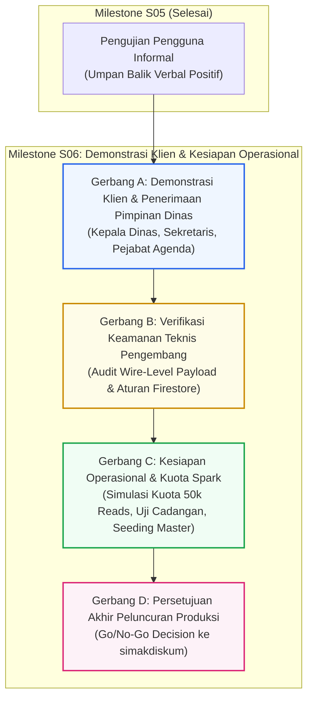

# SIMAK DISKUM v5.0 — Milestone S06 Client Demonstration & Operational Readiness Plan

**Sistem:** SIMAK DISKUM v5.0 (Sistem Informasi Manajemen Agenda Kedinasan)  
**Klien:** Dinas Koperasi dan Usaha Mikro Kota Batam  
**Target Rilis:** Firebase Spark Free Tier ($0.00/bulan) — Proyek Produksi: `simakdiskum`  
**Lingkungan Evaluasi / Demo Saat Ini:** Cloud Staging: `simakdiskum-staging`  
- Portal Publik Staging: [https://simakdiskum-staging.web.app](https://simakdiskum-staging.web.app)  
- Portal Admin Staging: [https://simakdiskum-staging-admin.web.app](https://simakdiskum-staging-admin.web.app)  
**Tanggal Penyusunan Rencana:** 9 November 2026  
**Status Dokumen:** **DRAFT PERENCANAAN RESMI — MENUNGGU PERSETUJUAN PEMILIK PROYEK**  

---

## 1. Latar Belakang & Konteks Transisi (Dari S05 ke S06)

Pada Milestone S05, sistem telah melalui tahap **Evaluasi Pengguna Eksternal Informal (*Informal External User Testing*)** yang dibantu secara sukarela oleh rekan pemilik proyek (Asep). Hasil pengujian verbal menyatakan bahwa aplikasi berjalan dengan lancar, stabil, dan tidak ditemukan kendala operasional. Rekan penguji juga menyatakan kesediaannya secara sukarela dan informal untuk membantu penelusuran masalah (*troubleshooting*) apabila diperlukan di masa mendatang.

Sesuai klarifikasi tata kelola proyek:
1. **Pengujian S05 bersifat informal dan sukarela:** Pengujian ini **BUKAN** merupakan perikatan QA terkontrak (*contracted QA engagement*) dan **BUKAN** merupakan penerimaan kelembagaan resmi (*formal institutional acceptance*).
2. **Tidak Mengklaim Kelulusan 33 Skenario Secara Formal:** Dokumen panduan dan 33 skenario uji pada `docs/S05_EXTERNAL_QA_ACCEPTANCE_CHECKLIST.md` tetap menjadi rujukan standar fungsional, namun sistem secara jujur mencatat bahwa checklist tersebut tidak dieksekusi atau ditandatangani per butir dalam format audit formal. Tidak ada laporan uji palsu, tangkapan layar rekayasa, atau tanda tangan artifisial yang dibuat.
3. **Bantuan Troubleshooting Masa Depan Bersifat Sukarela:** Kesediaan bantuan dari rekan penguji dicatat sebagai bantuan persahabatan informal tanpa ikatan Service Level Agreement (SLA) atau kewajiban kontrak formal.
4. **Pemisahan Gerbang Menuju Rilis (Decoupled Governance Gates):** Milestone S06 dirancang untuk memisahkan secara tegas 4 gerbang keputusan independen sebelum peluncuran produksi:
   - **Gerbang A:** Demonstrasi Resmi Klien & Penerimaan Pimpinan Dinas (*Stakeholder Acceptance*).
   - **Gerbang B:** Verifikasi Teknis Keamanan Jaringan & Data oleh Pengembang (*Security Verification*).
   - **Gerbang C:** Kesiapan Operasional, Kuota Spark & Uji Pemulihan Bencana (*Operational Readiness*).
   - **Gerbang D:** Persetujuan Akhir & Peluncuran Produksi Terkendali (*Production Deployment Approval*).

---

## 2. Struktur Empat Gerbang Tata Kelola Independen (Decoupled Gates)



---

### GERBANG A: Demonstrasi Klien & Penerimaan Pimpinan Dinas (Stakeholder Acceptance)

**Tujuan:** Memperagakan kemampuan fungsional lengkap SIMAK DISKUM v5.0 secara langsung kepada pimpinan dan operator Dinas Koperasi dan Usaha Mikro Kota Batam di lingkungan cloud staging.

- **Pemangku Kepentingan Target:**
  - Kepala Dinas Koperasi dan Usaha Mikro Kota Batam
  - Sekretaris Dinas & Kepala Bagian / Subbag Kepegawaian & Umum
  - Para Operator Pengelola Agenda Kedinasan
- **Prasyarat Gerbang A:**
  - Cloud Staging (`simakdiskum-staging`) aktif dan menyajikan 38 agenda baseline demonstrasi Oktober 2026.
  - Perangkat laptop/tablet pemapar terhubung proyektor ruang rapat dengan koneksi internet stabil.
  - Akun demo resmi aktif (`admin.staging@diskum.local` atau akun peraga berizin admin).

#### Skenario & Alur Peragaan Demonstrasi (Live Demonstration Script)

1. **Peragaan Portal Publik (Citizen & Inter-Agency Facing):**
   - **Tampilan Beranda:** Identitas resmi Batam, lambang daerah, spanduk selamat datang Jembatan Barelang, dan kartu rekapitulasi 4 metrik (*Hari Ini, Pekan Ini, Bulan Ini, Total Agenda*).
   - **Agenda Hari Ini & Mendatang:** Format waktu Indonesia Barat (WIB), tanggal formal bahasa Indonesia (`dddd, D MMMM YYYY`), status operasional, serta lencana tahap kegiatan.
   - **Modul Kalender Interaktif:** Navigasi Tampilan Bulan (*Month View*), Pekan (*Week Stacked View* pada ponsel / 7-kolom desktop), Hari (*Day View*), dan Daftar (*List View*).
   - **Pencarian Agenda:** Filter pencarian multi-kriteria berbasis teks dan rentang tanggal dengan validasi format `dd/mm/yyyy`.
   - **Privasi Publik Terjamin:** Memperlihatkan bahwa modal detail publik hanya menyajikan informasi umum kedinasan, tanpa membocorkan catatan internal pimpinan, tautan rapat virtual berpassword, atau dokumen berstatus rahasia.

2. **Peragaan Portal Administrasi (Internal Operator & Executive Facing):**
   - **Otentikasi Aman:** Masuk portal admin menggunakan email dan sandi resmi, demonstrasi pencegahan akses liar (*Access Denied Isolation*), dan profil operator dengan lencana peran (*Role Badge*).
   - **Dashboard Eksekutif:** Grafik donut persentase status administrasi murni CSS (*conic-gradient* tanpa beban library luar), kartu ringkasan 4 tahap administrasi, dan daftar agenda prioritas mendatang.
   - **Alur Kerja 4 Tahap Administrasi (Feature F01):**
     - *Tahap 1 (Input Awal / INITIAL_ENTRY):* Pendaftaran jadwal masuk dengan peringatan non-blocking.
     - *Tahap 2 (Proses Offline / OFFLINE_PROCESS):* Pencatatan proses disposisi fisik dan koordinasi internal.
     - *Tahap 3 (Detail Dilengkapi / DETAILS_COMPLETED):* Penugasan personil pegawai dinas dan catatan publik.
     - *Tahap 4 (Administrasi Lengkap / ADMIN_COMPLETE):* Validasi berkas final, nomor agenda, tanggal surat, dan penguncian arsip.
   - **Pencegahan Konflik Penjadwalan Otomatis:**
     - Simulasi bentrok ruangan rapat pada rentang jam yang tumpang tindih (muncul dialog peringatan bentrok ruangan).
     - Simulasi penugasan personil ganda pada waktu bersamaan di lokasi berbeda.
     - Pembuktian interval berurutan (*half-open interval*: acara selesai jam 10.00, acara berikutnya mulai jam 10.00 diperbolehkan tanpa alarm bentrok).
   - **Manajemen Data Master Kedinasan:**
     - Struktur 5 tab: Pegawai, Unit Bidang, Ruangan/Lokasi, Penyelenggara, dan Kategori.
     - Pembuktian proteksi referensial (*Referential Safeguard*): penolakan penghapusan data master yang masih terikat pada agenda aktif.
   - **Paket Ekspor Rekapitulasi Resmi 8 Kolom:**
     - *Unduh Excel (.xlsx):* Berkas kerja OpenXML asli via ExcelJS dengan header biru tua kedinasan dan netralisasi injeksi formula.
     - *Unduh Gambar (.png / .jpg):* Gambar tajam siap sebar ke grup koordinasi pimpinan.
     - *Cetak PDF A4 Landscape:* Standar Milestone S04 dengan layout kompak 3 halaman untuk 38 agenda, pengulangan header tabel di setiap lembar, penomoran halaman dinamis ("Halaman X dari 3"), dan resolusi nama resmi tanpa kebocoran ID database.
   - **Responsivitas Ponsel Pimpinan & Staf:**
     - Menunjukkan bahwa portal publik dan admin dapat diakses melalui ponsel cerdas (*smartphone*) dengan nol geser samping (*0px horizontal overflow*), navigasi sentuh minimal 44 × 44 px, dan reflow kartu agenda yang nyaman dibaca.

- **Kriteria Keberhasilan Gerbang A:** Pimpinan Dinas Koperasi dan Usaha Mikro Kota Batam menyatakan penerimaan terhadap antarmuka dan alur kerja aplikasi, serta memberikan rekomendasi nama pejabat penandatangan resmi untuk template laporan.

---

### GERBANG B: Verifikasi Keamanan Teknis Pengembang (Security Verification)

**Tujuan:** Membuktikan secara teknis dan matematis bahwa seluruh data administratif privat terlindungi pada tingkat basis data dan transmisi jaringan, independen dari antarmuka visual UI.

> [!IMPORTANT]
> Gerbang ini dijalankan secara mandiri oleh **Tim Pengembang (Developer)** menggunakan automated testing dan inspeksi paket jaringan. Gerbang ini TIDAK bergantung pada demonstrasi visual kepada pengguna.

- **Ruang Lingkup Pengujian Gerbang B:**
  1. **Uji Otomatis Aturan Keamanan Basis Data (Firestore Security Rules):**
     - Menjalankan test suite unit aturan basis data (`tests/rules/firestore.rules.test.ts` & `tests/unit/rulesSourceVerification.test.ts`).
     - Memverifikasi 38 pengujian aturan lolos 100%:
       - Penolakan akses tulis (*write, update, delete*) tanpa token JWT admin resmi (`PERMISSION_DENIED`).
       - Penolakan pembuatan peran istimewa di luar ketentuan RBAC (`admin`, `editor`).
       - Enforce server timestamp `request.time` pada riwayat audit (*audit trail*).
       - Enforce sinkronisasi versi transaksi ganda (*optimistic concurrency version lockstep*).
  2. **Audit Transmisi Muatan Jaringan Mentah (Wire-Level Payload Inspection):**
     - Membuka Portal Publik pada jendela peramban anonim (*incognito*).
     - Menginspeksi tab *Network* pada Chrome Developer Tools (filter WebSocket frames / Firestore Listen / REST GET).
     - Memeriksa secara mendalam muatan data mentah yang diterima peramban publik:
       - Memastikan field sensitif (`privateNotes`, `internalMeetingUrl`, `referenceDocuments`) tidak ditransmisikan secara telanjang melalui kabel jaringan ke publik.
       - Membedakan secara tegas antara penutupan visual (elemen disembunyikan via CSS/DOM) dengan eliminasi muatan pada level arsitektur data.
  3. **Isolasi Kredensial & Kunci Layanan:**
     - Memverifikasi bahwa build produksi dan staging bersih dari Application Default Credentials (ADC), kunci JSON service account, token GitHub, atau rahasia Firebase Admin SDK.
     - Memverifikasi repositori GitHub privat tetap berstatus HTTP 404 bagi akses tanpa otentikasi.

- **Kriteria Keberhasilan Gerbang B:** Laporan audit keamanan pengembang mengonfirmasi 100% aturan Firestore aktif, nol kebocoran data privat pada payload jaringan publik, dan isolasi penuh kunci kredensial.

---

### GERBANG C: Kesiapan Operasional, Kuota Spark & Uji Pemulihan Bencana (Operational Readiness)

**Tujuan:** Memastikan bahwa sistem siap beroperasi secara mandiri dan berkelanjutan di atas paket tanpa biaya **Firebase Spark Plan ($0.00/bulan)** tanpa risiko terhenti di tengah jalan.

- **Ruang Lingkup Pengujian Gerbang C:**
  1. **Audit Model Kuota Harian Firebase Spark:**
     - Kuota baca (*read quota*): 50.000 dokumen/hari.
     - Kuota tulis (*write quota*): 20.000 dokumen/hari.
     - Estimasi konsumsi dinas harian (5 operator, ~200 pengunjung masyarakat): ~4.000 s.d. 8.000 baca/hari (<16% kapasitas gratis).
     - Perilaku Saat Batas Kuota Tercapai: Memastikan aplikasi menampilkan pesan informatif dalam bahasa Indonesia bahwa kuota harian sedang menyegarkan, tanpa menyebabkan halaman web mengalami crash layar putih.
     - Waktu Reset Kuota Resmi: Dicatat dan dipantau sesuai waktu Pasifik AS (pukul 14.00 WIB pada musim panas PDT / pukul 15.00 WIB pada musim dingin PST).
  2. **Uji Cadangan & Pemulihan Mandiri (Backup & Disaster Recovery Rehearsal):**
     - Menjalankan uji skrip pencadangan logis `scripts/backupRestore.mjs export --target=staging`.
     - Memverifikasi serialisasi tipe data lossless: `Timestamp` (seconds/nanoseconds) dan `DocumentReference`.
     - Menguji integritas berkas cadangan melalui verifikasi checksum SHA-256 dan ledger kemajuan pemulihan (`restore-progress.json`).
     - Menguji pemulihan non-destruktif (`--mode=merge`) dan pemulihan penuh terkontrol (`--mode=full --force`).
     - Memverifikasi perlindungan mutlak koleksi `auditLogs`: nol penghapusan riwayat audit saat pemulihan database.
  3. **Penyusunan Data Master Produksi Resmi:**
     - Memvalidasi template master data produksi `templates/productionMasterDataTemplate.json`.
     - Memastikan data pejabat resmi, NIP riil, dan daftar ruangan kantor telah diverifikasi oleh bagian umum sebelum injeksi data awal (*initial seeding*).
     - Mengaktifkan bendera persetujuan klien (`clientApproved: true`) hanya setelah dokumen SK dinas diterima.
  4. **Kesiagaan Prosedur Lockdown Pemeliharaan (Maintenance Shield):**
     - Memverifikasi ketersediaan aturan darurat `firebase/firestore.maintenance.rules` dan konfigurasi `firebase.maintenance.json`.
     - Menjamin prosedur penguncian mutasi tulis dapat diaktifkan dalam hitungan detik jika terjadi anomali darurat, dengan portal publik tetap dapat membaca data arsip.

- **Kriteria Keberhasilan Gerbang C:** Uji pencadangan menghasilkan berkas ekspor valid, verifikasi kuota dinyatakan aman, dan template master data siap diisi data resmi dinas.

---

### GERBANG D: Persetujuan Akhir & Peluncuran Produksi Terkendali (Production Deployment Approval)

**Tujuan:** Mengeksekusi peluncuran perdana ke proyek produksi resmi `simakdiskum` secara teratur, aman, dan tanpa pemadaman layanan (*zero downtime*).

- **Prasyarat Mutlak Gerbang D:**
  1. Gerbang A (Penerimaan Klien) telah berstatus **DISETUJUI RESMI**.
  2. Gerbang B (Keamanan Teknis) telah berstatus **LOLOS VERIFIKASI**.
  3. Gerbang C (Kesiapan Operasional) telah berstatus **SIAP OPERASI**.
  4. Pernyataan persetujuan resmi (*Go Decision*) dari Pemilik Proyek (*Project Owner*).

#### Urutan Eksekusi Peluncuran Produksi (10 Gerbang Aktivasi Rujukan P02_ACTIVATION_PLAN)

```
[Tahap 1] Pemeriksaan Pra-Aktivasi & Verifikasi Target CLI
          - Verifikasi target .firebaserc menunjuk ke proyek 'simakdiskum'
          - Penolakan otomatis jika parameter menunjuk ke staging/emulator

[Tahap 2] Penerapan Aturan Keamanan Produksi (Firestore Security Rules)
          - firebase deploy --only firestore:rules --project simakdiskum
          - Verifikasi SHA-256 rules dan uji penolakan akses tulis anonim

[Tahap 3] Penerapan Indeks Komposit Basis Data
          - firebase deploy --only firestore:indexes --project simakdiskum
          - Verifikasi status indeks selesai dibangun (READY) di Firebase Console

[Tahap 4] Provisi Akun Operator & Administrator Perdana
          - node scripts/manageRoles.mjs provision <email_admin_dinas> "Admin Diskum" admin --target=prod
          - Pengiriman tautan pengaturan sandi resmi secara aman out-of-band

[Tahap 5] Injeksi Data Master Resmi Dinas
          - node scripts/backupRestore.mjs seed --target=prod
          - Validasi integritas 5 entitas master data dinas

[Tahap 6] Build & Deployment Aplikasi Hosting Publik & Admin
          - npm run build
          - firebase deploy --only hosting --project simakdiskum

[Tahap 7] Verifikasi Pasca-Peluncuran (Smoke Testing)
          - Akses https://simakdiskum.web.app (Periksa Beranda & Kalender)
          - Akses https://simakdiskum-admin.web.app (Login perdana Admin & ganti sandi sementara)
          - Uji input 1 agenda kedinasan perdana

[Tahap 8] Serah Terima Operasional Resmi ke Operator Dinas
          - Penyerahan panduan operasional pengguna
          - Pendampingan input jadwal mandiri oleh operator agenda
```

---

## 3. Matriks Tanggung Jawab & Peran (RACI Matrix)

| Aktivitas Pelaksanaan | Pemilik Proyek (Owner) | Pengembang (Developer) | Rekan Tester (Asep) | Pimpinan / Staf Dinas |
|:---|:---:|:---:|:---:|:---:|
| **Klarifikasi & Penutupan Informal S05** | **Accountable (A)** | **Responsible (R)** | Informed (I) | - |
| **Penyusunan Rencana Milestone S06** | **Accountable (A)** | **Responsible (R)** | - | - |
| **Gerbang A: Demonstrasi Klien Resmi** | **Responsible (R)** | **Responsible (R)** | - | **Consulted (C) / Approver** |
| **Gerbang B: Audit Keamanan Teknis** | Informed (I) | **Accountable & Responsible (A/R)** | - | - |
| **Gerbang C: Kesiapan Operasional Spark** | **Accountable (A)** | **Responsible (R)** | - | Consulted (C) |
| **Gerbang D: Eksekusi Produksi (Go/No-Go)** | **Accountable (A)** | **Responsible (R)** | - | Informed (I) |
| **Bantuan Troubleshooting Masa Depan** | - | Consulted (C) | **Voluntary / Informal (V)** | - |

*Keterangan:* `(A) Accountable / Pengambil Keputusan`; `(R) Responsible / Pelaksana Teknis`; `(C) Consulted / Narasumber`; `(I) Informed / Penerima Laporan`; `(V) Voluntary / Bantuan Sukarela Non-Kontraktual`.

---

## 4. Perlindungan Data Baseline & Lingkungan Saat Ini

Selama pelaksanaan Milestone S06 dan seluruh gerbang persiapannya:
1. **Lingkungan Produksi (`simakdiskum`):** Tetap **TERLINDUNGI 100%**, tanpa mutasi data, tanpa build yang belum disetujui, dan tanpa akses kredensial terbuka.
2. **Lingkungan Staging (`simakdiskum-staging`):** Ke-38 data kegiatan baseline Oktober 2026 **WAJIB TETAP DIPELIHARA UTUH** untuk keperluan demonstrasi Gerbang A. Setiap data uji coba baru wajib menggunakan awalan `[QA-TEST]` dan dibersihkan secara berurutan sesuai prosedur.

---

<div align="center">
  <sub>SIMAK DISKUM v5.0 — Dokumen Perencanaan Demonstrasi Klien & Kesiapan Operasional (Milestone S06).</sub>
</div>
