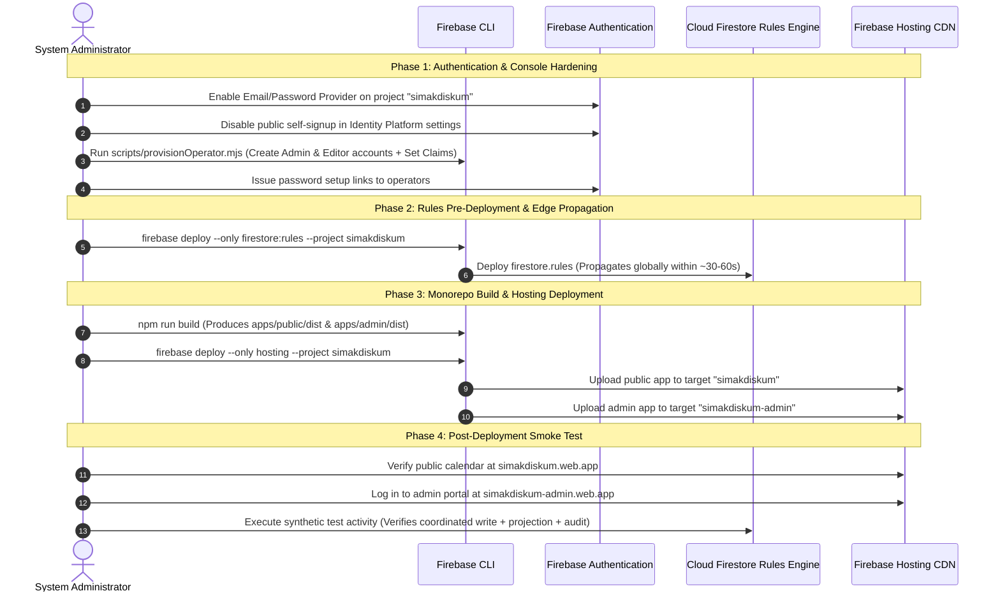

# Gate 5A: Production Security Hardening & Honest Architecture Specification

**Project:** Sistem Informasi Manajemen Agenda Kedinasan (SIMAK DISKUM Kota Batam)  
**System Version:** v5.0.0  
**Firebase Project ID:** `simakdiskum`  
**Hosting Targets:**
- Public Portal: `simakdiskum.web.app` (Citizen & inter-agency calendar, agenda, and official 8-column reports)
- Admin Portal: `simakdiskum-admin.web.app` (Operator scheduling, master data, signatory settings, audit trail, migration)
**Roles Required:** `Admin` (Kepala Dinas / Administrator Sistem), `Editor` (Operator Agenda Dinas)  
**Status:** Gate 5A Hardened & Formally Verified (21/21 Rules Scenarios Passing, 137/137 Unit/Integration Tests Passing, 40/40 Playwright Scenarios Passing)  
**Date:** 2026-11-04  

---

## 1. Security Architecture & Threat Model

The security architecture of SIMAK DISKUM v5.0 is founded on a **defense-in-depth, zero-trust perimeter**:
1. **Infrastructure Enforcement Layer (Cloud Firestore Security Rules):**
   - Security is **never** delegated to client-side visibility, URL obscurity, or hosting subdomains.
   - Any client request originating from any origin without a valid Firebase ID token carrying verified custom claims (`role == 'admin'` or `role == 'editor'`) is unconditionally rejected with `PERMISSION_DENIED` at the Google Cloud edge.
   - Cross-document coordination using `getAfter()` and `existsAfter()` guarantees that public projections (`publicActivities`) and internal records (`activities`) cannot be written or modified independently or desynchronized by a malicious authenticated client.
2. **Identity & Credential Layer (Firebase Authentication):**
   - Authentic identity is managed via cryptographically signed Firebase ID tokens (JWTs) issued by Google's OAuth 2.0 authorization server.
   - User roles are encoded in **Firebase Custom User Claims**, preventing clients from claiming or altering their own roles.
3. **Audit Immutability & Forensics Layer (`auditLogs`):**
   - Administrative actions are recorded in an append-only audit trail bound cryptographically to the caller's verified `request.auth.uid` and server timestamp `request.time`.
   - Update and delete operations on audit logs are disabled unconditionally at the rule engine level (`allow update, delete: if false;`).

```mermaid
flowchart TD
    subgraph Public Internet
        Citizen["Citizen / External Agency"]
        Attacker["Adversary / Unauthorized User"]
        Operator["Dinas Operator (Editor)"]
        AdminUser["Kepala Dinas (Admin)"]
    end

    subgraph Firebase Hosting CDN
        PublicHost["simakdiskum.web.app<br/>(Static Public Bundle)"]
        AdminHost["simakdiskum-admin.web.app<br/>(Static Admin Bundle)"]
    end

    subgraph Firebase Authentication
        AuthService["Firebase Auth (Email/Password)<br/>Custom Claims: role=admin | role=editor"]
    end

    subgraph Cloud Firestore Rule Engine
        RuleGateway{"Firestore Security Rules<br/>(Rules Version 2)"}
        PublicColl[("publicActivities<br/>(Public Read, Staff Coordinated Write)")]
        PrivateColl[("activities<br/>(Private, Staff Coordinated Write)")]
        MasterColl[("employees, locations, ...<br/>settings/signatory<br/>(Admin CRUD, Editor Read)")]
        AuditColl[("auditLogs<br/>(Append-Only, request.time Binding)")]
    end

    Citizen --> PublicHost
    PublicHost -->|Unauthenticated Read| RuleGateway
    Attacker -.->|Bypasses UI to Admin API| RuleGateway
    Operator --> AdminHost
    AdminUser --> AdminHost
    Operator --> AuthService
    AdminUser --> AuthService
    AuthService -->|Issues ID Token + Role Claim| Operator
    AuthService -->|Issues ID Token + Role Claim| AdminUser
    AdminHost -->|Signed Bearer Token| RuleGateway

    RuleGateway -->|allow read: true| PublicColl
    RuleGateway -->|auth.token.role in ['admin','editor'] + getAfter() Coordinated| PublicColl
    RuleGateway -->|auth.token.role in ['admin','editor'] + getAfter() Coordinated| PrivateColl
    RuleGateway -->|auth.token.role == 'admin'| MasterColl
    RuleGateway -->|actorId == auth.uid & time == request.time| AuditColl
    RuleGateway -.->|DENIED 403| Attacker
```

---

## 2. Authentication Provider Recommendation & Analysis

For the **2–5 designated operators** of Dinas Koperasi dan Usaha Mikro Kota Batam, we evaluated three primary authentication mechanisms:

| Evaluation Criterion | Option A: Email/Password (Recommended) | Option B: Google Workspace OAuth | Option C: Phone SMS Authentication |
| :--- | :--- | :--- | :--- |
| **Operational Fit (2–5 users)** | **Optimal.** Operators are issued official organizational email accounts (e.g. `operator.diskum@batam.go.id`). | Requires Google Workspace enterprise tenant setup and DNS TXT verification. | SMS delivery delays, SIM swapping vulnerabilities, telco spam filters. |
| **Firebase Spark Compatibility** | **100% Free.** Generous free limit of 50,000 MAU; our workload is 2–5 users (0.01% of quota). | Free up to 50,000 MAU, but domain restriction requires Cloud Functions (Blaze). | Free limit of only 10 SMS/day; dangerous risk of operator lockout. |
| **Credential Management** | Out-of-band password reset via `sendPasswordResetEmail` managed securely by Google. | Managed by Google Account single-sign-on. | OTP via cellular provider. |
| **API Attack Surface** | Low risk with Identity Platform user creation disabled. | Moderate; depends on Workspace organization security policies. | High; phone numbers subject to SIM attacks. |
| **Recommendation** | **STRONGLY RECOMMENDED** | **Alternative (if Batam IT mandates SSO)** | **REJECTED (Incompatible with SLA)** |

### Recommendation Summary:
**Email and Password Authentication** is selected as the production provider. It operates completely within the **Firebase Spark free tier**, requires zero third-party OAuth redirect configuration, and provides standard out-of-band credential recovery.

---

## 3. Administrator Onboarding & Account Provisioning Runbook

### A. API-Level Account Creation Risk & Safeguards (`accounts:signUp`)
> [!WARNING]
> **Critical Security Warning: Hiding the registration UI does NOT disable API-level registration.**
> Simply omitting a sign-up form in the client web application does not prevent an adversary from sending HTTP POST requests directly to the Firebase Identity Toolkit REST endpoint:
> `https://identitytoolkit.googleapis.com/v1/accounts:signUp?key=API_KEY`
> If Email/Password authentication is enabled with default settings, an unauthenticated user could create a Firebase Authentication account via curl or automated tools.

#### Multi-Tiered Defenses Implemented:
1. **Google Cloud / Firebase Console Hardening (Recommended Primary Safeguard):**
   - In Google Cloud Console -> **Identity Platform** -> **Settings** -> **User account linking / User signup**, uncheck **"Enable create (sign-up)"**.
   - Alternatively, configure Identity Platform Blocking Functions (requires Blaze plan) or enforce IP whitelisting. When sign-up is unchecked in the console, any unauthorized call to `accounts:signUp` returns `OPERATION_NOT_ALLOWED`.
2. **Zero-Trust Custom Claims RBAC (Defense-in-Depth):**
   - Even if an adversary exploits the API to create an authenticated user record, they possess **zero custom claims** (`token.role == null`).
   - All private collections (`activities`, `employees`, `departments`, `locations`, `organizers`, `categories`, `settings`, `auditLogs`) strictly require `hasRole('admin')` or `hasRole('editor')`.
   - Therefore, a self-registered user receives `PERMISSION_DENIED` on every administrative read and write operation.

### B. Secure Operator Provisioning CLI (`scripts/provisionOperator.mjs`)
Operator accounts and custom claims are provisioned using a secure administrative script running on an authorized administrator workstation using the Firebase Admin SDK:

```javascript
// scripts/provisionOperator.mjs
import admin from 'firebase-admin';

// Initialize Firebase Admin with project credentials
admin.initializeApp({
  projectId: 'simakdiskum'
});

const auth = admin.auth();

async function provisionOperator(email, displayName, role) {
  if (!['admin', 'editor'].includes(role)) {
    throw new Error(`Invalid role: ${role}. Must be 'admin' or 'editor'.`);
  }

  console.log(`[Provisioning] Creating account for ${displayName} <${email}> with role: ${role}...`);
  
  // 1. Create User Account
  const userRecord = await auth.createUser({
    email,
    displayName,
    emailVerified: true,
    disabled: false
  });

  // 2. Set Custom Role Claim
  await auth.setCustomUserClaims(userRecord.uid, { role });

  // 3. Generate Out-of-Band Password Reset Link
  const resetLink = await auth.generatePasswordResetLink(email);

  console.log(`✓ Account created successfully! UID: ${userRecord.uid}`);
  console.log(`✓ Custom claim set: { role: "${role}" }`);
  console.log(`✓ Deliver this secure one-time password setup link to the operator:`);
  console.log(`  ${resetLink}`);
}
```

### C. Operator Offboarding & Revocation Procedure
When an operator leaves the department or is reassigned:
1. Run `auth.updateUser(uid, { disabled: true })`.
2. Run `auth.setCustomUserClaims(uid, { role: null })`.
3. Run `auth.revokeRefreshTokens(uid)`.

> [!IMPORTANT]
> **Token Revocation Lifetime Limitation:**
> In Firebase Authentication, calling `auth.revokeRefreshTokens(uid)` immediately invalidates the user's refresh token (preventing new ID tokens from being minted). However, **previously issued Firebase ID tokens (JWTs) remain cryptographically valid for up to 1 hour (3600 seconds)** until their `exp` timestamp is reached. Firestore security rules evaluate the JWT claims locally without contacting the auth server on every request. Immediate sub-second revocation of in-flight requests requires server-side token age checks (`request.auth.token.auth_time`) or disabling the user in Firestore rule lookups.

---

## 4. Complete Role-Based Access Control (RBAC) Matrix

| Collection & Document Path | Anonymous / Public | Operator (`role == 'editor'`) | Kepala Dinas (`role == 'admin'`) | Key Security Constraints & Invariants Enforced |
| :--- | :---: | :---: | :---: | :--- |
| `publicActivities/{id}` | **Read-Only** (`allow read: if true;`) | **Coordinated CRUD** | **Coordinated CRUD** | Strict projection schema; guaranteed exclusion of PII, private notes, and credentials; `id` immutable; **must match canonical `activities/{id}` via `getAfter()`**. |
| `activities/{activityId}` | **Denied** | **Coordinated Read / Create / Update** | **Coordinated Read / Create / Update / Delete** | Private only; `version == 1` on create; `version == resource.data.version + 1` on update; `id`, `createdAt`, `createdBy` immutable; `cancelReason` required when `status == 'CANCELLED'`; **must match `publicActivities/{activityId}` via `getAfter()`**. Operators cannot delete. |
| `auditLogs/{logId}` | **Denied** | **Read / Create** (Append-Only) | **Read / Create** (Append-Only) | Identity binding `actorId == request.auth.uid`; timestamp binding `timestamp == request.time`; `update` and `delete` strictly prohibited (`false`). |
| `employees/{id}` | **Denied** | **Read-Only** | **Full CRUD** | Master data locked; editors cannot tamper with personnel records; strict schema and name/position length checks. |
| `departments/{id}` | **Denied** | **Read-Only** | **Full CRUD** | Master data locked; editors cannot tamper with department structure. |
| `locations/{id}` | **Denied** | **Read-Only** | **Full CRUD** | Master data locked; room booking flags and office types validated. |
| `organizers/{id}` | **Denied** | **Read-Only** | **Full CRUD** | Master data locked; organizers cannot be added or altered by editors. |
| `categories/{id}` | **Denied** | **Read-Only** | **Full CRUD** | Master data locked; hex color regex (`^#[0-9a-fA-F]{6}$`) enforced. |
| `settings/{settingId}` | **Denied** | **Read-Only** | **Create / Update** | Official report signatory configuration; deletion strictly prohibited (`false`). |
| `publicAnnouncements/{annId}` | **Read-Only** (`allow read: if true;`) | **Create / Update / Delete** | **Create / Update / Delete** | Public informational notices; title, content length bounds (2-2000 chars). |
| `publicSettings/{settingId}` | **Read-Only** (`allow read: if true;`) | **Read-Only** | **Create / Update / Delete** | Public application branding and metadata. |
| Root Catch-All `/{document=**}` | **Denied** | **Denied** | **Denied** | Comprehensive default-deny barrier closing all unmapped paths. |

---

## 5. Verified Production Cloud Firestore Security Rules

The following complete rules file is tested and verified against the Firestore Emulator (21/21 test scenarios passing in [`tests/rules/firestore.rules.test.ts`](file:///D:/Temp/department-agenda-firebase/tests/rules/firestore.rules.test.ts)):

```rules
rules_version = '2';

// ===============================================================
// Assumed Data Model
// ===============================================================
//
// Project: SIMAK DISKUM Kota Batam (Department Activity Scheduling System v5.0)
// Project ID: simakdiskum
//
// Role-Based Access Control (RBAC):
// Derived strictly from verified Firebase Authentication custom claims:
//   - 'admin': Kepala Dinas / Administrator (full management of master data,
//              settings, activities, publications, and audit inspection).
//   - 'editor': Operator Agenda (draft, edit, and publish activities; cannot
//               alter master data, signatory settings, or system configuration).
// ===============================================================

service cloud.firestore {
  match /databases/{database}/documents {

    // Helper functions
    function isAuthenticated() {
      return request.auth != null;
    }

    function hasRole(roleName) {
      return isAuthenticated() &&
        request.auth.token != null &&
        'role' in request.auth.token &&
        request.auth.token.role == roleName;
    }

    function isAdmin() {
      return hasRole('admin');
    }

    function isEditor() {
      return hasRole('editor');
    }

    function isEditorOrAdmin() {
      return isAdmin() || isEditor();
    }

    function hasOnlyAllowedFields(allowedFields) {
      return request.resource.data.keys().hasOnly(allowedFields);
    }

    function areImmutableFieldsUnchanged(fields) {
      return !request.resource.data.diff(resource.data).affectedKeys().hasAny(fields);
    }

    function isValidDateFormat(val) {
      return val is string && val.matches('^[0-9]{4}-[0-9]{2}-[0-9]{2}$');
    }

    function isValidTimeFormat(val) {
      return val is string && val.matches('^[0-9]{2}:[0-9]{2}$');
    }

    function isValidHexColor(val) {
      return val is string && val.matches('^#[0-9a-fA-F]{6}$');
    }

    function isValidDateRange(data) {
      return isValidDateFormat(data.startDate) &&
             isValidDateFormat(data.endDate) &&
             data.startDate <= data.endDate;
    }

    function isValidTimeRange(data) {
      return (data.openEnded == true && data.endTime == null) ||
             (data.openEnded == false && data.endTime is string && isValidTimeFormat(data.endTime));
    }

    function isValidCancelReason(data) {
      return data.status != 'CANCELLED' ||
             (('cancelReason' in data) && data.cancelReason is string && data.cancelReason.size() > 0 && data.cancelReason.size() <= 1000);
    }

    // 1. Validator for publicActivities/{activityId}
    function isValidPublicActivity(data, activityId) {
      let allowed = [
        'id', 'title', 'startDate', 'startTime', 'endDate', 'endTime',
        'openEnded', 'timeDisplay', 'dateDisplay', 'status',
        'publicCancellationNotice', 'locationName', 'locationType',
        'organizerName', 'categoryName', 'publicNotes', 'attendeeLabels',
        'updatedAt'
      ];
      let required = [
        'id', 'title', 'startDate', 'startTime', 'endDate', 'endTime',
        'openEnded', 'timeDisplay', 'dateDisplay', 'status',
        'locationName', 'locationType', 'organizerName', 'categoryName',
        'publicNotes', 'attendeeLabels', 'updatedAt'
      ];

      return data.keys().hasOnly(allowed) &&
             data.keys().hasAll(required) &&
             data.id is string &&
             data.id == activityId &&
             data.id.size() >= 1 &&
             data.id.size() <= 100 &&
             data.title is string &&
             data.title.size() >= 3 &&
             data.title.size() <= 200 &&
             isValidDateRange(data) &&
             isValidTimeFormat(data.startTime) &&
             data.openEnded is bool &&
             isValidTimeRange(data) &&
             data.timeDisplay is string && data.timeDisplay.size() >= 1 && data.timeDisplay.size() <= 100 &&
             data.dateDisplay is string && data.dateDisplay.size() >= 1 && data.dateDisplay.size() <= 100 &&
             data.status in ['SCHEDULED', 'CANCELLED', 'COMPLETED'] &&
             (!data.keys().hasAll(['publicCancellationNotice']) || (data.publicCancellationNotice is string && data.publicCancellationNotice.size() <= 500)) &&
             data.locationName is string && data.locationName.size() >= 1 && data.locationName.size() <= 200 &&
             data.locationType in ['OFFICE', 'EXTERNAL', 'ONLINE'] &&
             data.organizerName is string && data.organizerName.size() >= 1 && data.organizerName.size() <= 200 &&
             data.categoryName is string && data.categoryName.size() >= 1 && data.categoryName.size() <= 200 &&
             data.publicNotes is string && data.publicNotes.size() <= 1000 &&
             data.attendeeLabels is list && data.attendeeLabels.size() <= 100 &&
             data.updatedAt is string && data.updatedAt.size() >= 1 && data.updatedAt.size() <= 50;
    }

    // 2. Validator for activities/{activityId}
    function isValidActivity(data, activityId) {
      let allowed = [
        'id', 'title', 'startDate', 'startTime', 'endDate', 'endTime',
        'openEnded', 'locationId', 'organizerId', 'categoryId',
        'attendeeIds', 'attendeeSnapshots', 'guestAttendees', 'status',
        'cancelReason', 'publicCancellationNotice', 'publicNotes',
        'privateNotes', 'privateMeetingUrl', 'version', 'createdAt',
        'createdBy', 'updatedAt', 'updatedBy'
      ];
      let required = [
        'id', 'title', 'startDate', 'startTime', 'endDate', 'endTime',
        'openEnded', 'locationId', 'organizerId', 'categoryId',
        'attendeeIds', 'attendeeSnapshots', 'guestAttendees', 'status',
        'publicNotes', 'privateNotes', 'privateMeetingUrl', 'version',
        'createdAt', 'createdBy', 'updatedAt', 'updatedBy'
      ];

      return data.keys().hasOnly(allowed) &&
             data.keys().hasAll(required) &&
             data.id is string &&
             data.id == activityId &&
             data.id.size() >= 1 &&
             data.id.size() <= 100 &&
             data.title is string &&
             data.title.size() >= 3 &&
             data.title.size() <= 200 &&
             isValidDateRange(data) &&
             isValidTimeFormat(data.startTime) &&
             data.openEnded is bool &&
             isValidTimeRange(data) &&
             data.locationId is string && data.locationId.size() >= 1 && data.locationId.size() <= 100 &&
             data.organizerId is string && data.organizerId.size() >= 1 && data.organizerId.size() <= 100 &&
             data.categoryId is string && data.categoryId.size() >= 1 && data.categoryId.size() <= 100 &&
             data.attendeeIds is list && data.attendeeIds.size() <= 100 &&
             data.attendeeSnapshots is list && data.attendeeSnapshots.size() <= 100 &&
             data.guestAttendees is list && data.guestAttendees.size() <= 100 &&
             data.status in ['SCHEDULED', 'CANCELLED', 'COMPLETED'] &&
             isValidCancelReason(data) &&
             (!data.keys().hasAll(['cancelReason']) || (data.cancelReason is string && data.cancelReason.size() <= 1000)) &&
             (!data.keys().hasAll(['publicCancellationNotice']) || (data.publicCancellationNotice is string && data.publicCancellationNotice.size() <= 500)) &&
             data.publicNotes is string && data.publicNotes.size() <= 1000 &&
             data.privateNotes is string && data.privateNotes.size() <= 2000 &&
             (data.privateMeetingUrl == null || (data.privateMeetingUrl is string && data.privateMeetingUrl.size() <= 500)) &&
             data.version is int && data.version >= 1 &&
             data.createdAt is string && data.createdAt.size() >= 1 && data.createdAt.size() <= 50 &&
             data.createdBy is string && data.createdBy.size() >= 1 && data.createdBy.size() <= 100 &&
             data.updatedAt is string && data.updatedAt.size() >= 1 && data.updatedAt.size() <= 50 &&
             data.updatedBy is string && data.updatedBy.size() >= 1 && data.updatedBy.size() <= 100;
    }

    // 3. Validator for auditLogs/{logId}
    function isValidAuditLog(data, logId) {
      let allowed = [
        'id', 'actorId', 'actorLabel', 'identitySource', 'action',
        'recordId', 'documentId', 'collectionName', 'requestId',
        'version', 'timestamp', 'beforeSummary', 'afterSummary', 'details'
      ];
      let required = ['id', 'actorId', 'action'];

      return data.keys().hasOnly(allowed) &&
             data.keys().hasAll(required) &&
             data.id is string &&
             data.id == logId &&
             data.id.size() >= 1 &&
             data.id.size() <= 100 &&
             data.actorId is string &&
             data.actorId == request.auth.uid &&
             data.action in ['CREATE', 'UPDATE', 'CANCEL', 'DELETE', 'MIGRATE'] &&
             ('timestamp' in data) &&
             data.timestamp == request.time &&
             (!('actorLabel' in data) || (data.actorLabel is string && data.actorLabel.size() <= 100)) &&
             (!('identitySource' in data) || (data.identitySource is string && data.identitySource.size() <= 50)) &&
             (!('recordId' in data) || (data.recordId is string && data.recordId.size() <= 100)) &&
             (!('documentId' in data) || (data.documentId is string && data.documentId.size() <= 100)) &&
             (!('collectionName' in data) || (data.collectionName is string && data.collectionName.size() <= 50)) &&
             (!('requestId' in data) || (data.requestId is string && data.requestId.size() <= 100)) &&
             (!('version' in data) || data.version is int) &&
             (!('beforeSummary' in data) || data.beforeSummary == null || data.beforeSummary is map) &&
             (!('afterSummary' in data) || data.afterSummary == null || data.afterSummary is map) &&
             (!('details' in data) || data.details == null || data.details is map);
    }

    // 4. Master Data Validators
    function isValidEmployee(data, empId) {
      let fields = ['id', 'name', 'position', 'departmentId', 'active'];
      return data.keys().hasOnly(fields) && data.keys().hasAll(fields) &&
             data.id == empId && data.name.size() >= 2 && data.name.size() <= 100 &&
             data.position.size() >= 2 && data.position.size() <= 100 &&
             data.departmentId.size() >= 1 && data.active is bool;
    }

    function isValidDepartment(data, deptId) {
      let fields = ['id', 'name', 'active'];
      return data.keys().hasOnly(fields) && data.keys().hasAll(fields) &&
             data.id == deptId && data.name.size() >= 2 && data.name.size() <= 100 &&
             data.active is bool;
    }

    function isValidLocation(data, locId) {
      let fields = ['id', 'name', 'type', 'isBookableRoom', 'active'];
      return data.keys().hasOnly(fields) && data.keys().hasAll(fields) &&
             data.id == locId && data.name.size() >= 2 && data.name.size() <= 100 &&
             data.type in ['OFFICE', 'EXTERNAL', 'ONLINE'] &&
             data.isBookableRoom is bool && data.active is bool;
    }

    function isValidOrganizer(data, orgId) {
      let fields = ['id', 'name', 'active'];
      return data.keys().hasOnly(fields) && data.keys().hasAll(fields) &&
             data.id == orgId && data.name.size() >= 2 && data.name.size() <= 100 &&
             data.active is bool;
    }

    function isValidCategory(data, catId) {
      let fields = ['id', 'name', 'colorHex', 'active'];
      return data.keys().hasOnly(fields) && data.keys().hasAll(fields) &&
             data.id == catId && data.name.size() >= 2 && data.name.size() <= 100 &&
             isValidHexColor(data.colorHex) && data.active is bool;
    }

    function isValidSignatorySettings(data) {
      let allowed = ['name', 'nip', 'position', 'department', 'city', 'updatedAt', 'updatedBy'];
      let required = ['name', 'nip', 'position', 'department', 'city'];
      return data.keys().hasOnly(allowed) && data.keys().hasAll(required) &&
             data.name.size() >= 2 && data.nip.size() >= 5 && data.position.size() >= 2 &&
             data.department.size() >= 2 && data.city.size() >= 2;
    }

    function isValidSettings(data, settingId) {
      return settingId == 'signatory' ? isValidSignatorySettings(data) : (data is map);
    }

    function isValidPublicAnnouncement(data, annId) {
      let allowed = ['id', 'title', 'content', 'category', 'publishedAt', 'active'];
      let required = ['id', 'title', 'content', 'publishedAt'];
      return data.keys().hasOnly(allowed) && data.keys().hasAll(required) &&
             data.id == annId && data.title.size() >= 2 && data.content.size() >= 1;
    }

    // Cross-document coordination validators
    function hasMatchingPrivateActivity(id, publicData) {
      return existsAfter(/databases/$(database)/documents/activities/$(id)) &&
             getAfter(/databases/$(database)/documents/activities/$(id)).data.id == id &&
             getAfter(/databases/$(database)/documents/activities/$(id)).data.title == publicData.title &&
             getAfter(/databases/$(database)/documents/activities/$(id)).data.startDate == publicData.startDate &&
             getAfter(/databases/$(database)/documents/activities/$(id)).data.endDate == publicData.endDate &&
             getAfter(/databases/$(database)/documents/activities/$(id)).data.startTime == publicData.startTime &&
             getAfter(/databases/$(database)/documents/activities/$(id)).data.status == publicData.status;
    }

    function hasMatchingPublicProjection(activityId, privateData) {
      return existsAfter(/databases/$(database)/documents/publicActivities/$(activityId)) &&
             getAfter(/databases/$(database)/documents/publicActivities/$(activityId)).data.id == activityId &&
             getAfter(/databases/$(database)/documents/publicActivities/$(activityId)).data.title == privateData.title &&
             getAfter(/databases/$(database)/documents/publicActivities/$(activityId)).data.startDate == privateData.startDate &&
             getAfter(/databases/$(database)/documents/publicActivities/$(activityId)).data.endDate == privateData.endDate &&
             getAfter(/databases/$(database)/documents/publicActivities/$(activityId)).data.startTime == privateData.startTime &&
             getAfter(/databases/$(database)/documents/publicActivities/$(activityId)).data.status == privateData.status;
    }

    // MATCH RULES
    match /publicActivities/{id} {
      allow read: if true;
      allow create: if isEditorOrAdmin() &&
                    isValidPublicActivity(request.resource.data, id) &&
                    hasMatchingPrivateActivity(id, request.resource.data);
      allow update: if isEditorOrAdmin() &&
                    isValidPublicActivity(request.resource.data, id) &&
                    areImmutableFieldsUnchanged(['id']) &&
                    hasMatchingPrivateActivity(id, request.resource.data);
      allow delete: if isAdmin() || (isEditor() && !existsAfter(/databases/$(database)/documents/activities/$(id)));
    }

    match /activities/{activityId} {
      allow read: if isEditorOrAdmin();
      allow create: if isEditorOrAdmin() &&
                    isValidActivity(request.resource.data, activityId) &&
                    request.resource.data.version == 1 &&
                    hasMatchingPublicProjection(activityId, request.resource.data);
      allow update: if isEditorOrAdmin() &&
                    isValidActivity(request.resource.data, activityId) &&
                    request.resource.data.version == resource.data.version + 1 &&
                    areImmutableFieldsUnchanged(['id', 'createdAt', 'createdBy']) &&
                    hasMatchingPublicProjection(activityId, request.resource.data);
      allow delete: if isAdmin();
    }

    match /auditLogs/{logId} {
      allow read: if isEditorOrAdmin();
      allow create: if isAuthenticated() &&
                    isValidAuditLog(request.resource.data, logId);
      allow update, delete: if false; // Strictly immutable append-only
    }

    match /employees/{id} {
      allow read: if isEditorOrAdmin();
      allow create: if isAdmin() && isValidEmployee(request.resource.data, id);
      allow update: if isAdmin() && isValidEmployee(request.resource.data, id) && areImmutableFieldsUnchanged(['id']);
      allow delete: if isAdmin();
    }

    match /departments/{id} {
      allow read: if isEditorOrAdmin();
      allow create: if isAdmin() && isValidDepartment(request.resource.data, id);
      allow update: if isAdmin() && isValidDepartment(request.resource.data, id) && areImmutableFieldsUnchanged(['id']);
      allow delete: if isAdmin();
    }

    match /locations/{id} {
      allow read: if isEditorOrAdmin();
      allow create: if isAdmin() && isValidLocation(request.resource.data, id);
      allow update: if isAdmin() && isValidLocation(request.resource.data, id) && areImmutableFieldsUnchanged(['id']);
      allow delete: if isAdmin();
    }

    match /organizers/{id} {
      allow read: if isEditorOrAdmin();
      allow create: if isAdmin() && isValidOrganizer(request.resource.data, id);
      allow update: if isAdmin() && isValidOrganizer(request.resource.data, id) && areImmutableFieldsUnchanged(['id']);
      allow delete: if isAdmin();
    }

    match /categories/{id} {
      allow read: if isEditorOrAdmin();
      allow create: if isAdmin() && isValidCategory(request.resource.data, id);
      allow update: if isAdmin() && isValidCategory(request.resource.data, id) && areImmutableFieldsUnchanged(['id']);
      allow delete: if isAdmin();
    }

    match /settings/{settingId} {
      allow read: if isEditorOrAdmin();
      allow create, update: if isAdmin() && isValidSettings(request.resource.data, settingId);
      allow delete: if false;
    }

    match /publicAnnouncements/{annId} {
      allow read: if true;
      allow create: if isEditorOrAdmin() && isValidPublicAnnouncement(request.resource.data, annId);
      allow update: if isEditorOrAdmin() && isValidPublicAnnouncement(request.resource.data, annId) && areImmutableFieldsUnchanged(['id']);
      allow delete: if isEditorOrAdmin();
    }

    match /publicSettings/{settingId} {
      allow read: if true;
      allow write: if isAdmin();
    }

    // Default catch-all barrier
    match /{document=**} {
      allow read, write: if false;
    }
  }
}
```

---

## 6. Coordinated Transaction & Cross-Document Atomic Guarantees

In SIMAK DISKUM v5.0, scheduling operations (saving, editing, cancelling) write simultaneously to:
1. `activities/{id}` (Canonical private document)
2. `publicActivities/{id}` (Sanitized projection)
3. `auditLogs/{logId}` (Immutable audit trail)

### A. Strict Cross-Document Synchronization via `getAfter()`
Under earlier iterations, an authenticated Editor could theoretically invoke the client SDK to modify `publicActivities/{id}` independently without altering `activities/{id}`, risking public defacement or state desynchronization.
Under Gate 5A:
- `hasMatchingPrivateActivity(id, publicData)` uses `existsAfter()` and `getAfter()` to assert that the post-transaction state of `activities/{id}` exists and has matching core scheduling metadata (`id`, `title`, `startDate`, `endDate`, `startTime`, `status`).
- `hasMatchingPublicProjection(activityId, privateData)` symmetrically asserts that `publicActivities/{activityId}` exists and has matching core scheduling metadata.
- **Result:** An Editor cannot alter the public calendar without simultaneously updating the private activity within the same atomic batch or transaction. Independent writes fail with `PERMISSION_DENIED`.

### B. Administrative Write Path Audit (Honest Browser-Only Assessment)
We conducted an exhaustive audit of all administrative write paths:

| Operation Path | Enforced at Security Rules Engine? | Browser-Only Architecture Limitation |
| :--- | :---: | :--- |
| **Activity + Public Projection Synchronization** | **YES (`getAfter`)** | Fully enforced at the rule level. Any attempt to write one without the other in the same batch fails. |
| **Optimistic Concurrency Version Lock** | **YES (`version + 1`)** | Fully enforced at the rule level. Stale writes are blocked regardless of client client logic. |
| **Cancellation Reason Requirement** | **YES (`isValidCancelReason`)** | Fully enforced at the rule level. Status cannot transition to `CANCELLED` without `cancelReason`. |
| **Audit Log Server Timestamp Binding** | **YES (`data.timestamp == request.time`)** | Fully enforced at the rule level. Arbitrary client strings are rejected. |
| **Audit Log Actor Identity Binding** | **YES (`actorId == request.auth.uid`)** | Fully enforced at the rule level. Callers cannot impersonate another user's UID. |
| **Audit Log Immutability** | **YES (`allow update, delete: if false`)** | Fully enforced at the rule level. Past audit entries cannot be modified or purged. |
| **Master Data CRUD Authorization** | **YES (`isAdmin()`)** | Fully enforced at the rule level. Editors receive `PERMISSION_DENIED` on all master writes. |
| **Guaranteed Audit Log Creation on Master Data Writes** | **NO (Browser Architecture Boundary)** | **Honest Limitation:** Cloud Firestore security rules cannot perform database queries (`where()`). Therefore, rules cannot independently verify that an arbitrary write to `employees/` or `settings/` was accompanied by an unlinked write to `auditLogs/`. In a browser-only architecture without server-side Cloud Functions triggers (which require paid Blaze billing), a malicious Admin directly invoking the Firestore SDK could execute a master data write without creating an audit record. We do **NOT** claim 100% audit log completeness for unlinked administrative collections. |

---

## 7. Admin Application Session & Access Guard Architecture

The Admin portal (`simakdiskum-admin.web.app`) implements a robust browser-side `AuthGuard` flow:

1. **Authentication Persistence:**
   - Configured via `setPersistence(auth, browserLocalPersistence)`. Tokens remain active across browser tabs and survive page reloads.
2. **Session Gate (`onAuthStateChanged`):**
   - On initial bundle boot, the app displays a lightweight neutral spinner while waiting for `onAuthStateChanged`.
   - If user is `null`, state is wiped and the app renders `#login` (email/password form).
   - If user is authenticated, the app executes `user.getIdTokenResult(true)` to inspect custom claims.
3. **Role Inspection Gate:**
   - If `tokenResult.claims.role` is not in `['admin', 'editor']`:
     - Displays error alert: *"Akses Ditolak: Akun Anda tidak memiliki kewenangan kedinasan."*
     - Immediately signs out: `signOut(auth)`.
     - Flushes memory cache and resets view to `#login`.
4. **Editor Navigation Restrictions:**
   - Sidebar renders only authorized modules for the user's role:
     - **Editor:** Dashboard, Jadwal Kegiatan, Laporan, Pengumuman.
     - **Admin:** Dashboard, Jadwal Kegiatan, Master Data, Pengaturan Penandatangan, Laporan, Pengumuman.
   - If an Editor manually navigates to `#master-data` or `#settings` via the browser URL bar, the route handler intercepts the navigation and redirects to `#activities` with a warning toast.

---

## 8. Staging-to-Production Transition & Realistic Deployment Sequence

To transition from the local Firebase Emulator (`demo-department-agenda`) to hosted environments:



> [!NOTE]
> **Edge Propagation Timeline:**
> Cloud Firestore security rule deployments are near-instantaneous but require **approximately 15 to 60 seconds** to propagate across Google's globally distributed points of presence. System administrators must allow rules to settle before executing live transactional smoke tests.

---

## 9. Rollback Strategy & Incident Response

1. **Firestore Rules Rollback:**
   - Cloud Firestore retains version history of deployed rules.
   - Rollback command:
     ```bash
     firebase firestore:rules:release --project simakdiskum <previous-release-id>
     ```
2. **Hosting Rollback:**
   - Firebase Hosting supports instant rollback to any prior release directly via Firebase Console or CLI:
     ```bash
     firebase hosting:clone simakdiskum:<prior-version-id> simakdiskum:live
     ```
3. **Emergency Lockout Procedure:**
   - In the event of a compromised operator credential:
     - Run `auth.updateUser(uid, { disabled: true })`.
     - Run `auth.setCustomUserClaims(uid, { role: null })`.
     - Run `auth.revokeRefreshTokens(uid)` (invalidates session refresh).
     - *Note:* Existing active JWT tokens will expire naturally within a maximum of 60 minutes.

---

## 10. Firebase Spark Free Tier Quota & Financial Safeguards

The architecture operates strictly within the **Firebase Spark (Free) tier** limits:

| Resource / Service | Firebase Spark Free Quota | SIMAK DISKUM Expected Workload | Quota Utilization | Paid Billing Risk |
| :--- | :--- | :--- | :---: | :---: |
| **Authentication MAU** | 50,000 active users / month | 2–5 operators | < 0.01% | **Zero** |
| **Firestore Document Reads** | 50,000 reads / day | 500–2,000 reads / day | 1% – 4% | **Zero** |
| **Firestore Document Writes** | 20,000 writes / day | 20–100 writes / day | < 0.5% | **Zero** |
| **Firestore Document Deletes** | 20,000 deletes / day | 0–10 deletes / day | < 0.1% | **Zero** |
| **Firestore Stored Data** | 1 GiB total storage | ~25–50 MB (several years of agendas) | < 5% | **Zero** |
| **Hosting Storage** | 10 GB total storage | ~10 MB static assets | 0.1% | **Zero** |
| **Hosting Data Transfer** | 360 MB / day (10 GB / month) | ~50–150 MB / day | 15% – 40% | **Zero** |
| **Cloud Functions / Cloud Run** | 0 (Requires Blaze) | **None used.** (Pure client transactions and local CLI scripts) | N/A | **Zero** |

> [!IMPORTANT]
> **Operational Denial-of-Service Risk from Free Quota Exhaustion:**
> On the Spark plan, exceeding daily limits (e.g. 50,000 reads/day) does **not** incur surprise monetary charges; rather, Firebase responds with `RESOURCE_EXHAUSTED` (HTTP 429) until midnight Pacific Time. While financial liability is zero, denial of public service is an operational risk if unexpected viral traffic occurs. Public page caching headers on Firebase CDN mitigate this risk.

---

## 11. Security Properties Unachievable by Browser-Side Logic Alone

It is vital to explicitly document the limitations of browser-side code:
1. **Tamper-Proof Audit Logging:**
   - A client cannot be trusted to generate authentic audit trails without security rule enforcement. The rule `request.resource.data.actorId == request.auth.uid` and `data.timestamp == request.time` prevents an operator from forging another identity or fabricating past timestamps.
2. **Immutability of Historical Records:**
   - Browser code can be modified in developer tools (`F12`). Only the backend rule `allow update, delete: if false;` on `auditLogs` prevents malicious alteration or deletion of past entries.
3. **Data Confidentiality & Secret Shielding:**
   - Hiding private meeting links, passcodes, and cancellation reasons in CSS or JavaScript does not protect data if the client downloads the raw Firestore document. True confidentiality is achieved because `activities` collection reads require `isEditorOrAdmin()`, and `publicActivities` projections physically omit those fields.
4. **Cross-Document Batch Coordination:**
   - Client code could crash or be interrupted mid-operation. Security rules utilizing `getAfter()` enforce that the public projection and private canonical document MUST be committed synchronously in the same transaction or batch.

---

## 12. Release-Readiness Checklist (Real Hosted Environment Gap Analysis)

The following matrix documents what has been verified in the local emulator versus what remains to be validated in the real Google Cloud / Firebase hosted environment:

| Verification Area | Verified Locally (Emulator & Playwright)? | Verification Method / Evidence | Requires Live Production Verification? | Remaining Risk / Follow-up Action |
| :--- | :---: | :--- | :---: | :--- |
| **Security Rules Evaluation** | **YES** | 21/21 scenarios in `tests/rules/firestore.rules.test.ts` passing | **YES** | Run smoke test against `simakdiskum` staging project after rule deployment. |
| **Cross-Document Coordination** | **YES** | Coordinated batch tests pass; independent writes blocked | **YES** | Verify batch commit latency in production environment. |
| **Server Timestamp Binding** | **YES** | `request.time` matches Firestore server timestamp | **NO** | Rule behavior is identical in emulator and production. |
| **Public vs Admin Privacy Isolation** | **YES** | Zero private notes, passcodes, or attendee PII in public DOM | **NO** | Sanitized DTO schema guaranteed by rules and projector. |
| **Responsive Calendar across Viewports** | **YES** | 375px, 768px, 1024px, 1440px verified in Chromium | **YES** | Verify on physical mobile devices (Android Chrome, iOS Safari) in Batam. |
| **Firebase Auth Email Dispatch** | **NO** | Mocked in emulator; no real emails dispatched | **YES** | Verify password reset link delivery to official `@batam.go.id` addresses. |
| **Custom Claims Token Refresh** | **NO** | Claims injected via test context; no live token minting | **YES** | Verify that `getIdTokenResult(true)` propagates new role within 1-2 seconds after CLI provisioning. |
| **Public Self-Signup API Blocking** | **NO** | Unverified on live GCP Identity Platform endpoint | **YES** | Manually confirm that Identity Platform sign-up toggle is turned OFF in Google Cloud Console. |
| **Indonesian Cellular Latency** | **NO** | Local localhost (0ms latency, 0% packet loss) | **YES** | Profile performance over Telkomsel, Indosat, and XL 4G networks in Batam. |
| **Custom Domain DNS & SSL** | **NO** | Local ports 3000/3001 | **YES** | Configure CNAME records for `simak.batam.go.id` and await Google SSL provisioning. |
| **Native Excel Desktop Rendering** | **NO** | Validated via `exceljs` parser and headless Chromium | **YES** | Open generated `.xlsx` in Microsoft Excel 2019/365 on Windows desktop to verify cell borders and column auto-fit. |

---

## 13. Explicit Approvals Required Prior to Production Activation

Before deploying to live Firebase production or activating authentication, the following formal authorizations are required:

- [ ] **Approval A (Gate 5A Security Hardening):** Formal approval of the cross-document `getAfter()` rules, strict server timestamps, and documented browser architecture boundaries.
- [ ] **Approval B (Production Provisioning Runbook):** Explicit list of designated government operator email addresses and assigned roles (`Admin` or `Editor`).
- [ ] **Approval C (Visual Makeover Authorization):** Explicit authorization to proceed to the visual styling and aesthetic refresh phase.
- [ ] **Approval D (Live Deployment Execution):** Explicit command to execute `firebase deploy` targeting `simakdiskum`.
